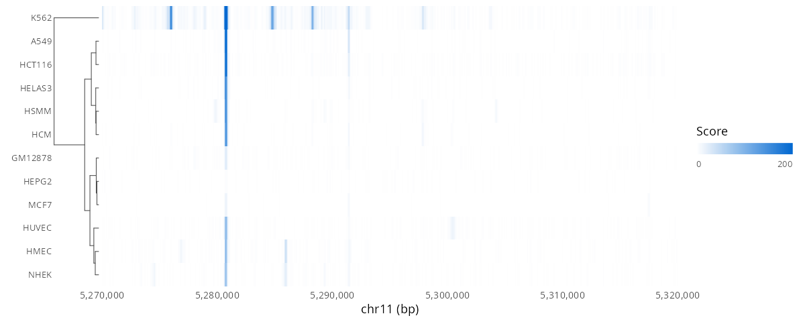
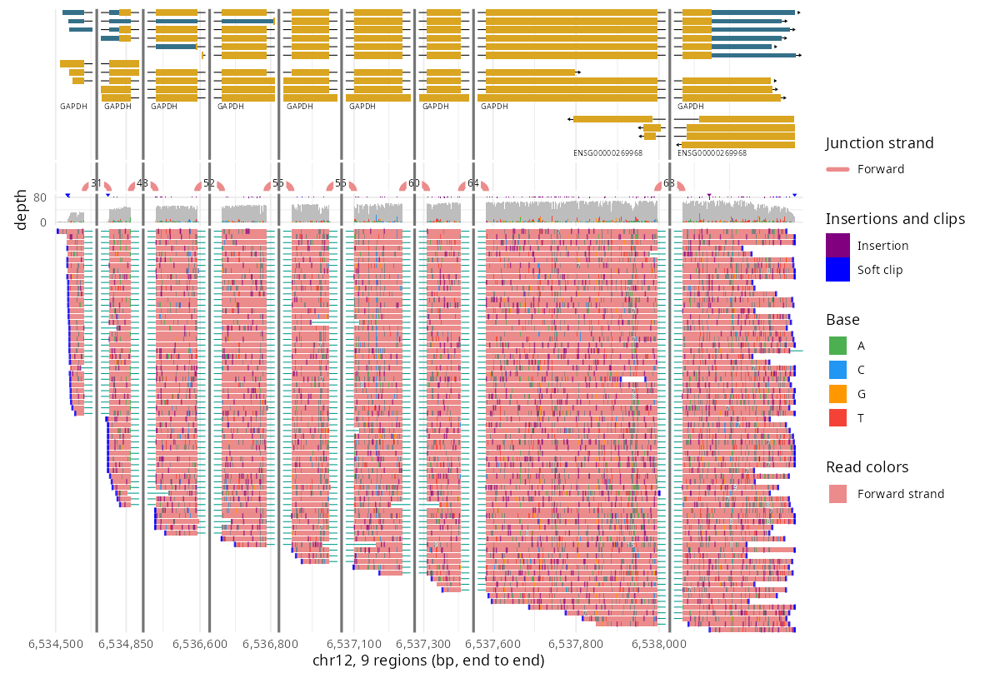
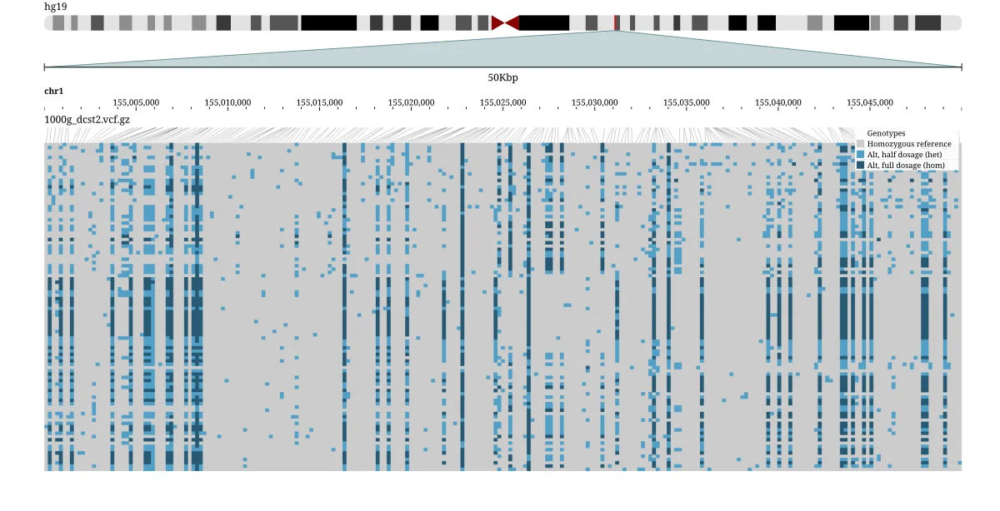
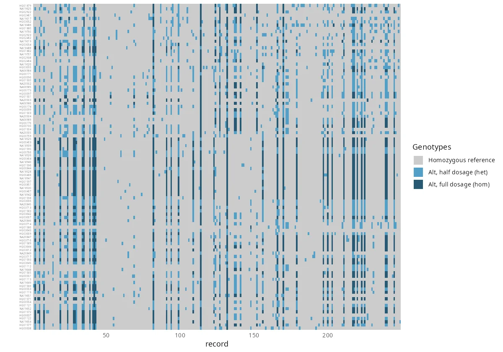

# ggjbrowse


> [!CAUTION]
> Very early results from work in progress!

Genome browser tracks as ggplot2 layers.

- **In:** a region of a BAM, CRAM, GFF3, GTF, BED, BigBed, BigWig or VCF, or
  two regions a PAF aligns.
- **Out:** the tables the [JBrowse 2](https://jbrowse.org) genome browser's
  own display draws from, run in V8: each read on its pileup row, each gene's
  glyph, each bin's score, each sample's genotype, each synteny ribbon, with
  the color the display paints it.
- **Also:** reads CRAM, which Rsamtools cannot, and needs no Bioconductor
  packages.
- **Drawn with:** a geom per table, so a figure is an ordinary ggplot that
  `+` changes piece by piece. `autoplot()` composes the geoms into the
  browser's track.

```r
remotes::install_github("GMOD/ggjbrowse")
```

See [Docs](#docs) for how the engine works.

Every example here runs as written, on clips of public human data installed
with the package. `scripts/extdata-*.sh` make the clips.

```r
library(ggjbrowse)
e <- function(f) system.file("extdata", f, package = "ggjbrowse")

a <- jbrowse_alignments(e("gapdh_direct_rna.bam"), "chr12:6,534,201-6,538,700")
autoplot(a)
```

A region is a locus as JBrowse's location box writes it, 1-based:
`"chr12:6,534,201-6,538,700"`, or `"chr12", 6534200, 6538700` in 0-based
half-open coordinates.


The track is the display's stack: splice-junction arcs where the reads
splice, each counted and colored by strand; the coverage band with every
mismatch position's alleles stacked in their base colors; and the pileup,
each read filled as the browser fills it, with its mismatches, deletions,
insertions and soft or hard clips, each faded as the browser fades it where
it is narrower than a pixel and rarer than the depth there warrants, so
sequencing errors recede and shared variants stand. Zoomed in far enough, the
bases and insertion lengths are written out.

```r
l <- jbrowse_alignments(e("colo829_tumor_chr3.bam"),
  "chr3:25,358,500-25,359,800",
  display = list(unit = "chain", readConnections = "arc",
    color = list(field = "strand"), filter = list(split = "only")))
autoplot(l)
```

JBrowse's own render of this figure is in [the gallery](#from-a-jbrowse-view).

```r
d <- jbrowse_alignments(e("hg008t_cuzd1_deletion.bam"),
  "chr10:122,831,700-122,840,800",
  display = list(sort = list(type = "basePair", pos = 122836300)))
autoplot(d)
```

JBrowse's own render of this figure is in [the gallery](#from-a-jbrowse-view).

```r
autoplot(jbrowse_alignments(e("hg008t_cuzd1_deletion.bam"),
  "chr10:122,835,300-122,835,420",
  display = list(sort = list(type = "basePair", pos = 122835344))))
```

JBrowse's own render of this figure is in [the gallery](#from-a-jbrowse-view).

```r
m <- jbrowse_alignments(e("methylation_clip.bam"), "20:10,001-22,000",
  reference = e("hg38_clip.fa"),
  display = list(baseColor = list(field = "modifications"),
    modifications = list(unmodified = "all")))
autoplot(m)
```

JBrowse's own render of this figure is in [the gallery](#from-a-jbrowse-view).

`readConnections = "arc"` adds the display's read-pair band: each mate
pair's and split read's arc, colored by insert size and pair orientation.
`"cloud"` plots each abnormal pair at its insert size instead. A `facet` splits
the reads into the display's stacked sections, each packed separately:

```r
inv <- jbrowse_alignments(e("hg00151_chr1_inversion.bam"),
  "chr1:197,786,900-197,789,700",
  display = list(unit = "chain", readConnections = "arc",
    color = list(field = "pairOrientation"), facet = list(field = "split")))
autoplot(inv)
```

JBrowse's own render of this figure is in [the gallery](#from-a-jbrowse-view).

`unit = "chain"` puts a read's mate or split segments on one row, joined by a
hairline, and colors each segment by its strand against its chain's.

Each band is its own ggplot too (`autoplot(a, "pileup")`,
`"coverage"`, `"junctions"`, `"arcs"`), to restyle or stack with patchwork.

## The grammar

`autoplot()` only composes pieces you can use yourself:

- **Data:** `ggplot(a)` holds a result, and each table is a data frame
  (`a$reads`, `a$mismatches`, `a$coverage`, ...).
- **Geoms:** one per table: `geom_jbrowse_reads()`,
  `geom_jbrowse_mismatches()`, `geom_jbrowse_coverage()`,
  `geom_jbrowse_arcs()`, `geom_jbrowse_glyphs()`, `geom_jbrowse_wiggle()`,
  `geom_jbrowse_genotypes()` and the rest. Each draws as the display does
  and takes any column of its table in `aes()`.
- **Scales:** each table's `color` column is the display's color, which
  ggplot paints through an identity scale. Map another column and ggplot's
  own scales take over. `scale_fill_jbrowse(a)` adds the display's key,
  `scale_y_jbrowse(w)` a quantitative display's score axis, and
  `scale_x_jbrowse(a)` the axis of several regions laid end to end, which
  `ggplot(a)` adds unasked, moving the result's tables in your own layers
  onto it.
- **Facets:** the `section` column is the display's facet, so
  `facet_grid(section ~ .)` splits a plot the way `facet =` splits the track.

```r
library(ggplot2)

ggplot(a) +
  geom_jbrowse_reads(aes(fill = mapq)) +
  geom_jbrowse_mismatches() +
  scale_fill_viridis_c() +
  scale_y_reverse()
```

The tables work without the geoms as well:

```r
cram <- jbrowse_alignments(e("gapdh_direct_rna.cram"),
  "chr12:6,534,201-6,535,200", reference = e("gapdh_hg38.fa.gz"))
ggplot(cram$mismatches, aes(position, frequency, colour = color)) +
  geom_point() +
  scale_colour_jbrowse(cram, "bases")
```

`display` is the display's config, written as a JBrowse track config writes
it, so what JBrowse can color, filter, paint, sort or split by, this can:
`color = list(field = "mapq")`,
`color = list(field = "insertSize", domain = c(200, 600))`,
`filter = list(flagExclude = 1796, tagFilters = list(list(tag = "HP", value = "1")))`,
`baseColor = list(field = "modifications")`,
`sort = list(type = "basePair", pos = 1055)`,
`facet = list(field = "tags.HP")`, or any other slot such as
`showOrdinaryPairs = FALSE`. As in a track config, a bare string `color` is
one constant color: `color = "purple"`.
Each read comes back on the row the display lays it on, with the fill the
display paints it and the bucket it files it under, each modification call
with its color and opacity, the coverage band's stacks as the display stacks
them, and `a$legend` is the display's key.

## Feature tracks

`jbrowse_features()` reads a GFF3, GTF, BED or BigBed region through
JBrowse's feature display and returns what it draws: each feature on its
row, its gene glyph's boxes, intron lines, strand chevrons and arrows in
their colors, its transcripts, and the labels the display shows at that
zoom. `display` takes the display's own settings (`color`, `displayMode`,
`showLabels`, `geneGlyphMode`, `showOnlyGenes`, ...), and `width` is the
pixel width the display lays the region out across, which decides which
names fit. Draw it above reads with `above`:

```r
genes <- jbrowse_features(e("gapdh_gencode.gff3.gz"),
  "chr12:6,534,201-6,538,700")
autoplot(a, above = genes)
```

JBrowse's own render of this figure is in [the gallery](#from-a-jbrowse-view).

The y axis of a feature track is the display's pixels. Labels scale with the
panel they land in, so they keep to the room the layout left them at any
output size.

## Quantitative tracks

`jbrowse_wiggle()` reads a BigWig through JBrowse's quantitative display: the
bins the file serves at that zoom, the marks the display draws from them in
its colors, and the score axis it autoscales to. `display` takes its settings
(`mark`, `aggregate`, `extent`, `color`, `scales`, ...), and `width` picks the
zoom level that answers. Zoomed out, a min-max extent draws each bin's max and
min around its mean:

```r
bw <- e("gapdh_phylop100way.bw")
autoplot(jbrowse_wiggle(bw, "chr12:6,534,201-6,538,700", width = 100))
autoplot(jbrowse_wiggle(bw, "chr12:6,534,201-6,538,700", width = 100,
  display = list(mark = "line", interpolate = "linear")))
autoplot(jbrowse_wiggle(bw, "chr12:6,534,201-6,538,700",
  display = list(mark = "span")))
```

JBrowse's own render of this figure is in [the gallery](#from-a-jbrowse-view).

A track of several BigWigs, read through a `MultiWiggleAdapter` config,
draws a row per source in `w$sources`' order. Reorder or filter that table
to rearrange them, as for a variant matrix's rows.

```r
cells <- c("gm12878", "k562", "hepg2", "huvec", "hmec", "nhek", "helas3",
  "a549", "mcf7", "hsmm", "hcm", "hct116")
dnase <- list(type = "MultiWiggleAdapter", subadapters = lapply(cells,
  function(cell) list(type = "BigWigAdapter", name = toupper(cell),
    bigWigLocation = list(uri = e(sprintf("hbb_dnase_%s.bw", cell))))))
autoplot(jbrowse_wiggle(dnase, "chr11:5,270,001-5,320,000"))
```

JBrowse's own render of this figure is in [the gallery](#from-a-jbrowse-view).

Clustering the rows works as it does for a variant matrix:

- `as.matrix(w)` is the matrix the display's "Cluster rows" clusters: a row
  per source, a column per pixel.
- `w$tree <- hclust(dist(as.matrix(w)), "average")` puts the rows in the
  tree's order, and `autoplot()` draws the tree beside them:

```r
w <- jbrowse_wiggle(dnase, "chr11:5,270,001-5,320,000",
  display = list(mark = "span"))
w$tree <- hclust(dist(as.matrix(w)), "average")
autoplot(w)
```



## Variant matrices

`jbrowse_variants()` reads a multi-sample VCF through JBrowse's variant
display: the records its filters keep, each sample's genotype at each, and
the fill the display paints it, its hue shaded by the alt dosage. `display`
takes the display's settings (`unit = "haplotype"` for a row per haplotype,
`color`, `filter`, `minorAlleleFrequencyFilter`, ...), and `samples` a table
of the samples' attributes, which `rowColor` marks the rows by:

```r
v <- jbrowse_variants(e("1000g_dcst2.vcf.gz"), "1:155,000,001-155,050,000",
  samples = e("1000g_dcst2_samples.tsv"),
  display = list(rowColor = list(field = "superpopulation")))
autoplot(v, layout = "columns")
```


The matrix draws its rows in `v$rows`' order: reorder or filter that table
to rearrange them. A tree in `v$tree` puts the rows in its leaf order, and
`autoplot()` draws it beside them (`geom_jbrowse_tree()`). Any clustering
that gives an `hclust`, or anything `as.hclust()` takes, labelled by row
name, will do.

`as.matrix(v)` is the genotype matrix the display's "Cluster rows by
genotype" clusters, a column per ALT allele with `NA` for a no-call, and
this is the R script its dialog writes:

```r
v$tree <- hclust(dist(as.matrix(v)), "average")
autoplot(v, layout = "columns")
```


## A view of several tracks

`jbrowse_stack()` stacks tracks as a JBrowse view does: each track's plot,
or an alignments track's bands, top to bottom in the order given, on one x
axis, with the keys collected. Several loci draw end to end, as a view lays
out several regions, each tick labelled in its own region's positions:

```r
loci <- c("chr12:6,534,201-6,535,700", "chr12:6,537,201-6,538,700")
genes <- jbrowse_features(e("gapdh_gencode.gff3.gz"), loci)
signal <- jbrowse_wiggle(e("gapdh_phylop100way.bw"), loci)
reads <- jbrowse_alignments(e("gapdh_direct_rna.bam"), loci,
  display = list(color = list(field = "strand")))
jbrowse_stack(genes, signal, reads)
```

JBrowse's own render of this figure is in [the gallery](#from-a-jbrowse-view).

Each band is an ordinary ggplot. Restyle every band with patchwork's `&`,
`jbrowse_stack(genes, signal, reads) & theme_classic()`, or draw one on its
own and add to it: `autoplot(reads, "pileup") + theme_classic()`. A ggplot
of your own stacks as a band on the same axis.
A track's settings decide its bands: an alignments track read with
`display = list(showCoverage = FALSE)` stacks no coverage band.

Each band takes the pixels the display gives it. Reads draw at the display's
`featureHeight` (7, or 3 and 1 for its compact and super-compact settings),
and `jbrowse_height()` gives the figure height that keeps those proportions,
so a compact pileup saves as a shorter figure:

```r
compact <- jbrowse_alignments(e("gapdh_direct_rna.bam"), loci,
  display = list(featureHeight = 3, color = list(field = "strand")))
fig <- jbrowse_stack(genes, signal, compact)
ggsave("stack.png", fig, width = 10, height = jbrowse_height(fig))
```

Regions need not be loci of one gene's neighbors. A transcript's exons, each
with a few bases of flank, lay the exons side by side with the introns
collapsed, as JBrowse's **Collapse introns** does. Each splice junction then
arcs from one exon straight to the next:

```r
gff <- read.delim(gzfile(e("gapdh_gencode.gff3.gz")), header = FALSE,
  comment.char = "#")
exon <- gff[gff$V3 == "exon" &
  grepl("transcript_id=ENST00000229239.10;", gff$V9), ]
exons <- data.frame(chrom = exon$V1, start = exon$V4 - 1 - 20,
  end = exon$V5 + 20)
genes <- jbrowse_features(e("gapdh_gencode.gff3.gz"), exons)
reads <- jbrowse_alignments(e("gapdh_direct_rna.bam"), exons,
  display = list(color = list(field = "strand")))
jbrowse_stack(genes, reads)
```



A file can be a path or a URL; a remote file is read in byte ranges through
`curl`. CRAM needs the reference: a FASTA with its `.fai`, a bgzipped one
with its `.fai` and `.gzi`, or a 2bit. There is no Bioconductor dependency:
the BAM, CRAM, FASTA, GFF3, BED, BigBed, BigWig and VCF readers are
JBrowse's.

## Synteny

`jbrowse_synteny()` reads a pairwise alignment (PAF, indexed PIF, MUMmer
delta, UCSC chain, MashMap) through JBrowse's linear synteny display: the
blocks two rows of regions share, and the ribbons the band draws between
them in the view's colors and opacity, with each CIGAR insertion, deletion
and skip wider than a pixel drawn in its color. `view` takes the
`LinearSyntenyView`'s settings (`color`, `opacity`, `cigarMode`,
`minAlignmentLength`, `drawLocationMarkers`, ...). Tracks over either row
stack above and below the band:

```r
r <- "5,250,001-14,250,000"
s <- jbrowse_synteny(e("hg002_chr8.chain"), paste0("chr8_MATERNAL:", r),
  paste0("chr8_PATERNAL:", r),
  view = list(color = list(field = "strand")), swap = TRUE,
  labels = c(query = "paternal", target = "maternal"))
gene_track <- function(file, contig) jbrowse_features(e(file),
  paste0(contig, ":", r),
  display = list(displayMode = "compact", showLabels = FALSE,
    showOnlyGenes = TRUE))
autoplot(s, above = gene_track("hg002_mat_genes.gff3.gz", "chr8_MATERNAL"),
  below = gene_track("hg002_pat_genes.gff3.gz", "chr8_PATERNAL"))
```


A PAF names its sequences by assembly when they read `sample#haplotype#contig`.
Three alignments of GRCh38 against HG00133 over the amylase locus show the
copies rearranged:

```r
a <- jbrowse_synteny(e("hprc_amylase.paf"),
  "GRCh38#0#chr1:103,520,894-103,832,637",
  "HG00133#1#CM090045.1:103,669,666-103,981,330",
  view = list(color = list(field = "strand")),
  labels = c(query = "GRCh38", target = "HG00133"))
autoplot(a)
```

JBrowse's own render of this figure is in [the gallery](#from-a-jbrowse-view).

Zoomed in, the CIGAR shows: insertions in yellow, deletions in blue over the
red match block, as the band paints them:

```r
autoplot(jbrowse_synteny(e("hprc_amylase.paf"),
  "GRCh38#0#chr1:103,619,501-103,622,500",
  "HG00133#1#CM090045.1:103,768,401-103,771,400", width = 1500))
```


`jbrowse_dotplot()` reads the same files through JBrowse's dotplot display,
a line per block, or per CIGAR step where a block is wide enough on the
plot, and `view` takes the `DotplotView`'s settings:

```r
autoplot(jbrowse_dotplot(e("hg002_chr8.chain"),
  view = list(color = list(field = "strand")),
  labels = c(query = "paternal", target = "maternal")))
```

JBrowse's own render of this figure is in [the gallery](#from-a-jbrowse-view).

A continuous field such as `list(field = "identity")` keys as the display's
bar, `0%` to `100%`, through `guides_jbrowse()`; a threshold field such as
`mapq` keys its bins as chips.

The tables are `s$alignments`, `s$ribbons` (each foot's span on its row, and
`thin` where the band draws a one-pixel line) and `s$offscreen` (blocks whose
mate the other row does not show), and `geom_jbrowse_ribbons()` and
`geom_jbrowse_dotplot()` draw them. `geom_jbrowse_offscreen_mates()` draws
`s$offscreen_strip`, the marks and contig names the band hangs off a row's
edge for those blocks, and `autoplot()` keys each contig with the line the
strip's hover prints, from `s$offscreen_contigs`.

- A file guessed from its extension names its sides `query` and `target`; a
  JBrowse adapter config names assemblies, and `assemblies = c(query, target)`
  picks which goes on which row.
- `swap = TRUE` puts the file's target on the top row instead.
- `labels = c(query = "peach", target = "grape")` writes those names in the
  axis titles, whichever side each is on.
- With no regions given, a row shows every contig of its assembly, in natural
  order, and a contig named alone shows whole, so a whole-genome dotplot is
  one call:

```r
autoplot(jbrowse_dotplot(e("peach_grape.paf.gz"),
  labels = c(query = "peach", target = "grape")))
```

JBrowse's own render of this figure is in [the gallery](#from-a-jbrowse-view).

### Several genomes

`jbrowse_multiway()` reads an all-vs-all PAF (sequences named
`sample#haplotype#contig`), an indexed PIF or a multi-genome adapter config
through JBrowse's multi-way synteny display: an anchor lane over the locus
given, a lane per other genome in the alignments' own coordinates, each at
the zoom and orientation the display gives it, and the ribbons between
adjacent lanes. `lanes` picks and orders the genomes, or pins a lane to a
contig, and `display` takes the display's settings (`ribbonColor`,
`drawCurves`, `bridgeSkippedLanes`, ...). Tracks over the anchor lane stack
above it, as `autoplot(m, above = genes)`:

```r
liftover <- function(genome, assembly) list(type = "PairwiseIndexedPAFAdapter",
  pifGzLocation = list(uri = e(sprintf("hg38To%s.over.pif.gz", genome))),
  index = list(
    location = list(uri = e(sprintf("hg38To%s.over.pif.gz.csi", genome))),
    indexType = "CSI"),
  assemblyNames = c(assembly, "hg38"))
primates <- list(type = "MultiPairwiseSyntenyAdapter", adapters = list(
  liftover("PanTro6", "panTro6"), liftover("GorGor6", "gorGor6"),
  liftover("PonAbe3", "ponAbe3")))
m <- jbrowse_multiway(primates, "chr17:7,400,001-7,700,000", "hg38",
  lanes = c("panTro6", "gorGor6", "ponAbe3"),
  display = list(ribbonColor = list(field = "strand")))
autoplot(m)
```


## From a JBrowse view

- JBrowse's linear genome view is gaining an **Export R script** menu item,
  not yet in a release. It writes one ggjbrowse reader per open track, then
  `jbrowse_stack()` and `ggsave(height = jbrowse_height(fig))`.
- Each figure on the left is JBrowse's own renderer, `jb2export` from
  `@jbrowse/img`, run on the same files; each on the right is ggjbrowse.
  `scripts/gallery.R` redraws both.

<!-- gallery -->
<table>
<tr><th width="50%">JBrowse</th><th width="50%">R</th></tr>
<tr><td colspan="2"><b>GENCODE genes over direct RNA reads</b> <code>chr12:6,534,201-6,538,700</code></td></tr>
<tr><td width="50%"></td><td width="50%"></td></tr>
<tr><td colspan="2"><b>COLO829 der(3) split reads chained across its two chr3 breakpoints</b> <code>chr3:25,358,500-25,359,800</code></td></tr>
<tr><td width="50%"></td><td width="50%"></td></tr>
<tr><td colspan="2"><b>Reads sorted by the base at the center, over a somatic deletion</b> <code>chr10:122,831,700-122,840,800</code></td></tr>
<tr><td width="50%"></td><td width="50%"></td></tr>
<tr><td colspan="2"><b>Compact reads over the same deletion</b> <code>chr10:122,831,700-122,840,800</code></td></tr>
<tr><td width="50%"></td><td width="50%"></td></tr>
<tr><td colspan="2"><b>Base-level zoom at the deletion's left edge</b> <code>chr10:122,835,300-122,835,420</code></td></tr>
<tr><td width="50%"></td><td width="50%"></td></tr>
<tr><td colspan="2"><b>Split reads chained across an inversion, with their arcs</b> <code>chr1:197,786,900-197,789,700</code></td></tr>
<tr><td width="50%"></td><td width="50%"></td></tr>
<tr><td colspan="2"><b>CpG methylation from MM/ML tags</b> <code>20:10,001-22,000</code></td></tr>
<tr><td width="50%"></td><td width="50%"></td></tr>
<tr><td colspan="2"><b>DNase in twelve cell lines over the beta-globin locus</b> <code>chr11:5,270,001-5,320,000</code></td></tr>
<tr><td width="50%"></td><td width="50%"></td></tr>
<tr><td colspan="2"><b>phyloP conservation across GAPDH as bars, a line and density</b> <code>chr12:6,534,201-6,538,700</code></td></tr>
<tr><td width="50%"></td><td width="50%"></td></tr>
<tr><td colspan="2"><b>Genes, conservation and strand-colored reads over two regions end to end</b> <code>chr12:6,534,201-6,535,700 chr12:6,537,201-6,538,700</code></td></tr>
<tr><td width="50%"></td><td width="50%"></td></tr>
<tr><td colspan="2"><b>100 people's genotypes across DCST2 (GRCh37)</b> <code>1:155,000,001-155,050,000</code></td></tr>
<tr><td width="50%"></td><td width="50%"></td></tr>
<tr><td colspan="2"><b>HG002's maternal chr8 over its paternal copy at 8p23.1</b> <code>chr8_MATERNAL:5,250,001-14,250,000 chr8_PATERNAL:5,250,001-14,250,000</code></td></tr>
<tr><td width="50%"></td><td width="50%"></td></tr>
<tr><td colspan="2"><b>HG002's maternal chr8 against its paternal copy as a dotplot</b> <code>chr8_MATERNAL chr8_PATERNAL</code></td></tr>
<tr><td width="50%"></td><td width="50%"></td></tr>
<tr><td colspan="2"><b>Peach against grape, every chromosome</b> <code>whole genome</code></td></tr>
<tr><td width="50%"></td><td width="50%"></td></tr>
<tr><td colspan="2"><b>GRCh38 over HG00133 at the amylase genes</b> <code>GRCh38#0#chr1:103,520,894-103,832,637</code></td></tr>
<tr><td width="50%"></td><td width="50%"></td></tr>
</table>
<!-- /gallery -->

## The engine

- `inst/js/jbrowse-tables.js` is
  [`@jbrowse/tables`](https://github.com/GMOD/jbrowse-components/tree/main/packages/tables)
  bundled for a bare JavaScript host, committed so installing needs no
  JavaScript toolchain.
- JBrowse's own tests hold the bundle, run with no web globals, to the
  browser's engine.
- [CONTRIBUTING.md](CONTRIBUTING.md#updating-the-engine) covers rebuilding it
  and the CI that takes each new release.

## Not yet

The variant display's row arrangements other than clustering (bands, a
saved order) and its zoomed-out density fade; the bisulfite layer; facets on a feature
track; the amino-acid
overlay on a zoomed-in CDS. A CRAN release, which needs the bundle's own dependencies credited
(`cph` and a LICENSE.note) and its source named.

## Docs

- [docs/api.md](docs/api.md): every reader, helper and geom, and what each
  returns
- [docs/how-does-this-work.md](docs/how-does-this-work.md): the V8 engine, how
  it reads files through R, and which side decides colors and geometry
- [docs/dataflow.md](docs/dataflow.md): a diagram of one call from path to plot
- [docs/faq.md](docs/faq.md): V8 versus QuickJS, caching, indexes, coordinates
- [agent-docs/engine-owns-display-decisions.md](agent-docs/engine-owns-display-decisions.md):
  the plan to move the rules R still copies into the engine
- [CONTRIBUTING.md](CONTRIBUTING.md): development, rebuilding the engine and CI

## See also

- [JBrowse 2](https://jbrowse.org)
- [JBrowseR](https://github.com/GMOD/JBrowseR) - JBrowse 2 as an R htmlwidget
- [ggbandage](https://github.com/GMOD/ggbandage) - pangenome graphs as ggplot2 layers
- [ggtubemap](https://github.com/GMOD/ggtubemap) - pangenome tubemaps as ggplot2 layers

## Academic use

Written with [NHGRI](http://genome.gov) funding as part of
[JBrowse](http://jbrowse.org). If you use this in a publication, please cite the
most recent JBrowse paper at [jbrowse.org](http://jbrowse.org).

## License

Apache License 2.0 © [Colin Diesh](https://github.com/cmdcolin)
