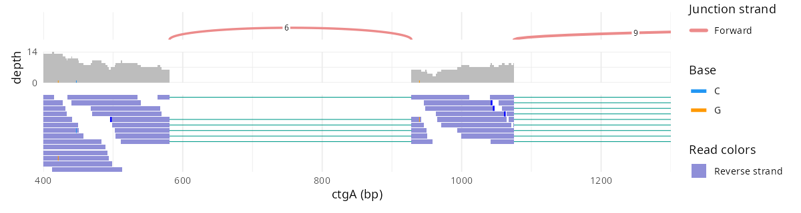

# ggjbrowse


> [!CAUTION]
> Very early results from work in progress!

Genome browser tracks as ggplot2 layers.

- **In:** a region of a BAM, CRAM, GFF3, GTF, BED, BigBed, BigWig or VCF, or
  two regions a PAF aligns.
- **Out:** the tables the [JBrowse 2](https://jbrowse.org) genome browser's
  own display draws from, run in V8: each read on its pileup row, each gene's
  glyph, each bin's score, each sample's genotype, each synteny ribbon, with
  the color the display paints it.
- **Drawn with:** a geom per table, so a figure is an ordinary ggplot that
  `+` changes piece by piece. `autoplot()` composes the geoms into the
  browser's track.

```r
remotes::install_github("GMOD/ggjbrowse")
```

Every example here runs as written, on the volvox test data the package
carries:

```r
library(ggjbrowse)
e <- function(f) system.file("extdata", f, package = "ggjbrowse")

a <- jbrowse_alignments(e("spliced.bam"), "ctgA:401-1,300",
  display = list(color = list(field = "strand")))
autoplot(a)
```

A region is a locus as JBrowse's location box writes it, 1-based:
`"ctgA:401-1,300"`, or `"ctgA", 400, 1300` in 0-based half-open
coordinates.



The track is the display's stack: splice-junction arcs where the reads
splice, each counted and colored by strand; the coverage band with every
mismatch position's alleles stacked in their base colors; and the pileup,
each read filled as the browser fills it, with its mismatches, deletions,
insertions and soft or hard clips, each faded as the browser fades it where
it is narrower than a pixel and rarer than the depth there warrants, so
sequencing errors recede and shared variants stand. Zoomed in far enough, the
bases and insertion lengths are written out.

```r
l <- jbrowse_alignments(e("volvox-long-reads-sv.bam"), "ctgA:1,001-2,700",
  reference = e("volvox.fa"), display = list(color = list(field = "strand")))
autoplot(l)
```


```r
autoplot(jbrowse_alignments(e("volvox-sorted.bam"), "ctgA:1,001-1,120",
  reference = e("volvox.fa"), display = list(color = list(field = "mapq"))))
```


```r
m <- jbrowse_alignments(e("methylation_clip.bam"), "20:10,001-22,000",
  reference = e("hg38_clip.fa"),
  display = list(baseColor = list(field = "modifications"),
    modifications = list(unmodified = "calls")))
autoplot(m)
```


`readConnections = "arc"` adds the display's read-pair band: each mate
pair's and split read's arc, colored by insert size and pair orientation.
`"cloud"` plots each abnormal pair at its insert size instead. A `facet` splits
the reads into the display's stacked sections, each packed separately:

```r
inv <- jbrowse_alignments(e("volvox-simple-inv-paired.bam"), "ctgA:18,001-32,000",
  display = list(readConnections = "arc", facet = list(field = "strand")))
autoplot(inv)
```


Each band is its own ggplot too (`autoplot(a, "pileup")`,
`"coverage"`, `"junctions"`, `"arcs"`), to restyle or stack with patchwork.

## The grammar

`autoplot()` only composes pieces you can use yourself:

- **Data:** `ggplot(a)` holds a result, and each table is a data frame
  (`a$reads`, `a$mismatches`, `a$coverage`, ...).
- **Geoms:** one per table: `geom_jbrowse_reads()`,
  `geom_jbrowse_mismatches()`, `geom_jbrowse_coverage()`,
  `geom_jbrowse_arcs()`, `geom_jbrowse_glyphs()`, `geom_jbrowse_wiggle()`,
  `geom_jbrowse_genotypes()` and the rest. Each draws as the display does
  and takes any column of its table in `aes()`.
- **Scales:** each table's `color` column is the display's color, which
  ggplot paints through an identity scale. Map another column and ggplot's
  own scales take over. `scale_fill_jbrowse(a)` adds the display's key, and
  `scale_y_jbrowse(w)` a quantitative display's score axis.
- **Facets:** the `section` column is the display's facet, so
  `facet_grid(section ~ .)` splits a plot the way `facet =` splits the track.

```r
library(ggplot2)

ggplot(a) +
  geom_jbrowse_reads(aes(fill = mapq)) +
  geom_jbrowse_mismatches() +
  scale_fill_viridis_c() +
  scale_y_reverse()
```

The tables work without the geoms as well:

```r
cram <- jbrowse_alignments(e("volvox-sorted.cram"), "ctgA:1,001-3,000",
  reference = e("volvox.fa"))
ggplot(cram$mismatches, aes(position, frequency, colour = color)) +
  geom_point() +
  scale_colour_jbrowse(cram, "bases")
```

`display` is the display's config, written as a JBrowse track config writes
it, so what JBrowse can color, filter, paint, sort or split by, this can:
`color = list(field = "mapq")`,
`color = list(field = "insertSize", domain = c(200, 600))`,
`filter = list(flagExclude = 1796, tagFilters = list(list(tag = "HP", value = "1")))`,
`baseColor = list(field = "modifications")`,
`sort = list(type = "basePair", pos = 1055)`,
`facet = list(field = "tags.HP")`, or any other slot such as
`showOrdinaryPairs = FALSE`. As in a track config, a bare string `color` is
one constant color: `color = "purple"`.
Each read comes back on the row the display lays it on, with the fill the
display paints it and the bucket it files it under, each modification call
with its color and opacity, the coverage band's stacks as the display stacks
them, and `a$legend` is the display's key.

## Feature tracks

`jbrowse_features()` reads a GFF3, GTF, BED or BigBed region through
JBrowse's feature display and returns what it draws: each feature on its
row, its gene glyph's boxes, intron lines, strand chevrons and arrows in
their colors, its transcripts, and the labels the display shows at that
zoom. `display` takes the display's own settings (`color`, `displayMode`,
`showLabels`, `geneGlyphMode`, `showOnlyGenes`, ...), and `width` is the
pixel width the display lays the region out across, which decides which
names fit. Draw it over reads with `tracks`:

```r
genes <- jbrowse_features(e("volvox.sort.gff3.gz"), "ctgA:1,001-10,000",
  display = list(showOnlyGenes = TRUE))
reads <- jbrowse_alignments(e("spliced.bam"), "ctgA:1,001-10,000",
  reference = e("volvox.fa"), display = list(color = list(field = "strand")))
autoplot(reads, tracks = genes)
```


The y axis of a feature track is the display's pixels. Labels scale with the
panel they land in, so they keep to the room the layout left them at any
output size.

## Quantitative tracks

`jbrowse_wiggle()` reads a BigWig through JBrowse's quantitative display: the
bins the file serves at that zoom, the marks the display draws from them in
its colors, and the score axis it autoscales to. `display` takes its settings
(`mark`, `aggregate`, `extent`, `color`, `scales`, ...), and `width` picks the
zoom level that answers. Zoomed out, a min-max extent draws each bin's max and
min around its mean:

```r
bw <- e("volvox_microarray_posneg.bw")
autoplot(jbrowse_wiggle(bw, "ctgA:1-50,000", width = 100))
autoplot(jbrowse_wiggle(bw, "ctgA:1-50,000", width = 100,
  display = list(mark = "line", interpolate = "linear")))
autoplot(jbrowse_wiggle(bw, "ctgA:1-50,000", display = list(mark = "span")))
```


## Variant matrices

`jbrowse_variants()` reads a multi-sample VCF through JBrowse's variant
display: the records its filters keep, each sample's genotype at each, and
the fill the display paints it, its hue shaded by the alt dosage. `display`
takes the display's settings (`unit = "haplotype"` for a row per haplotype,
`color`, `filter`, `minorAlleleFrequencyFilter`, ...):

```r
v <- jbrowse_variants(e("dog10k_cyp1a2_snvs.vcf.gz"),
  "chr30:38,258,001-38,265,000")
autoplot(v, layout = "columns")
```


## A view of several tracks

`jbrowse_stack()` stacks tracks as a JBrowse view does: each track's plot,
or an alignments track's bands, top to bottom in the order given, on one x
axis, with the keys collected. Several loci draw end to end, as a view lays
out several regions, each tick labelled in its own region's positions:

```r
loci <- c("ctgA:1,001-4,000", "ctgA:6,001-9,000")
genes <- jbrowse_features(e("volvox.sort.gff3.gz"), loci)
signal <- jbrowse_wiggle(e("volvox_microarray_posneg.bw"), loci)
reads <- jbrowse_alignments(e("volvox-sorted.bam"), loci,
  display = list(color = list(field = "strand")))
jbrowse_stack(genes, signal, reads)
```


Each band is an ordinary ggplot. Restyle every band with patchwork's `&`,
`jbrowse_stack(genes, signal, reads) & theme_classic()`, or draw one on its
own and add to it: `autoplot(reads, "pileup") + theme_classic()`. A ggplot
of your own stacks as a band on the same axis.
A track's settings decide its bands: an alignments track read with
`display = list(showCoverage = FALSE)` stacks no coverage band.

Each band takes the pixels the display gives it. Reads draw at the display's
`featureHeight` (7, or 3 and 1 for its compact and super-compact settings),
and `jbrowse_height()` gives the figure height that keeps those proportions,
so a compact pileup saves as a shorter figure:

```r
compact <- jbrowse_alignments(e("volvox-sorted.bam"), loci,
  display = list(featureHeight = 3, color = list(field = "strand")))
fig <- jbrowse_stack(genes, signal, compact)
ggsave("stack.png", fig, width = 10, height = jbrowse_height(fig))
```

A file can be a path or a URL; a remote file is read in byte ranges through
`curl`. CRAM needs the reference, as a FASTA with its `.fai` or a 2bit. There
is no Bioconductor dependency: the BAM, CRAM, FASTA, GFF3, BED, BigBed,
BigWig and VCF readers are JBrowse's.

## Synteny

`jbrowse_synteny()` reads a pairwise alignment (PAF, indexed PIF, MUMmer
delta, UCSC chain, MashMap) through JBrowse's linear synteny display: the
blocks two rows of regions share, and the ribbons the band draws between
them in the view's colors and opacity, with each CIGAR insertion, deletion
and skip wider than a pixel drawn in its color. `view` takes the
`LinearSyntenyView`'s settings (`color`, `opacity`, `cigarMode`,
`minAlignmentLength`, `drawLocationMarkers`, ...). Tracks over either row
stack above and below the band:

```r
paf <- e("volvox_inv_indels.paf")
s <- jbrowse_synteny(paf, "ctgA:1-49,186", "ctgA:1-50,001",
  view = list(color = list(field = "strand")))
genes <- jbrowse_features(e("volvox.sort.gff3.gz"), "ctgA:1-50,001",
  display = list(showOnlyGenes = TRUE))
autoplot(s, target = genes)
```


Zoomed in, the CIGAR shows: insertions in yellow, deletions in blue over the
red match block, as the band paints them:

```r
autoplot(jbrowse_synteny(paf, "ctgA:26,801-30,000", "ctgA:27,201-30,500",
  width = 1500))
```


`jbrowse_dotplot()` reads the same files through JBrowse's dotplot display,
a line per block, or per CIGAR step where a block is wide enough on the
plot, and `view` takes the `DotplotView`'s settings:

```r
autoplot(jbrowse_dotplot(paf, "ctgA:1-49,186", "ctgA:1-50,001",
  view = list(color = list(field = "strand"))))
```


The tables are `s$alignments`, `s$ribbons` (each foot's span on its row, and
`thin` where the band draws a one-pixel line) and `s$offscreen` (blocks whose
mate the other row does not show), and `geom_jbrowse_ribbons()` and
`geom_jbrowse_dotplot()` draw them. A file guessed from its extension names
its sides `query` and `target`; a JBrowse adapter config names assemblies,
and `assemblies = c(query, target)` picks which goes on which row.

## From a JBrowse view

- JBrowse's linear genome view is gaining an **Export R script** menu item,
  not yet in a release. It writes one ggjbrowse reader per open track, then
  `jbrowse_stack()` and `ggsave(height = jbrowse_height(fig))`.
- Each figure on the right is that script, downloaded from the view on the
  left and run unchanged with `Rscript`.

| JBrowse | R |
| --- | --- |
| **Genes over a BAM**<br>`ctgA:1,000-9,000`<br> |  |
| **Base-level zoom, reads colored by MAPQ**<br>`ctgA:1,000-1,150`<br> |  |
| **Compact reads over a deep region**<br>`ctgA:1-20,000`<br> |  |
| **Super-compact long reads**<br>`ctgA:1,000-2,700`<br> |  |
| **RNA-seq with splice junctions**<br>`ctgA:1,000-10,000`<br> |  |
| **Reads split into strand sections**<br>`ctgA:2,000-5,000`<br> |  |
| **Paired reads across an inversion**<br>`ctgA:18,000-32,000`<br> |  |
| **Long reads split across a structural variant**<br>`ctgA:1,800-3,000 ctgA:33,900-35,100`<br> |  |
| **CpG methylation from MM/ML tags**<br>`20:10,000-22,000`<br> |  |
| **Multi-BigWig rows**<br>`ctgA:1-50,000`<br> |  |
| **200 BigWig rows**<br>`ctgA:1-50,000`<br> |  |
| **1,000 BigWig rows as density**<br>`ctgA:1-50,000`<br> |  |
| **Quantitative renderings**<br>`ctgA:1-50,000`<br> |  |
| **Two regions end to end**<br>`ctgA:1,001-4,000 ctgA:6,001-9,000`<br> |  |
| **Variants beside genes**<br>`ctgA:1-25,000`<br> |  |
| **Genes colored by a config expression**<br>`ctgA:1-25,000`<br> |  |
| **Structural variants across 1,800 dogs**<br>`chr6:47,340,000-47,420,000`<br> |  |

## The engine

`inst/js/jbrowse-tables.js` is
[`@jbrowse/tables`](https://github.com/GMOD/jbrowse-components/tree/main/packages/tables)
bundled for a bare JavaScript host, committed so installing needs no
JavaScript toolchain. Its first line names the release, or the
jbrowse-components commit it was built from. JBrowse's own tests hold the
bundle, run with no web globals, to the browser's engine.

To rebuild it from a jbrowse-components checkout beside this repo:

```console
cd ../jbrowse-components && pnpm install && cd -
scripts/build-js.sh
```

`scripts/check-against-jbrowse.sh` rebuilds, installs and tests in one step,
against `$JBROWSE_COMPONENTS` or `../jbrowse-components`; jbrowse-components'
downstream canary runs it against its main nightly, so a change there that
breaks this package shows up there. The `Bundle` workflow takes each new
`@jbrowse/tables` release from npm (`scripts/take-release.sh`) into the
committed bundle once R CMD check passes.

## Not yet

The variant display's row arrangement
and its zoomed-out density fade; the bisulfite layer; facets on a feature
track; the amino-acid
overlay on a zoomed-in CDS; the multi-way synteny display and the
synteny band's off-screen mate strip as the browser draws it. A CRAN release, which needs the bundle's own dependencies credited
(`cph` and a LICENSE.note) and its source named.

## See also

- [JBrowse 2](https://jbrowse.org)
- [JBrowseR](https://github.com/GMOD/JBrowseR) - JBrowse 2 as an R htmlwidget
- [ggbandage](https://github.com/GMOD/ggbandage) - pangenome graphs as ggplot2 layers
- [ggtubemap](https://github.com/GMOD/ggtubemap) - pangenome tubemaps as ggplot2 layers
