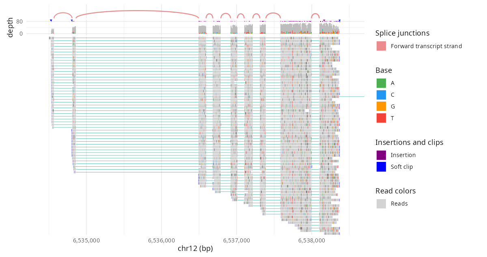

# ggjbrowse

> [!CAUTION]
> Very early results from work in progress!

Genome browser tracks as ggplot2 layers.

- **In:** a region of a BAM, CRAM, GFF3, GTF, BED, BigBed, BigWig or VCF, or
  two regions a PAF aligns.
- **Out:** the tables the [JBrowse 2](https://jbrowse.org) genome browser's
  own display draws from, run in V8: reads on pileup rows, gene glyphs,
  binned scores, genotypes and synteny ribbons, with the colors the display
  paints them.
- **Also:** reads CRAM, which Rsamtools cannot, and needs no Bioconductor
  packages.
- **Drawn with:** a geom per table, so a figure is an ordinary ggplot that
  `+` changes piece by piece. `autoplot()` composes the geoms into the
  browser's track.

```r
remotes::install_github("GMOD/ggjbrowse")
```

## Gallery

- Every figure is drawn twice from data installed with the package, by
  JBrowse's own renderer (`jb2export` from `@jbrowse/img`) on the left and by
  ggjbrowse on the right.
- A title links to the figure's R and `jb2export` recipes in
  [docs/gallery.md](docs/gallery.md).

<!-- gallery -->
<table>
<tr><th width="50%">JBrowse</th><th width="50%">R</th></tr>
<tr><td colspan="2"><b><a href="docs/gallery.md#genes_and_reads">GENCODE genes over direct RNA reads</a></b> <code>chr12:6,534,201-6,538,700</code></td></tr>
<tr><td width="50%"></td><td width="50%"></td></tr>
<tr><td colspan="2"><b><a href="docs/gallery.md#long_reads_sv">COLO829 der(3) split reads chained across its two chr3 breakpoints</a></b> <code>chr3:25,358,500-25,359,800</code></td></tr>
<tr><td width="50%"></td><td width="50%"></td></tr>
<tr><td colspan="2"><b><a href="docs/gallery.md#deletion">Reads sorted by the base at the center, over a somatic deletion</a></b> <code>chr10:122,831,700-122,840,800</code></td></tr>
<tr><td width="50%"></td><td width="50%"></td></tr>
<tr><td colspan="2"><b><a href="docs/gallery.md#compact_reads">Compact reads over the same deletion</a></b> <code>chr10:122,831,700-122,840,800</code></td></tr>
<tr><td width="50%"></td><td width="50%"></td></tr>
<tr><td colspan="2"><b><a href="docs/gallery.md#base_zoom">Base-level zoom at the deletion's left edge</a></b> <code>chr10:122,835,300-122,835,420</code></td></tr>
<tr><td width="50%"></td><td width="50%"></td></tr>
<tr><td colspan="2"><b><a href="docs/gallery.md#inversion">Split reads chained across an inversion, with their arcs</a></b> <code>chr1:197,786,900-197,789,700</code></td></tr>
<tr><td width="50%"></td><td width="50%"></td></tr>
<tr><td colspan="2"><b><a href="docs/gallery.md#methylation">CpG methylation from MM/ML tags</a></b> <code>20:10,001-22,000</code></td></tr>
<tr><td width="50%"></td><td width="50%"></td></tr>
<tr><td colspan="2"><b><a href="docs/gallery.md#bisulfite">CHH methylation from bisulfite reads</a></b> <code>NC_003070.9:4,398,001-4,412,000</code></td></tr>
<tr><td width="50%"></td><td width="50%"></td></tr>
<tr><td colspan="2"><b><a href="docs/gallery.md#dnase_rows">DNase in twelve cell lines over the beta-globin locus</a></b> <code>chr11:5,270,001-5,320,000</code></td></tr>
<tr><td width="50%"></td><td width="50%"></td></tr>
<tr><td colspan="2"><b><a href="docs/gallery.md#dnase_clustered">DNase in twelve cell lines as density, clustered by signal</a></b> <code>chr11:5,270,001-5,320,000</code></td></tr>
<tr><td width="50%"></td><td width="50%"></td></tr>
<tr><td colspan="2"><b><a href="docs/gallery.md#conservation">phyloP conservation across GAPDH as bars, a line and density</a></b> <code>chr12:6,534,201-6,538,700</code></td></tr>
<tr><td width="50%"></td><td width="50%"></td></tr>
<tr><td colspan="2"><b><a href="docs/gallery.md#two_regions">Genes, conservation and strand-colored reads over two regions end to end</a></b> <code>chr12:6,534,201-6,535,700 chr12:6,537,201-6,538,700</code></td></tr>
<tr><td width="50%"></td><td width="50%"></td></tr>
<tr><td colspan="2"><b><a href="docs/gallery.md#amino_acids">Amino acids over GAPDH's first coding exons, read in frame across the intron</a></b> <code>chr12:6,534,811-6,534,880 chr12:6,536,476-6,536,545</code></td></tr>
<tr><td width="50%"></td><td width="50%"></td></tr>
<tr><td colspan="2"><b><a href="docs/gallery.md#variants_by_population">100 people's genotypes across DCST2 (GRCh37), colored by superpopulation</a></b> <code>1:155,000,001-155,050,000</code></td></tr>
<tr><td width="50%"></td><td width="50%"></td></tr>
<tr><td colspan="2"><b><a href="docs/gallery.md#variants_clustered">100 people's genotypes across DCST2 clustered, the tree beside the rows</a></b> <code>1:155,000,001-155,050,000</code></td></tr>
<tr><td width="50%"></td><td width="50%"></td></tr>
<tr><td colspan="2"><b><a href="docs/gallery.md#variants_banded">100 people's genotypes across DCST2 in a band per superpopulation, each band clustered</a></b> <code>1:155,000,001-155,050,000</code></td></tr>
<tr><td width="50%"></td><td width="50%"></td></tr>
<tr><td colspan="2"><b><a href="docs/gallery.md#collapsed_introns">GAPDH's nine exons side by side, with the junctions between them as arcs</a></b> <code>ENST00000229239.10's exons, each padded by 20 bp</code></td></tr>
<tr><td width="50%"></td><td width="50%"></td></tr>
<tr><td colspan="2"><b><a href="docs/gallery.md#inversion_synteny">HG002's maternal chr8 over its paternal copy at 8p23.1</a></b> <code>chr8_MATERNAL:5,250,001-14,250,000 chr8_PATERNAL:5,250,001-14,250,000</code></td></tr>
<tr><td width="50%"></td><td width="50%"></td></tr>
<tr><td colspan="2"><b><a href="docs/gallery.md#inversion_dotplot">HG002's maternal chr8 against its paternal copy as a dotplot</a></b> <code>chr8_MATERNAL chr8_PATERNAL</code></td></tr>
<tr><td width="50%"></td><td width="50%"></td></tr>
<tr><td colspan="2"><b><a href="docs/gallery.md#whole_genome">Peach against grape, every chromosome</a></b> <code>whole genome</code></td></tr>
<tr><td width="50%"></td><td width="50%"></td></tr>
<tr><td colspan="2"><b><a href="docs/gallery.md#amylase_synteny">GRCh38 over HG00133 at the amylase genes</a></b> <code>GRCh38#0#chr1:103,520,894-103,832,637</code></td></tr>
<tr><td width="50%"></td><td width="50%"></td></tr>
<tr><td colspan="2"><b><a href="docs/gallery.md#amylase_zoom">3 kb at the amylase genes, the match block cut by an 80 bp deletion</a></b> <code>GRCh38#0#chr1:103,619,501-103,622,500</code></td></tr>
<tr><td width="50%"></td><td width="50%"></td></tr>
<tr><td colspan="2"><b><a href="docs/gallery.md#synteny_genes">HG002's maternal chr8 over its paternal copy, each with its genes</a></b> <code>chr8_MATERNAL:5,250,001-14,250,000 chr8_PATERNAL:5,250,001-14,250,000</code></td></tr>
<tr><td width="50%"></td><td width="50%"></td></tr>
<tr><td colspan="2"><b><a href="docs/gallery.md#multiway">The TP53 neighbourhood on hg38 over chimp, gorilla and orangutan</a></b> <code>chr17:7,400,001-7,700,000</code></td></tr>
<tr><td width="50%"></td><td width="50%"></td></tr>
</table>
<!-- /gallery -->

## Quick start

```r
library(ggjbrowse)
e <- function(f) system.file("extdata", f, package = "ggjbrowse")

a <- jbrowse_alignments(e("gapdh_direct_rna.bam"), "chr12:6,534,201-6,538,700")
autoplot(a)
```



`a` is a list of data frames, so the figure is also ordinary ggplot2:

```r
library(ggplot2)

ggplot(a) +
  geom_jbrowse_reads(aes(fill = mapq)) +
  geom_jbrowse_mismatches() +
  scale_fill_viridis_c() +
  scale_y_reverse()
```

- **Data:** every example runs as written on clips of public human data
  installed with the package. `scripts/extdata-*.sh` make the clips.
- **Regions:** a locus as JBrowse's location box writes it, 1-based
  (`"chr12:6,534,201-6,538,700"`), or `"chr12", 6534200, 6538700` in 0-based
  half-open coordinates. A vector of several loci draws them end to end.
- **Files:** a path or a URL. CRAM needs a `reference`.
- **Contig names:** where files spell a contig differently (`chr7` in a BAM,
  `7` in the FASTA), give each reader `assembly = jbrowse_assembly(fasta,
  aliases)`, with an alias table such as UCSC's `chromAlias.txt`. A region
  may then name the contig either way, and the reader names it in its tables
  as the region does.

## Tutorials

Whole analyses done in R, each on the data and question of a
[JBrowse tutorial](https://jbrowse.org/jb2/docs/tutorials/):

- [Methylation (bisulfite) in R](docs/tutorials/bisulfite.md): per-read CpG,
  CHG and CHH calls from an _Arabidopsis_ WGBS run, counted over a gene and a
  transposon and checked against MethylDackel
- [Methylation (long-read) in R](docs/tutorials/methylation.md): HG002
  nanopore 5mC split by haplotype at the _SNRPN_ imprinting center, checked
  against modkit and smoothed across the imprinted domain
- [Differential transcript usage in R](docs/tutorials/dtu.md): satuRn on
  ENCODE muscle and liver quantifications, written into GENCODE and drawn over
  each tissue's coverage, checked at the exon that tells _ATP5F1C_'s isoforms
  apart
- [Selection scans (Drosophila DGRP) in R](docs/tutorials/population_genomics.md):
  Fst, π and Tajima's D at the _Cyp6g1_ sweep and the `In(2L)t` inversion,
  each ranked against the rest of the genome
- [A loss-of-function allele across breeds (Dog10K) in R](docs/tutorials/dog10k_lof.md):
  the _CYP1A2_ stop codon derived from the reference, its frequency per breed
  with wolves and coyotes as controls, and the gene's copy number
- [RNA-seq splicing and strand in R](docs/tutorials/rnaseq.md): _ACTB_'s splice junctions from
  the reads, strand-specific coverage, IsoSeq isoforms, and a regtools junction
  table checked against the engine's own counts
- [Complex rearrangements and derivative alleles (COLO829) in R](docs/tutorials/cancer_sv.md):
  the chr3, chr10 and chr12 rearrangement chain walked from the calls, split
  reads counted in tumor and normal, and the der(3) allele against the truth
  set

## Docs

- [docs/alignments.md](docs/alignments.md): BAM and CRAM reads
  (`jbrowse_alignments()`): color, filter, sort, split and chain reads,
  methylation
- [docs/features.md](docs/features.md): GFF3, GTF, BED and BigBed
  (`jbrowse_features()`): gene glyphs, labels, facets
- [docs/wiggle.md](docs/wiggle.md): BigWig (`jbrowse_wiggle()`): bars, lines,
  density, rows per source, clustering
- [docs/variants.md](docs/variants.md): VCF (`jbrowse_variants()`): genotypes
  by sample, bands, clustering
- [docs/synteny.md](docs/synteny.md): PAF, PIF, delta, chain and MashMap
  (`jbrowse_synteny()`, `jbrowse_dotplot()`, `jbrowse_multiway()`): ribbons,
  dotplots, several genomes
- [docs/stack.md](docs/stack.md): several tracks (`jbrowse_stack()`):
  end-to-end regions, collapsed introns, figure size, the **Export R script**
  JBrowse menu item
- [docs/grammar.md](docs/grammar.md): the geoms, scales and facets that
  `autoplot()` composes
- [docs/api.md](docs/api.md): every reader, helper and geom, and what each
  returns
- [docs/gallery.md](docs/gallery.md): the R and `jb2export` code of each figure
- [docs/faq.md](docs/faq.md): how the engine works, what one call does, common
  errors
- [CONTRIBUTING.md](CONTRIBUTING.md): setup, rebuilding the engine, CI

## Not yet

- A CRAN submission: `R CMD check --as-cran` leaves the new-submission NOTE,
  and the 7.9 MB installed size, 4.3 MB of it `inst/extdata`, may need
  trimming or a word to CRAN

## See also

- [JBrowse 2](https://jbrowse.org)
- [JBrowseR](https://github.com/GMOD/JBrowseR) - JBrowse 2 as an R htmlwidget

Other R tools

- [ggbandage](https://github.com/GMOD/ggbandage) - pangenome graphs as ggplot2 layers
- [ggtubemap](https://github.com/GMOD/ggtubemap) - pangenome tubemaps as ggplot2 layers

## Academic use

Written with [NHGRI](https://www.genome.gov) funding as part of
[JBrowse](https://jbrowse.org). If you use this in a publication, please cite the
most recent JBrowse paper at [jbrowse.org](https://jbrowse.org).

## License

Apache License 2.0 © [Colin Diesh](https://github.com/cmdcolin)
