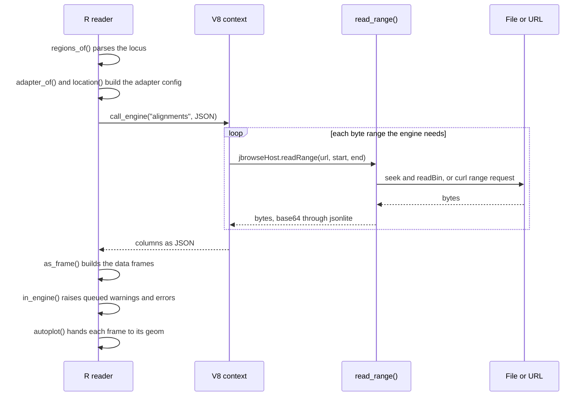

# Dataflow

One `jbrowse_alignments(bam, "chr12:6,534,201-6,538,700")` call, from path to plot:

- **Parse:** `regions_of()` in `R/regions.R` turns the region into 0-based
  half-open bounds.
- **Config:** `adapter_of()` guesses the adapter from the file name and
  index. `location()` gives a local file a `file://` URL with its modification
  time and size, so an overwritten file is a new cache key.
- **Engine:** `call_engine()` in `R/engine.R` runs `jbrowse.<table>` in the
  session's one V8 context and waits on the promise.
- **Reads:** each `readRange` the engine makes is a synchronous call into R.
  The context caches what it read, keyed by URL.
- **Queue:** `console.warn` and `console.error` inside the engine wait in a
  queue. `in_engine()` raises them after V8 returns.
- **Draw:** each geom in `R/geoms-alignments.R` and its siblings draws one
  table. R decides pixels per base, inches and layers; the tables already
  hold the display's colors.
