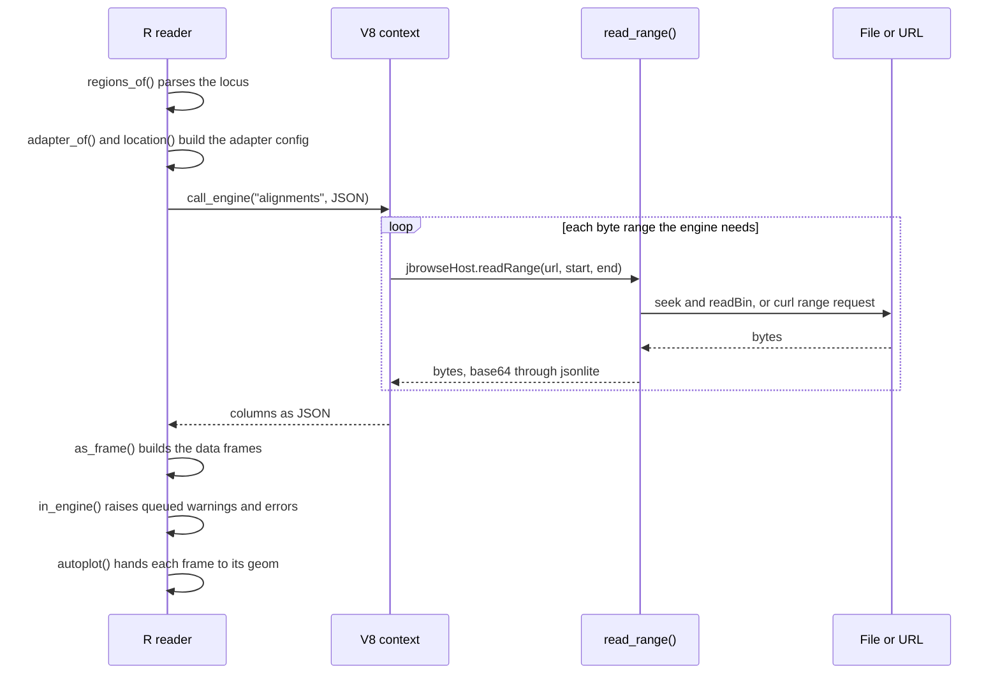

# FAQ

## How does it work?

- **In V8:** JBrowse's `@jbrowse/tables` package. It takes a region through
  the same fetching and layout as a display and returns the result as
  tables. JBrowse's canvas drawing and UI do not run.
- **In R:** the readers pass file bytes to that package, and ggplot2 draws the
  tables it returns.
- `engine()` in `R/engine.R` starts one [V8](https://CRAN.R-project.org/package=V8)
  context per R session and sources the bundle into it. The context stays
  alive between calls, so the engine's caches do too.
- `jbrowse_reset()` empties the caches and keeps the context.

## What happens in one call?

One `jbrowse_alignments(bam, "chr12:6,534,201-6,538,700")` call, from path to plot:

## Who decides what?

- The engine decides whatever JBrowse decides from the track's config, such as
  colors and the display's geometry.
- R decides whatever depends on the figure, such as pixels per base, inches,
  label sizes and which ggplot layer draws what.
- [agent-docs/engine-owns-display-decisions.md](../agent-docs/engine-owns-display-decisions.md)
  lists the rules R still copies.

## Why V8 and not QuickJS?

- JBrowse's engine is a 3 MB bundle built for a browser-like host. V8 runs it
  at full speed with full ES support, and the `V8` package is on CRAN.
- QuickJS could host the same bundle through the same `readRange` callback.
  Nothing in the engine depends on V8.

## Is the engine a reimplementation of JBrowse?

- No. `inst/js/jbrowse-tables.js` is `@jbrowse/tables`, built from
  jbrowse-components' own source and run with no web globals. JBrowse's tests
  hold it to the browser's output.

## How does it compare with Rsamtools?

- Rsamtools cannot open a CRAM. `jbrowse_alignments()` reads one when given
  its reference as `assembly`.
- Rsamtools parses faster. On a local 50 kb region with 9,596 reads,
  `scanBam()` took 0.02 s and `jbrowse_alignments()` 0.37 s; on a 73-read
  region, 0.02 s and 0.07 s (median of 5, ggjbrowse 0.7.0, Rsamtools 2.26.0).
- The two do different work. `scanBam()` returns raw fields, and
  `jbrowse_alignments()` also packs pileup rows and computes mismatches,
  coverage, junctions and colors.
- The first call in a session adds about 0.2 s to start the engine.

## Why is the bundle committed?

- Installing the package needs no Node or pnpm.
- The first line of the file names the release, or the jbrowse-components
  commit, it came from.
- [`inst/COPYRIGHTS`](../inst/COPYRIGHTS) names the license and copyright of
  each package bundled in it.

## How does it read a file in R?

- The JavaScript cannot touch a disk or a network. It calls
  `jbrowseHost.readRange(url, start, end)`, which V8 routes back to R's
  `read_range()`.
- `read_range()` seeks and reads a local file, or sends a `curl` range request
  for a remote one. The JavaScript waits on the answer, so the call is
  synchronous.
- jsonlite sends the bytes to the JavaScript base64-encoded.

## Why does a changed remote file still show old data?

- The engine caches every read by URL. A local file's modification time and
  size are part of its URL, so an overwritten local file rereads.
- A remote file has no such key. `jbrowse_reset()` clears the caches.

## How much memory does the engine keep?

- Between calls the engine keeps three caches, each bounded by 256 MiB:
  - the records it decoded;
  - the file bytes it read in ranges;
  - the files the last call read, open whatever they weigh, then each other
    open file, most recently read first, while its weight still fits under
    256 MiB beside those kept.
- A file weighs at least 1 MiB, or an estimate of what the engine parsed from
  the files it read whole, which is four times an index's uncompressed size and
  ten times any other file's, such as a plain or gzipped VCF.
- `jbrowse_cache()` reports what each holds. `jbrowse_cache(limit = 64 * 2^20)`
  lowers all three bounds to 64 MiB, and evicts at once;
  `jbrowse_cache(limit = Inf)` keeps everything, the file bytes included.
- A call whose reads exceed the limit can read a chunk again inside itself.
- A call's own reads and tables come on top, and one read of 1 Mb of a 100x BAM
  took R to 2.2 GB. So do R's copies of the tables, and the engine's
  decompressor memory, about 20 MiB.
- The engine's V8 stops at a heap of about 1.4 GB, which files parsed whole
  reach first, since a 24 MB plain VCF parses to about 220 MiB. Read a large VCF
  through its tabix index.
- `jbrowse_reset()` empties the caches. R's process keeps the freed memory
  and reuses it for the next reads, so its size seen from the system stays
  where it was.

## Can it read a file without an index?

- A BAM or CRAM needs its index, and a bgzipped GFF3, GTF, BED or VCF needs a
  tabix or CSI index. Put it beside the file under its usual name, or pass
  `index =`.
- A plain GFF3, GTF, BED or VCF has no index. The engine reads the whole file.

## A CRAM gives an error about the reference

- A CRAM stores reads against the FASTA it was encoded with. Pass that FASTA
  or 2bit as `assembly =`.

## The files spell a contig differently

- Pass each reader `assembly = jbrowse_assembly(fasta, aliases)`, the FASTA
  and an alias table listing each contig's names on a row, such as UCSC's
  `chromAlias.txt`. A region may name the contig as any file does. The
  engine reads each file under that file's spelling, and the reader names the
  contig in its tables as the region does.
- A JBrowse config's assembly works as is: `assembly = list(name = "hg19",
  uri = "hg19.fa.gz", refNameAliases = list(uri = "hg19_aliases.txt"))`.

## How do I tell a reader's errors apart?

- Each error has a class: `ggjbrowse_too_large` past `span_limit`,
  `byte_limit` or the whole-file row cap, `ggjbrowse_missing_contig` where
  no region's contig is in the file, `ggjbrowse_bad_display` for a `display`
  slot the schema refuses, and `ggjbrowse_bad_region` for a region that
  reads as neither a locus nor a contig. `tryCatch(..., ggjbrowse_too_large =
  function(e) ...)` catches one. `?jbrowse_result` lists them all.

## Do R warnings from inside the engine work with `tryCatch`?

- Yes, after the call. The engine's `console.warn` and `console.error` go to
  a queue, and `in_engine()` raises it once V8 returns. A handler that unwinds
  through V8's frames would break the context.

## Can I read in parallel?

- Yes, in a socket cluster: `parallel::makeCluster()`, `parLapply()`, or
  future's `multisession`. Each worker loads ggjbrowse and starts its own
  engine.
- Not in forked workers (`mclapply()`, future's `multicore`, BiocParallel's
  `MulticoreParam`): V8 hangs starting there, so the reader refuses with a
  `ggjbrowse_forked` error. A worker forked after the parent has read
  inherits the parent's engine.

## Which coordinates do I give?

- A locus string is 1-based and inclusive, as in JBrowse's location box.
- A data frame of `chrom`, `start` and `end` is 0-based half-open, as BED
  writes it. A frame that reads as 1-based, with `seqnames` or a `width` of
  `end - start + 1`, is refused: pass a GRanges as it is.

## Can I restyle a figure?

- Yes. `autoplot()` returns an ordinary ggplot, so `+` adds layers, scales and
  themes. Each table is also a data frame to plot yourself with
  `geom_jbrowse_*()`.
- The geoms paint the display's colors as they are, so a scale of your own,
  such as `scale_fill_viridis_c()` over `aes(fill = mapq)`, sits beside
  them. The keys take the plot's theme; edit `a$keys` to relabel an entry.
- `autoplot(a, "pileup")` draws one band, and `jbrowse_stack()` stacks bands
  and tracks on one axis.

## How do I update the engine?

- Run `pnpm install` in a jbrowse-components checkout, then
  `scripts/build-js.sh` here. The script looks in `../jbrowse-components`, or
  in `$JBROWSE_COMPONENTS`.
- [CONTRIBUTING.md](../CONTRIBUTING.md#updating-the-engine) covers the CI that
  takes each new release.
