# Gallery recipes

Each figure in the README's gallery, drawn from the package's own data by
ggjbrowse and by JBrowse.

- **ggjbrowse:** each R recipe runs as written after

  ```r
  library(ggjbrowse)
  e <- function(f) system.file("extdata", f, package = "ggjbrowse")
  ```

- **JBrowse:** each shell recipe runs `jb2export` from `@jbrowse/img`,
  JBrowse's own renderer, from the root of a checkout of this repo.
  It needs 5.0.0-beta or later, since 4.3.0 cannot draw most of these, and
  the clustered rows need jbrowse-components commit `c50aaedcda`, in no
  release yet.
- `scripts/gallery.R` draws both and writes this page, so edit an example
  there.

<a id="genes_and_reads"></a>

## GENCODE genes over direct RNA reads

`chr12:6,534,201-6,538,700`

<table>
<tr><td width="50%">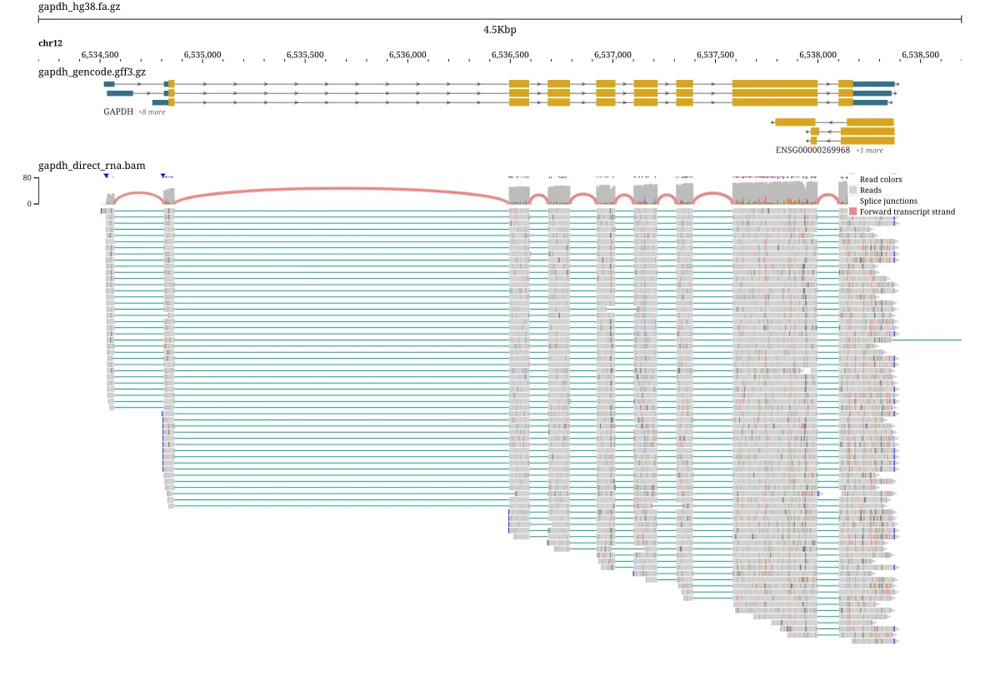</td><td width="50%">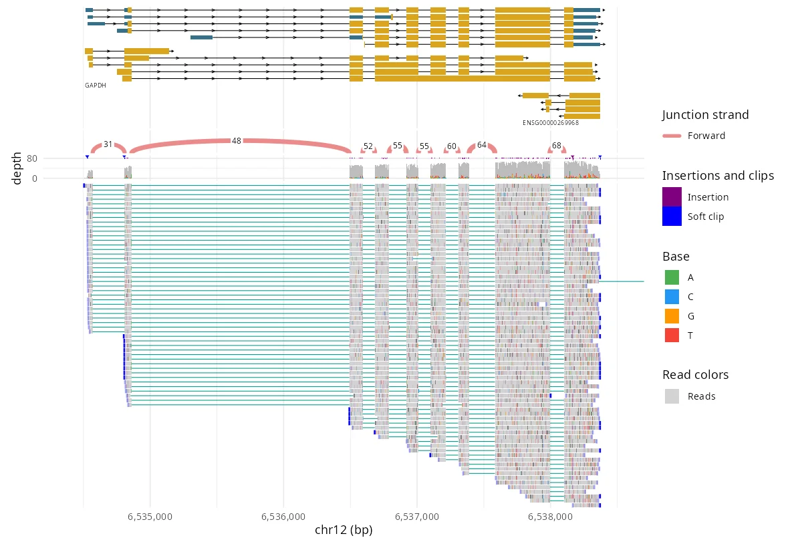</td></tr>
</table>

Junction arcs count each splice, from 31 to 68 reads, over the coverage band and the reads split at every intron.

```r
reads <- jbrowse_alignments(e("gapdh_direct_rna.bam"),
  "chr12:6,534,201-6,538,700")
genes <- jbrowse_features(e("gapdh_gencode.gff3.gz"),
  "chr12:6,534,201-6,538,700")
autoplot(reads, above = genes)
```

```sh
jb2export --fasta inst/extdata/gapdh_hg38.fa.gz \
  --gffgz inst/extdata/gapdh_gencode.gff3.gz \
  --bam inst/extdata/gapdh_direct_rna.bam showLegend=true heightMode:grow growMaxHeight=2000 \
  --loc chr12:6,534,201-6,538,700 \
  --width 1200 --out genes_and_reads.png
```

<a id="long_reads_sv"></a>

## COLO829 der(3) split reads chained across its two chr3 breakpoints

`chr3:25,358,500-25,359,800`

<table>
<tr><td width="50%">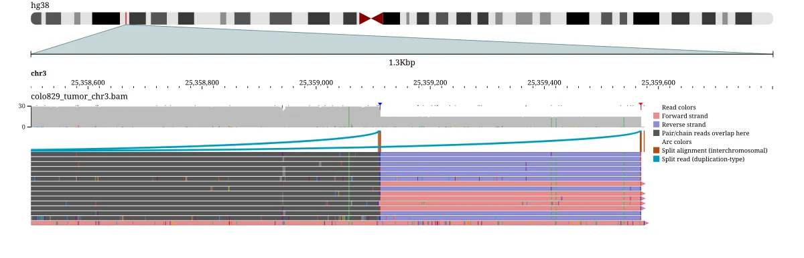</td><td width="50%">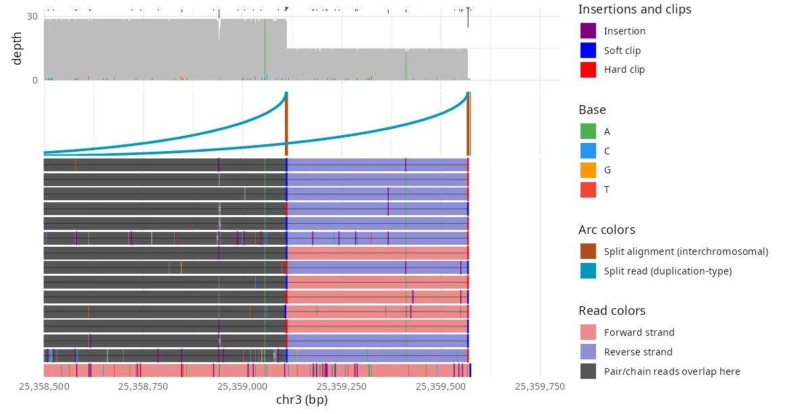</td></tr>
</table>

Coverage halves at the first breakpoint, and each read's segments share a row, overlapping in dark grey and colored by strand past it, joined by duplication-type arcs.

```r
autoplot(jbrowse_alignments(e("colo829_tumor_chr3.bam"),
  "chr3:25,358,500-25,359,800",
  display = list(unit = "chain", readConnections = "arc",
    color = list(field = "strand"), filter = list(split = "only"))))
```

```sh
jb2export --hub hg38 \
  --bam inst/extdata/colo829_tumor_chr3.bam showLegend=true heightMode:grow growMaxHeight=2000 arcs:down unit=chain color.field=strand filter.split=only \
  --loc chr3:25,358,500-25,359,800 \
  --width 1200 --out long_reads_sv.png
```

<a id="deletion"></a>

## Reads sorted by the base at the center, over a somatic deletion

`chr10:122,831,700-122,840,800`

<table>
<tr><td width="50%">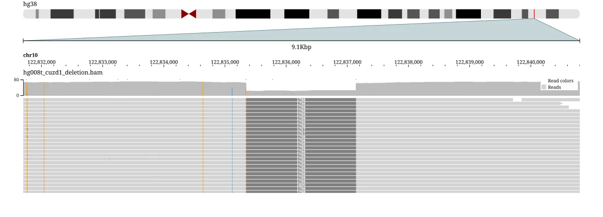</td><td width="50%">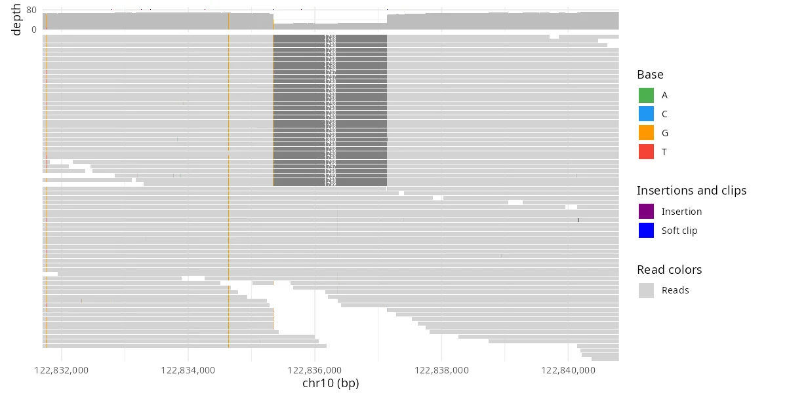</td></tr>
</table>

Coverage halves across the deletion, and the reads sorted to the top span it with dark deletion bars, each labelled with its length.

```r
autoplot(jbrowse_alignments(e("hg008t_cuzd1_deletion.bam"),
  "chr10:122,831,700-122,840,800",
  display = list(sort = list(type = "basePair", pos = 122836300))))
```

```sh
jb2export --hub hg38 \
  --bam inst/extdata/hg008t_cuzd1_deletion.bam showLegend=true heightMode:grow growMaxHeight=2000 sort:base \
  --loc chr10:122,831,700-122,840,800 \
  --width 1200 --out deletion.png
```

<a id="compact_reads"></a>

## Compact reads over the same deletion

`chr10:122,831,700-122,840,800`

<table>
<tr><td width="50%">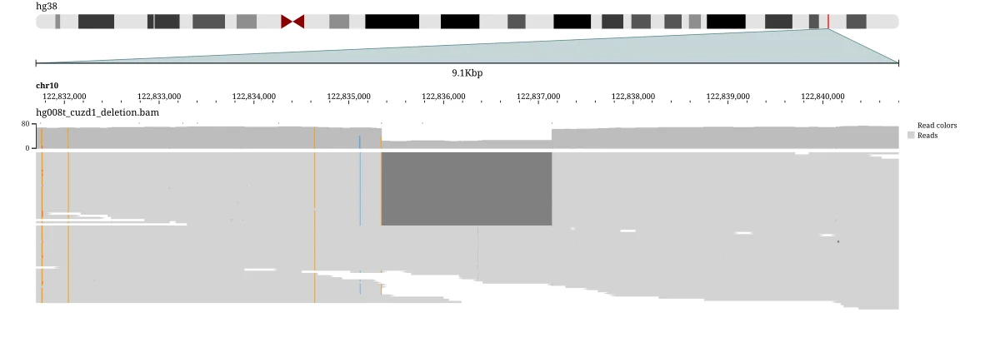</td><td width="50%">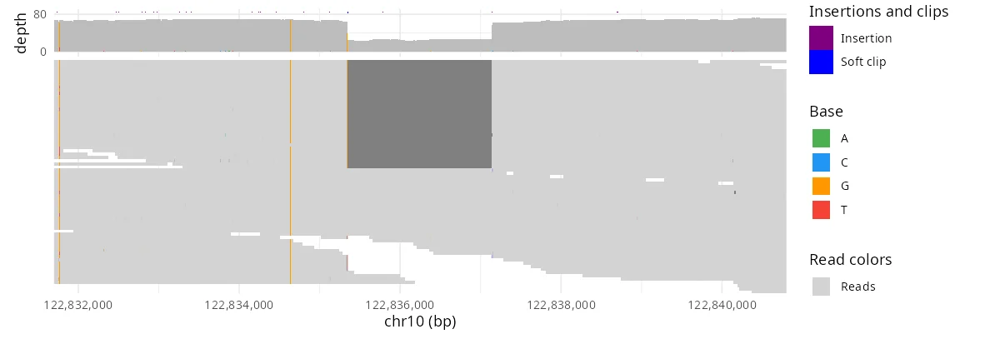</td></tr>
</table>

Sorted by the base at the center, at 3 pixels a row the pileup takes far less height, the deletion's dark bars banded through it.

```r
autoplot(jbrowse_alignments(e("hg008t_cuzd1_deletion.bam"),
  "chr10:122,831,700-122,840,800",
  display = list(featureHeight = 3,
    sort = list(type = "basePair", pos = 122836300))))
```

```sh
jb2export --hub hg38 \
  --bam inst/extdata/hg008t_cuzd1_deletion.bam showLegend=true heightMode:grow growMaxHeight=2000 sort:base featureHeight:compact \
  --loc chr10:122,831,700-122,840,800 \
  --width 1200 --out compact_reads.png
```

<a id="base_zoom"></a>

## Base-level zoom at the deletion's left edge

`chr10:122,835,300-122,835,420`

<table>
<tr><td width="50%">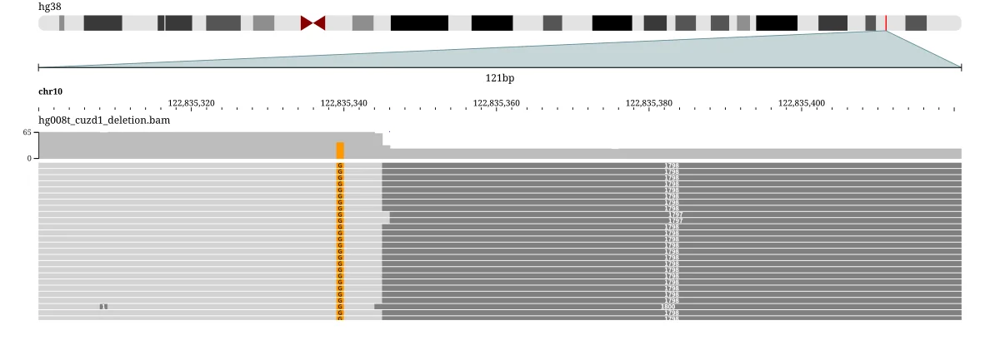</td><td width="50%">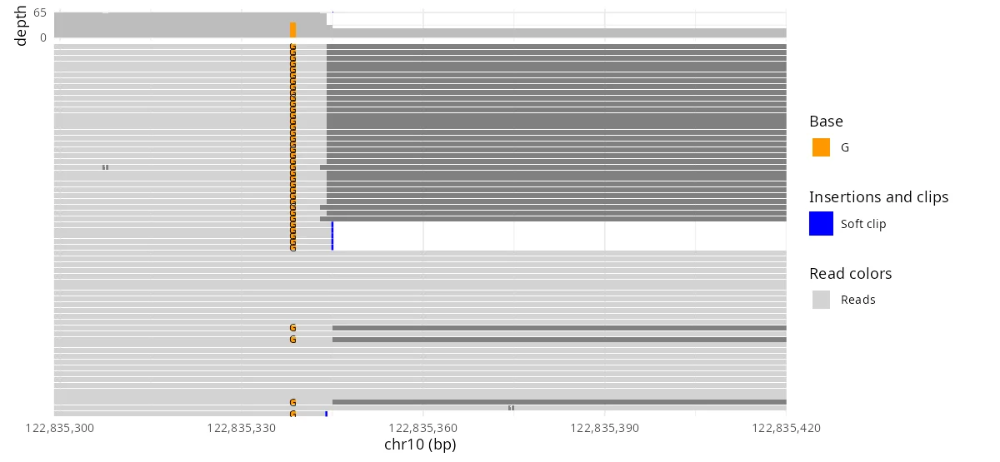</td></tr>
</table>

At 120 bp the pileup writes out each mismatch's base, and every read sorted to the top carries a G a few bases before its deletion.

```r
autoplot(jbrowse_alignments(e("hg008t_cuzd1_deletion.bam"),
  "chr10:122,835,300-122,835,420",
  display = list(sort = list(type = "basePair", pos = 122835344))))
```

```sh
jb2export --hub hg38 \
  --bam inst/extdata/hg008t_cuzd1_deletion.bam showLegend=true heightMode:grow growMaxHeight=2000 sort:base \
  --loc chr10:122,835,300-122,835,420 \
  --width 1200 --out base_zoom.png
```

<a id="inversion"></a>

## Split reads chained across an inversion, with their arcs

`chr1:197,786,900-197,789,700`

<table>
<tr><td width="50%">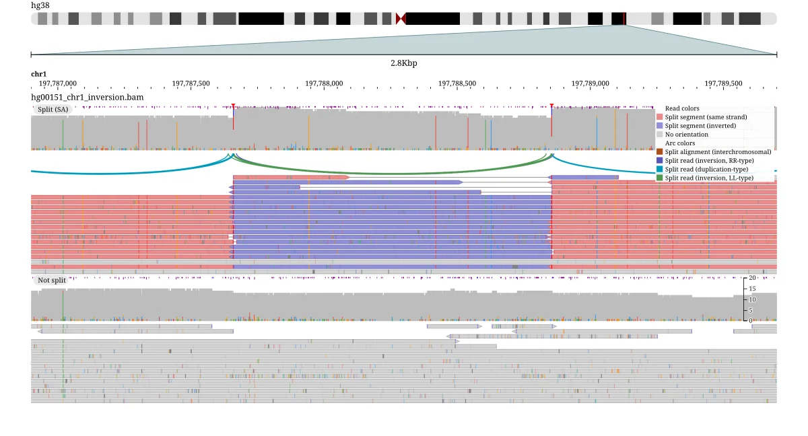</td><td width="50%">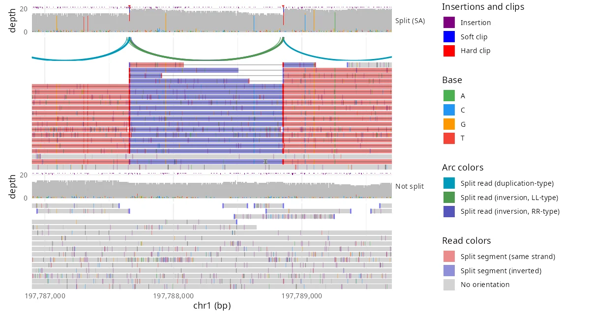</td></tr>
</table>

The split reads, in their own section above the unsplit ones, are colored inverted between the two breakpoints, where inversion-type arcs join their segments.

```r
autoplot(jbrowse_alignments(e("hg00151_chr1_inversion.bam"),
  "chr1:197,786,900-197,789,700",
  display = list(unit = "chain", readConnections = "arc",
    color = list(field = "pairOrientation"), facet = list(field = "split"))))
```

```sh
jb2export --hub hg38 \
  --bam inst/extdata/hg00151_chr1_inversion.bam showLegend=true heightMode:grow growMaxHeight=2000 arcs:down unit=chain color.field=pairOrientation facet=split coverageHeight=80 \
  --loc chr1:197,786,900-197,789,700 \
  --width 1200 --out inversion.png
```

<a id="methylation"></a>

## CpG methylation from MM/ML tags

`20:10,001-22,000`

<table>
<tr><td width="50%">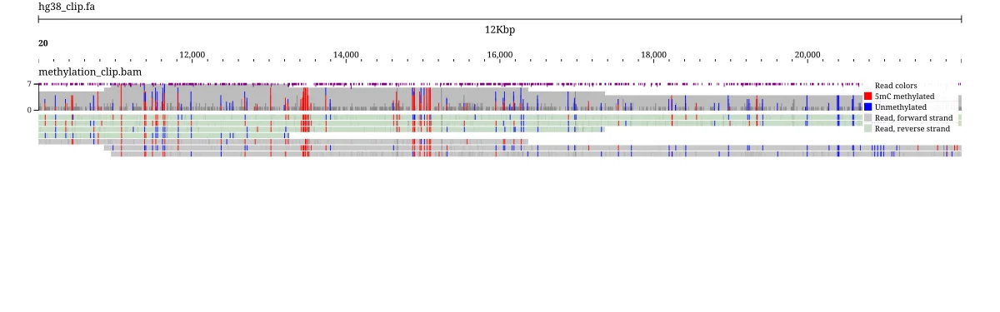</td><td width="50%">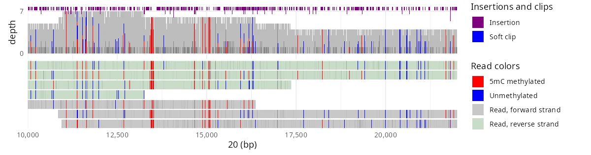</td></tr>
</table>

Each read's 5mC calls in red where methylated and blue where not.

```r
autoplot(jbrowse_alignments(e("methylation_clip.bam"), "20:10,001-22,000",
  assembly = e("hg38_clip.fa"),
  display = list(baseColor = list(field = "modifications"),
    modifications = list(unmodified = "all"))))
```

```sh
jb2export --fasta inst/extdata/hg38_clip.fa \
  --bam inst/extdata/methylation_clip.bam baseColor:methylation showLegend=true heightMode:grow growMaxHeight=2000 \
  --loc 20:10,001-22,000 \
  --width 1200 --out methylation.png
```

<a id="bisulfite"></a>

## CHH methylation from bisulfite reads

`NC_003070.9:4,398,001-4,412,000`

<table>
<tr><td width="50%">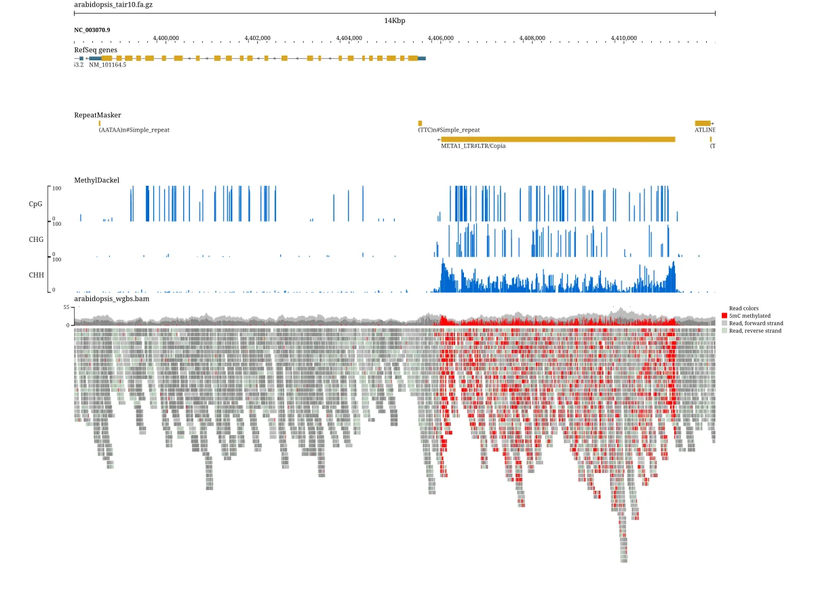</td><td width="50%">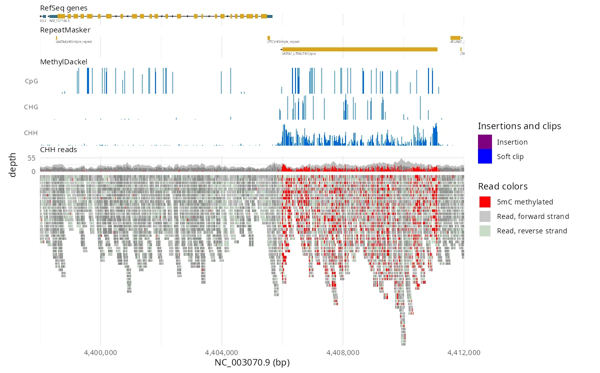</td></tr>
</table>

RefSeq genes and RepeatMasker over MethylDackel's three context bigWigs and each read's methylated CHH cytosines in red: CHH is dense over the LTR/Copia element on the right and rare over the gene on the left, which carries CpG methylation only.

```r
locus <- "NC_003070.9:4,398,001-4,412,000"
genes <- jbrowse_features(e("arabidopsis_refseq.bb"), locus)
repeats <- jbrowse_features(e("arabidopsis_rmsk.bb"), locus)
methyldackel <- list(type = "MultiWiggleAdapter",
  subadapters = lapply(c("CpG", "CHG", "CHH"), function(context)
    list(type = "BigWigAdapter", name = context, bigWigLocation = list(
      uri = e(sprintf("arabidopsis_methyldackel_%s.bw", context))))))
reads <- jbrowse_alignments(e("arabidopsis_wgbs.bam"), locus,
  assembly = e("arabidopsis_tair10.fa.gz"),
  display = list(baseColor = list(field = "bisulfite"),
    modifications = list(cytosineContext = "CHH")))
jbrowse_stack(`RefSeq genes` = genes, RepeatMasker = repeats,
  MethylDackel = jbrowse_wiggle(methyldackel, locus), `CHH reads` = reads)
```

```sh
jb2export --fasta inst/extdata/arabidopsis_tair10.fa.gz \
  --bigbed inst/extdata/arabidopsis_refseq.bb 'name:RefSeq genes' \
  --bigbed inst/extdata/arabidopsis_rmsk.bb name:RepeatMasker \
  --multiwig gallery/jb2export/methyldackel.json name:MethylDackel showLegend=true \
  --bam inst/extdata/arabidopsis_wgbs.bam baseColor:bisulfite modifications.cytosineContext=CHH showLegend=true heightMode:grow growMaxHeight=2000 \
  --loc NC_003070.9:4,398,001-4,412,000 \
  --width 1200 --out bisulfite.png
```

<a id="dnase_rows"></a>

## DNase in twelve cell lines over the beta-globin locus

`chr11:5,270,001-5,320,000`

<table>
<tr><td width="50%">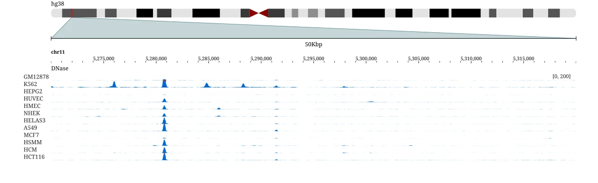</td><td width="50%">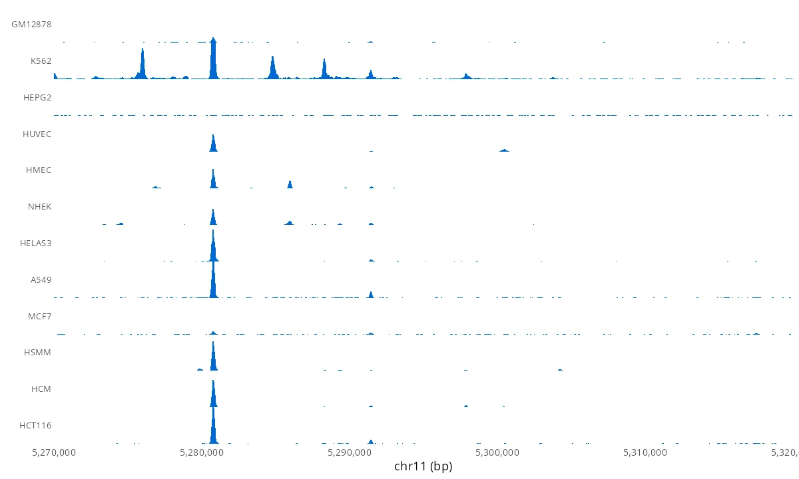</td></tr>
</table>

Most lines share one peak near 5,281,000, and K562 alone shows several more to either side.

```r
cells <- c("gm12878", "k562", "hepg2", "huvec", "hmec", "nhek", "helas3",
  "a549", "mcf7", "hsmm", "hcm", "hct116")
dnase <- list(type = "MultiWiggleAdapter", subadapters = lapply(cells,
  function(cell) list(type = "BigWigAdapter", name = toupper(cell),
    bigWigLocation = list(uri = e(sprintf("hbb_dnase_%s.bw", cell))))))
autoplot(jbrowse_wiggle(dnase, "chr11:5,270,001-5,320,000"))
```

```sh
jb2export --hub hg38 \
  --multiwig gallery/jb2export/dnase.json showLegend=true name:DNase \
  --loc chr11:5,270,001-5,320,000 \
  --width 1200 --out dnase_rows.png
```

<a id="dnase_clustered"></a>

## DNase in twelve cell lines as density, clustered by signal

`chr11:5,270,001-5,320,000`

<table>
<tr><td width="50%">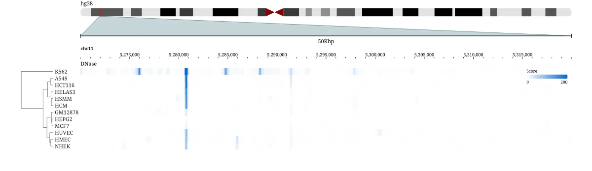</td><td width="50%">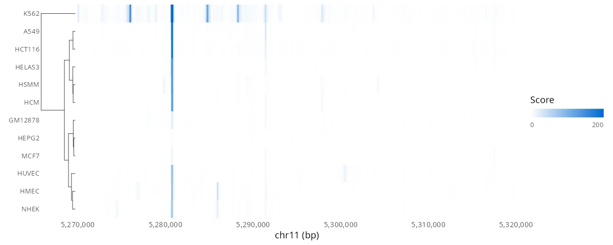</td></tr>
</table>

K562 splits off alone from the other eleven lines.

```r
cells <- c("gm12878", "k562", "hepg2", "huvec", "hmec", "nhek", "helas3",
  "a549", "mcf7", "hsmm", "hcm", "hct116")
dnase <- list(type = "MultiWiggleAdapter", subadapters = lapply(cells,
  function(cell) list(type = "BigWigAdapter", name = toupper(cell),
    bigWigLocation = list(uri = e(sprintf("hbb_dnase_%s.bw", cell))))))
w <- jbrowse_wiggle(dnase, "chr11:5,270,001-5,320,000",
  display = list(mark = "span"))
w$tree <- hclust(dist(as.matrix(w)), "average")
autoplot(w)
```

```sh
jb2export --hub hg38 \
  --multiwig gallery/jb2export/dnase.json showLegend=true name:DNase mark=span runClustering=true \
  --loc chr11:5,270,001-5,320,000 \
  --width 1200 --out dnase_clustered.png
```

<a id="conservation"></a>

## phyloP conservation across GAPDH as bars, a line and density

`chr12:6,534,201-6,538,700`

<table>
<tr><td width="50%">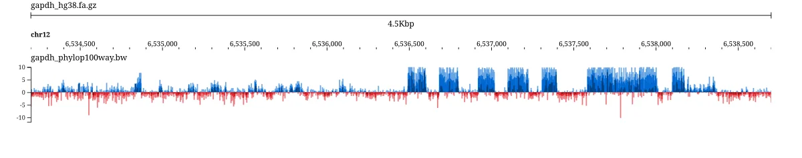</td><td width="50%">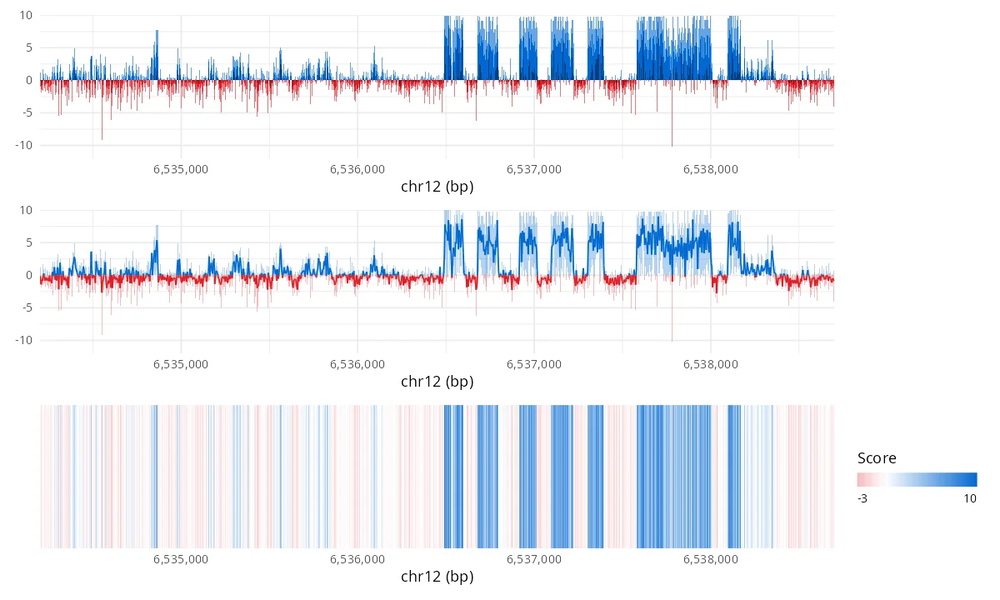</td></tr>
</table>

The exons stand out as runs of high scores in bars, in a mean line over its min-max band, and in a density strip.

```r
bw <- e("gapdh_phylop100way.bw")
gapdh <- "chr12:6,534,201-6,538,700"
patchwork::wrap_plots(ncol = 1,
  autoplot(jbrowse_wiggle(bw, gapdh, width = 1100)),
  autoplot(jbrowse_wiggle(bw, gapdh, width = 1100,
    display = list(mark = "line", interpolate = "linear"))),
  autoplot(jbrowse_wiggle(bw, gapdh, width = 1100,
    display = list(mark = "span"))))
```

```sh
jb2export --fasta inst/extdata/gapdh_hg38.fa.gz \
  --bigwig inst/extdata/gapdh_phylop100way.bw showLegend=true \
  --bigwig inst/extdata/gapdh_phylop100way.bw mark=line interpolate=linear \
  --bigwig inst/extdata/gapdh_phylop100way.bw mark=span \
  --loc chr12:6,534,201-6,538,700 \
  --width 1200 --out conservation.png
```

<a id="two_regions"></a>

## Genes, conservation and strand-colored reads over two regions end to end

`chr12:6,534,201-6,535,700 chr12:6,537,201-6,538,700`

<table>
<tr><td width="50%">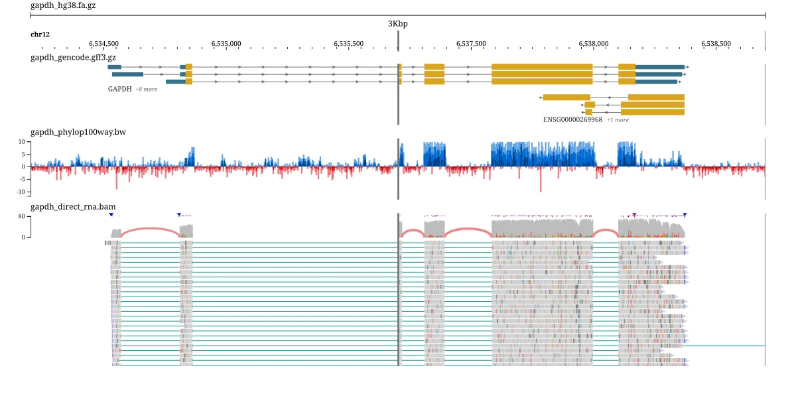</td><td width="50%">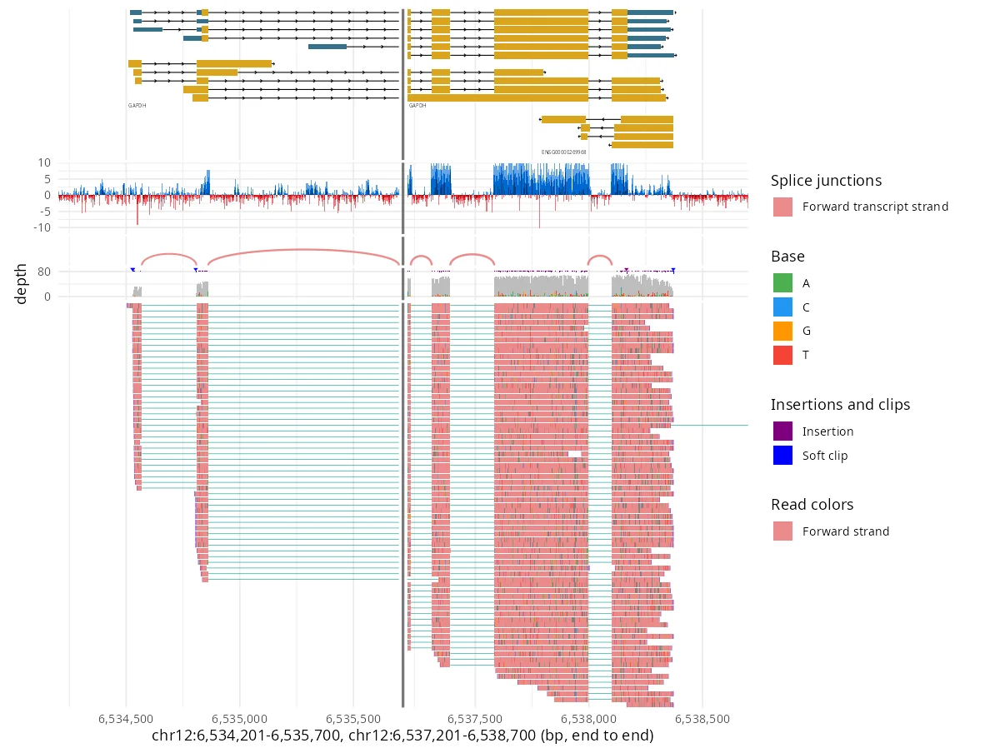</td></tr>
</table>

A grey divider separates the two loci, and each tick gives a position in its own region.

```r
loci <- c("chr12:6,534,201-6,535,700", "chr12:6,537,201-6,538,700")
genes <- jbrowse_features(e("gapdh_gencode.gff3.gz"), loci)
signal <- jbrowse_wiggle(e("gapdh_phylop100way.bw"), loci)
reads <- jbrowse_alignments(e("gapdh_direct_rna.bam"), loci,
  display = list(color = list(field = "strand")))
jbrowse_stack(genes, signal, reads)
```

```sh
jb2export --fasta inst/extdata/gapdh_hg38.fa.gz \
  --gffgz inst/extdata/gapdh_gencode.gff3.gz \
  --bigwig inst/extdata/gapdh_phylop100way.bw showLegend=true \
  --bam inst/extdata/gapdh_direct_rna.bam showLegend=true heightMode:grow growMaxHeight=2000 color.field=strand \
  --loc 'chr12:6,534,201-6,535,700 chr12:6,537,201-6,538,700' \
  --width 1200 --out two_regions.png
```

<a id="amino_acids"></a>

## Amino acids over GAPDH's first coding exons, read in frame across the intron

`chr12:6,534,811-6,534,880 chr12:6,536,476-6,536,545`

<table>
<tr><td width="50%">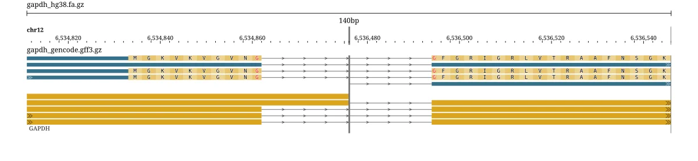</td><td width="50%">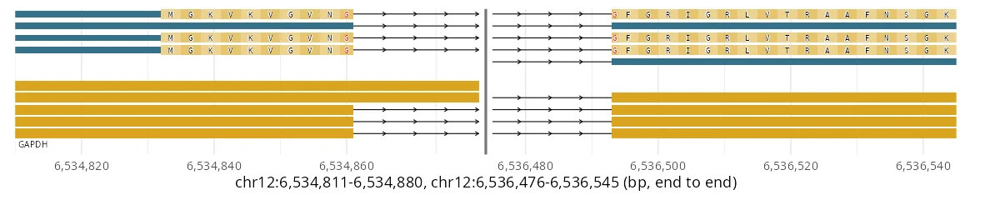</td></tr>
</table>

GAPDH's coding transcripts open MGKVKVGVNG, the last codon split by the intron and lettered red on each side, the frame running on in the next exon.

```r
loci <- c("chr12:6,534,811-6,534,880", "chr12:6,536,476-6,536,545")
genes <- jbrowse_features(e("gapdh_gencode.gff3.gz"), loci,
  assembly = e("gapdh_hg38.fa.gz"), width = 1200)
jbrowse_stack(genes)
```

```sh
jb2export --fasta inst/extdata/gapdh_hg38.fa.gz \
  --gffgz inst/extdata/gapdh_gencode.gff3.gz heightMode:grow growMaxHeight=2000 \
  --loc 'chr12:6,534,811-6,534,880 chr12:6,536,476-6,536,545' \
  --width 1200 --out amino_acids.png
```

<a id="variants_by_population"></a>

## 100 people's genotypes across DCST2 (GRCh37), colored by superpopulation

`1:155,000,001-155,050,000`

<table>
<tr><td width="50%">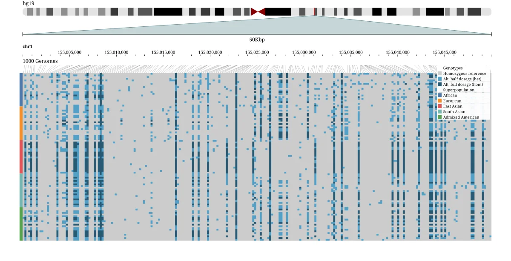</td><td width="50%">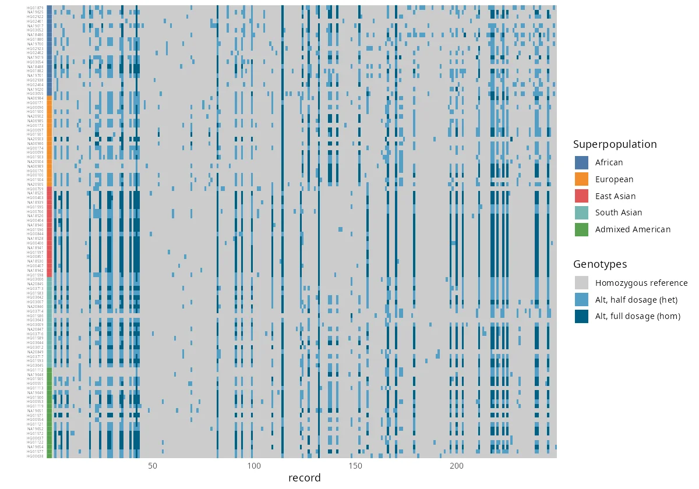</td></tr>
</table>

20 people from each superpopulation genotyped at 249 variants, a column per record, the East Asians homozygous for the alt allele at many of the first 40.

```r
v <- jbrowse_variants(e("1000g_dcst2.vcf.gz"), "1:155,000,001-155,050,000",
  samples = e("1000g_dcst2_samples.tsv"),
  display = list(rowColor = list(field = "superpopulation")))
autoplot(v, layout = "columns")
```

```sh
jb2export --hub hg19 \
  --tracks gallery/jb2export/people.tracks.json \
  --track people \
  --loc 1:155,000,001-155,050,000 \
  --width 1200 --out variants_by_population.png
```

<a id="variants_clustered"></a>

## 100 people's genotypes across DCST2 clustered, the tree beside the rows

`1:155,000,001-155,050,000`

<table>
<tr><td width="50%">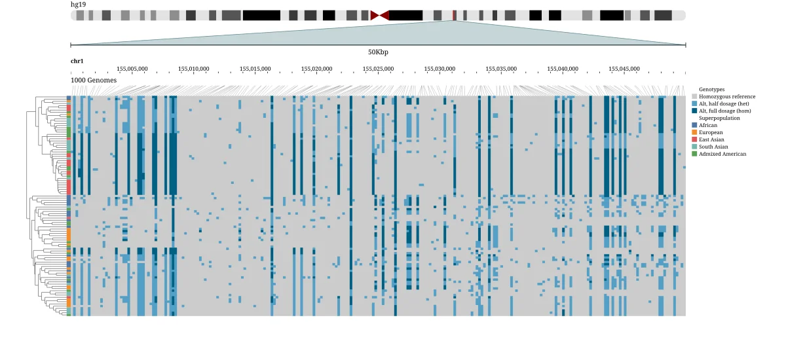</td><td width="50%">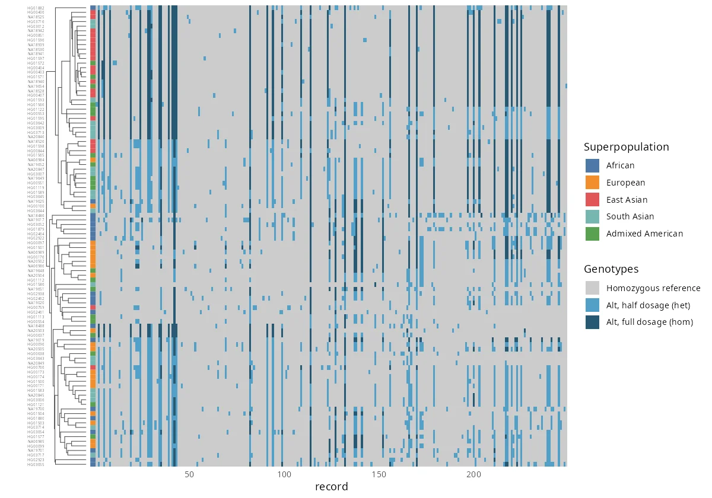</td></tr>
</table>

Most East Asians gather near the top, the Africans and Europeans further down.

```r
v <- jbrowse_variants(e("1000g_dcst2.vcf.gz"), "1:155,000,001-155,050,000",
  samples = e("1000g_dcst2_samples.tsv"),
  display = list(rowColor = list(field = "superpopulation")))
v$tree <- hclust(dist(as.matrix(v)), "average")
autoplot(v, layout = "columns")
```

```sh
jb2export --hub hg19 \
  --tracks gallery/jb2export/people.tracks.json \
  --track people runClustering=true \
  --loc 1:155,000,001-155,050,000 \
  --width 1200 --out variants_clustered.png
```

<a id="variants_banded"></a>

## 100 people's genotypes across DCST2 in a band per superpopulation, each band clustered

`1:155,000,001-155,050,000`

<table>
<tr><td width="50%">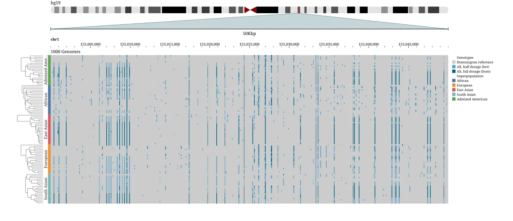</td><td width="50%">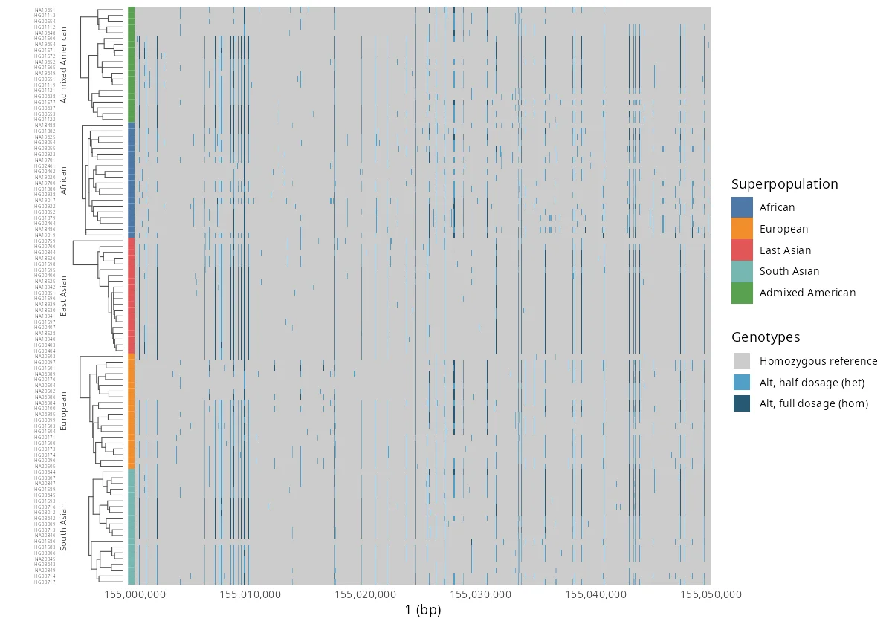</td></tr>
</table>

Each superpopulation clusters apart in its own band, and the records crowding a pixel fade by how many share it.

```r
v <- jbrowse_variants(e("1000g_dcst2.vcf.gz"), "1:155,000,001-155,050,000",
  samples = e("1000g_dcst2_samples.tsv"),
  display = list(rowColor = list(field = "superpopulation"),
    facet = "superpopulation"))
m <- as.matrix(v)
v$tree <- lapply(split(rownames(m), v$rows$band), function(rows)
  hclust(dist(m[rows, ]), "average"))
autoplot(v)
```

```sh
jb2export --hub hg19 \
  --tracks gallery/jb2export/people.tracks.json \
  --track people variantLayout=genomic facet=superpopulation runClustering=true \
  --loc 1:155,000,001-155,050,000 \
  --width 1200 --out variants_banded.png
```

<a id="collapsed_introns"></a>

## GAPDH's nine exons side by side, with the junctions between them as arcs

`ENST00000229239.10's exons, each padded by 20 bp`

<table>
<tr><td width="50%">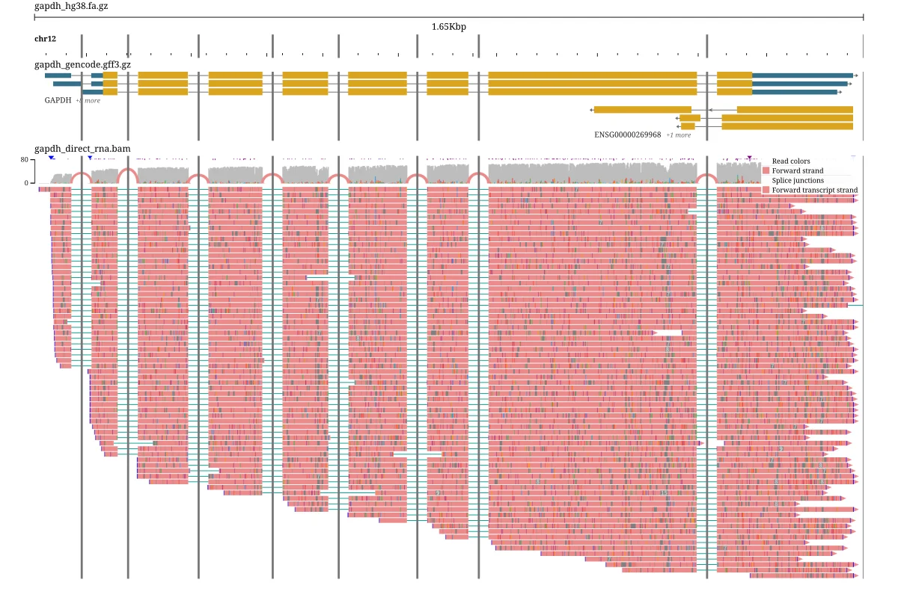</td><td width="50%">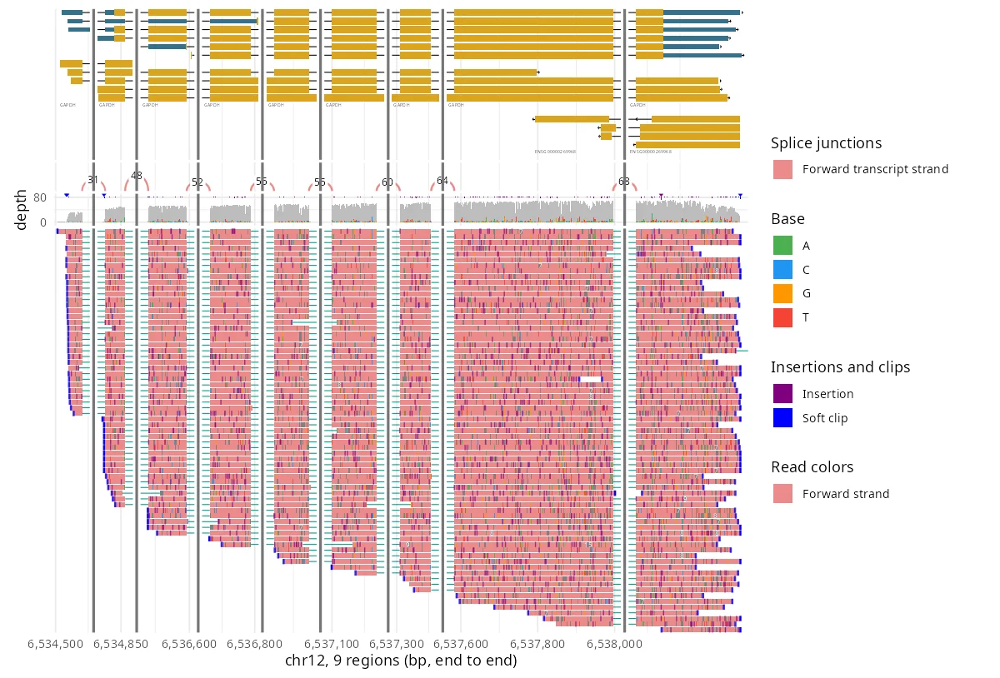</td></tr>
</table>

Each junction's read count sits over the arc joining its two exons, and the direct RNA reads run across.

```r
gff <- read.delim(gzfile(e("gapdh_gencode.gff3.gz")), header = FALSE,
  comment.char = "#")
exon <- gff[gff$V3 == "exon" &
  grepl("transcript_id=ENST00000229239.10;", gff$V9), ]
exon <- exon[order(exon$V4), ]
exons <- data.frame(chrom = exon$V1, start = exon$V4 - 1 - 20,
  end = exon$V5 + 20)
genes <- jbrowse_features(e("gapdh_gencode.gff3.gz"), exons)
reads <- jbrowse_alignments(e("gapdh_direct_rna.bam"), exons,
  display = list(color = list(field = "strand")))
jbrowse_stack(genes, reads)
```

```sh
jb2export --fasta inst/extdata/gapdh_hg38.fa.gz \
  --gffgz inst/extdata/gapdh_gencode.gff3.gz \
  --bam inst/extdata/gapdh_direct_rna.bam sashimi:auto color.field=strand showLegend=true heightMode:grow growMaxHeight=2000 \
  --loc 'chr12:6534497-6534589 chr12:6534790-6534881 chr12:6536474-6536613 chr12:6536664-6536810 chr12:6536900-6537030 chr12:6537081-6537236 chr12:6537289-6537410 chr12:6537564-6538016 chr12:6538081-6538391' \
  --width 1200 --out collapsed_introns.png
```

<a id="inversion_synteny"></a>

## HG002's maternal chr8 over its paternal copy at 8p23.1

`chr8_MATERNAL:5,250,001-14,250,000 chr8_PATERNAL:5,250,001-14,250,000`

<table>
<tr><td width="50%">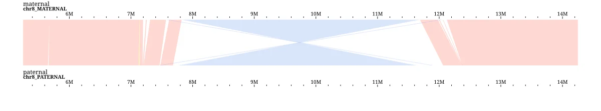</td><td width="50%">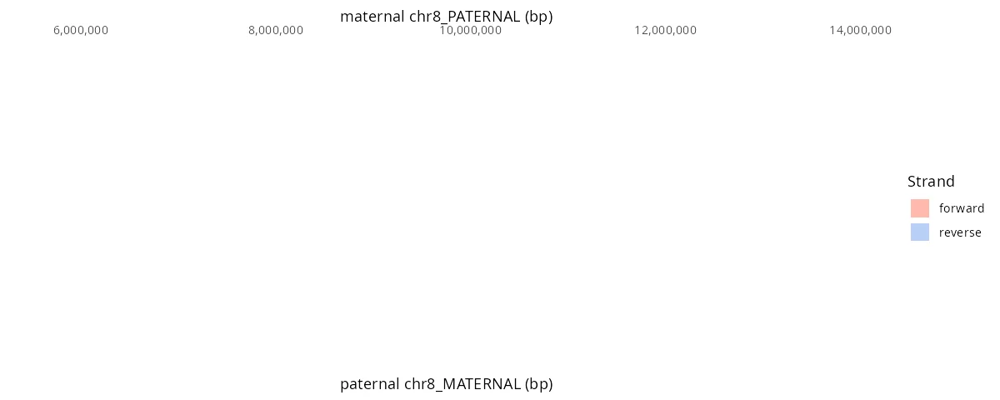</td></tr>
</table>

Forward blocks in tomato flank the 4 Mb inversion, whose reverse ribbon crosses in blue.

```r
r <- "5,250,001-14,250,000"
autoplot(jbrowse_synteny(e("hg002_chr8.chain"), paste0("chr8_MATERNAL:", r),
  paste0("chr8_PATERNAL:", r),
  display = list(color = list(field = "strand")), swap = TRUE,
  labels = c(query = "paternal", target = "maternal")))
```

```sh
jb2export synteny \
  --chromSizes gallery/jb2export/maternal.chrom.sizes loc:chr8_MATERNAL:5,250,001-14,250,000 \
  --chain inst/extdata/hg002_chr8.chain \
  --chromSizes gallery/jb2export/paternal.chrom.sizes loc:chr8_PATERNAL:5,250,001-14,250,000 \
  --colorBy strand \
  --width 1200 --out inversion_synteny.png
```

<a id="inversion_dotplot"></a>

## HG002's maternal chr8 against its paternal copy as a dotplot

`chr8_MATERNAL chr8_PATERNAL`

<table>
<tr><td width="50%">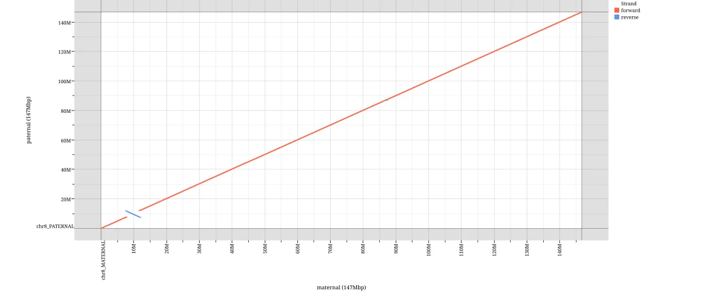</td><td width="50%">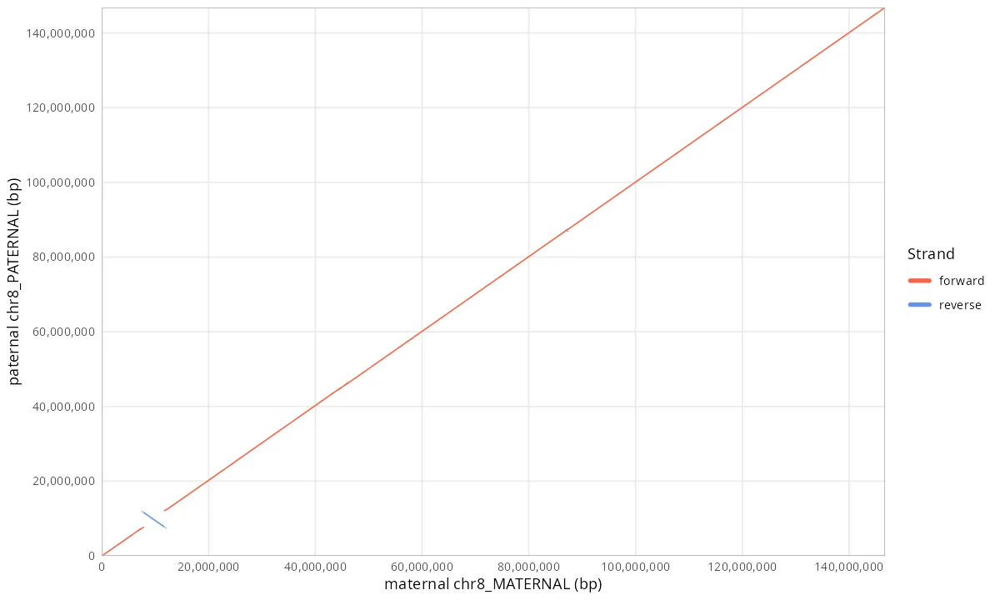</td></tr>
</table>

One forward diagonal runs the length of chr8, broken only by the inversion's short reverse segment near 10 Mb.

```r
autoplot(jbrowse_dotplot(e("hg002_chr8.chain"),
  display = list(color = list(field = "strand")), swap = TRUE,
  labels = c(query = "paternal", target = "maternal")))
```

```sh
jb2export dotplot \
  --chromSizes gallery/jb2export/maternal.chrom.sizes \
  --chain inst/extdata/hg002_chr8.chain \
  --chromSizes gallery/jb2export/paternal.chrom.sizes \
  --colorBy strand \
  --width 1200 --out inversion_dotplot.png
```

<a id="whole_genome"></a>

## Peach against grape, every chromosome

`whole genome`

<table>
<tr><td width="50%">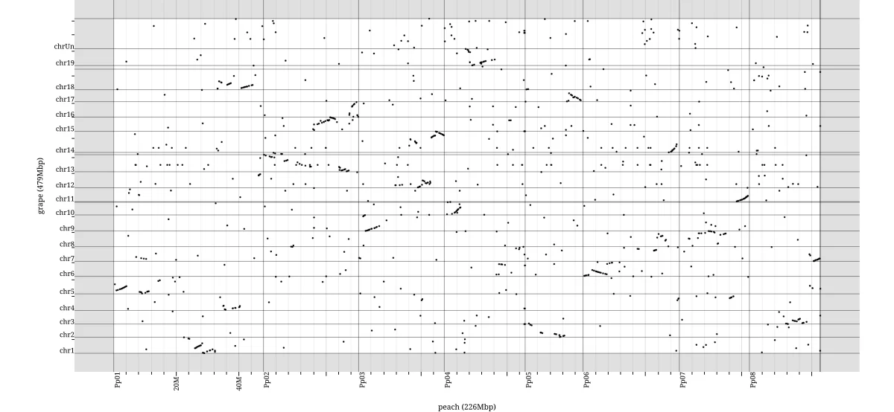</td><td width="50%">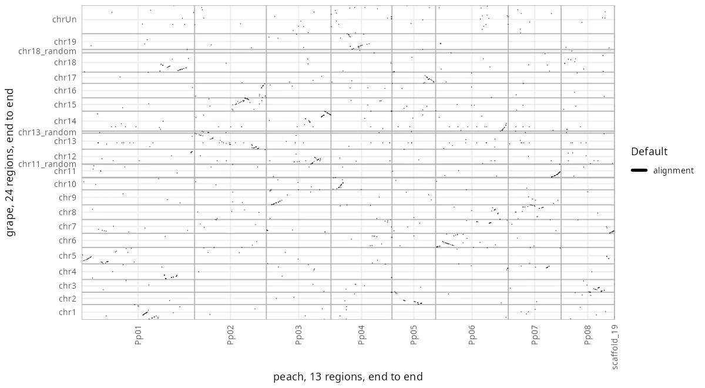</td></tr>
</table>

Short diagonal runs scatter over most pairs of peach and grape chromosomes.

```r
autoplot(jbrowse_dotplot(e("peach_grape.paf.gz"),
  labels = c(query = "peach", target = "grape")))
```

```sh
jb2export dotplot \
  --chromSizes gallery/jb2export/peach.chrom.sizes \
  --paf inst/extdata/peach_grape.paf.gz \
  --chromSizes gallery/jb2export/grape.chrom.sizes \
  --width 1200 --out whole_genome.png
```

<a id="amylase_synteny"></a>

## GRCh38 over HG00133 at the amylase genes

`GRCh38#0#chr1:103,520,894-103,832,637`

<table>
<tr><td width="50%">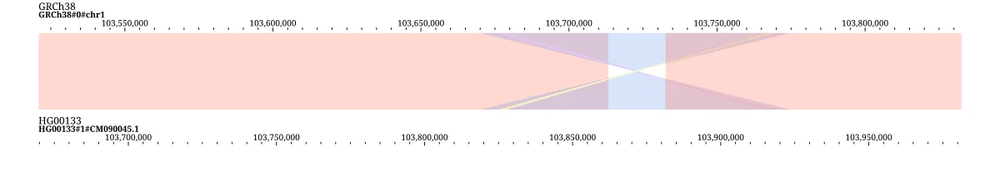</td><td width="50%">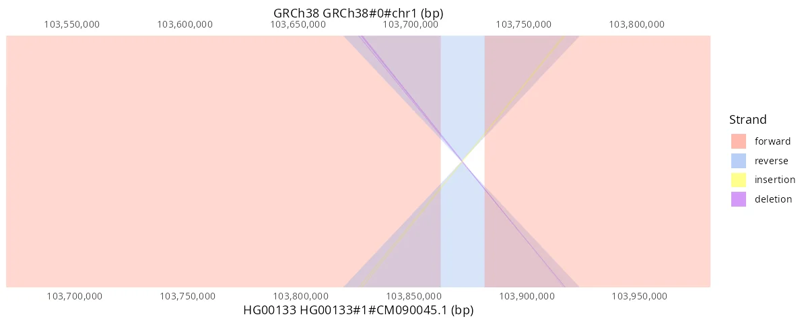</td></tr>
</table>

Forward blocks flank a reversed copy in the middle, with alignments of the other copies crossing over it.

```r
autoplot(jbrowse_synteny(e("hprc_amylase.paf"),
  "GRCh38#0#chr1:103,520,894-103,832,637",
  "HG00133#1#CM090045.1:103,669,666-103,981,330",
  display = list(color = list(field = "strand")),
  labels = c(query = "GRCh38", target = "HG00133")))
```

```sh
jb2export synteny \
  --chromSizes gallery/jb2export/GRCh38.chrom.sizes 'loc:GRCh38#0#chr1:103,520,894-103,832,637' \
  --paf inst/extdata/hprc_amylase.paf \
  --chromSizes gallery/jb2export/HG00133.chrom.sizes 'loc:HG00133#1#CM090045.1:103,669,666-103,981,330' \
  --colorBy strand \
  --width 1200 --out amylase_synteny.png
```

<a id="amylase_zoom"></a>

## 3 kb at the amylase genes, the match block cut by an 80 bp deletion

`GRCh38#0#chr1:103,619,501-103,622,500`

<table>
<tr><td width="50%">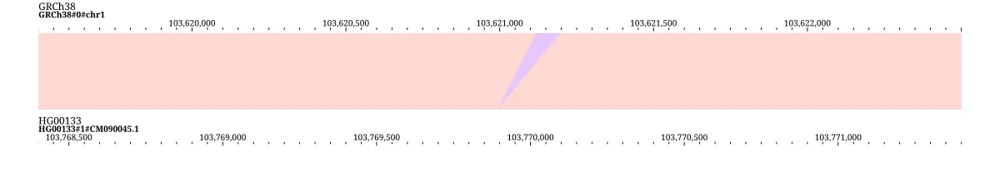</td><td width="50%">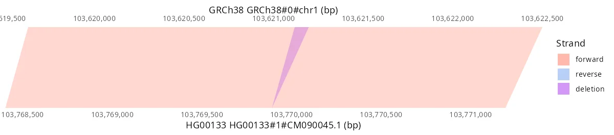</td></tr>
</table>

The deletion shows as a purple wedge narrowing to a point on HG00133's row.

```r
autoplot(jbrowse_synteny(e("hprc_amylase.paf"),
  "GRCh38#0#chr1:103,619,501-103,622,500",
  "HG00133#1#CM090045.1:103,768,401-103,771,400",
  display = list(color = list(field = "strand")),
  labels = c(query = "GRCh38", target = "HG00133")))
```

```sh
jb2export synteny \
  --chromSizes gallery/jb2export/GRCh38.chrom.sizes 'loc:GRCh38#0#chr1:103,619,501-103,622,500' \
  --paf inst/extdata/hprc_amylase.paf \
  --chromSizes gallery/jb2export/HG00133.chrom.sizes 'loc:HG00133#1#CM090045.1:103,768,401-103,771,400' \
  --colorBy strand \
  --width 1200 --out amylase_zoom.png
```

<a id="synteny_genes"></a>

## HG002's maternal chr8 over its paternal copy, each with its genes

`chr8_MATERNAL:5,250,001-14,250,000 chr8_PATERNAL:5,250,001-14,250,000`

<table>
<tr><td width="50%">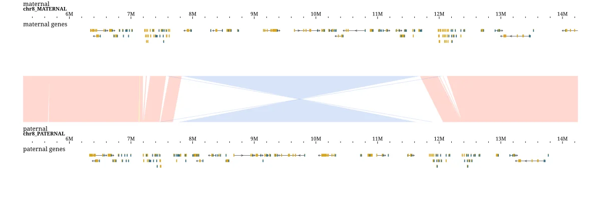</td><td width="50%">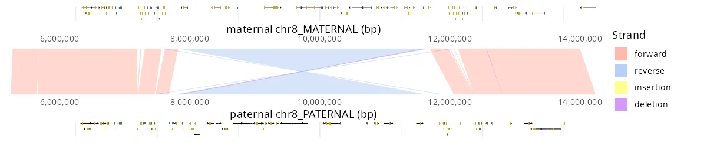</td></tr>
</table>

Forward blocks in tomato, the 4 Mb inversion crossing in blue, and the genes above and below.

```r
r <- "5,250,001-14,250,000"
s <- jbrowse_synteny(e("hg002_chr8.chain"), paste0("chr8_MATERNAL:", r),
  paste0("chr8_PATERNAL:", r),
  display = list(color = list(field = "strand")), swap = TRUE,
  labels = c(query = "paternal", target = "maternal"))
gene_track <- function(file, contig) jbrowse_features(e(file),
  paste0(contig, ":", r),
  display = list(displayMode = "compact", showLabels = FALSE,
    showOnlyGenes = TRUE))
autoplot(s, above = gene_track("hg002_mat_genes.gff3.gz", "chr8_MATERNAL"),
  below = gene_track("hg002_pat_genes.gff3.gz", "chr8_PATERNAL"))
```

```sh
jb2export --config gallery/jb2export/synteny_genes.config.json \
  --spec gallery/jb2export/synteny_genes.spec.json \
  --width 1200 --out synteny_genes.png
```

<a id="multiway"></a>

## The TP53 neighbourhood on hg38 over chimp, gorilla and orangutan

`chr17:7,400,001-7,700,000`

<table>
<tr><td width="50%">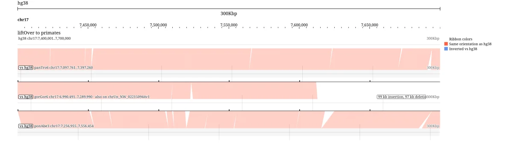</td><td width="50%">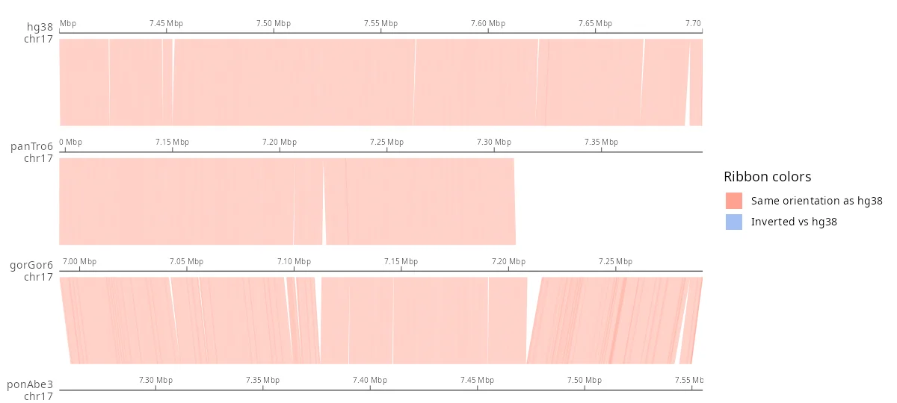</td></tr>
</table>

Each lane runs in its own genome's coordinates, every liftOver ribbon in hg38's orientation, with gaps where a genome lacks sequence the one above has.

```r
liftover <- function(genome, assembly) list(type = "PairwiseIndexedPAFAdapter",
  pifGzLocation = list(uri = e(sprintf("hg38To%s.over.pif.gz", genome))),
  index = list(
    location = list(uri = e(sprintf("hg38To%s.over.pif.gz.csi", genome))),
    indexType = "CSI"),
  assemblyNames = c(assembly, "hg38"))
primates <- list(type = "MultiPairwiseSyntenyAdapter", adapters = list(
  liftover("PanTro6", "panTro6"), liftover("GorGor6", "gorGor6"),
  liftover("PonAbe3", "ponAbe3")))
autoplot(jbrowse_multiway(primates, "chr17:7,400,001-7,700,000", "hg38",
  lanes = c("panTro6", "gorGor6", "ponAbe3"),
  display = list(ribbonColor = list(field = "strand"))))
```

```sh
jb2export --config gallery/jb2export/multiway.config.json \
  --assembly hg38 \
  --track primates \
  --loc chr17:7,400,001-7,700,000 \
  --width 1200 --out multiway.png
```

