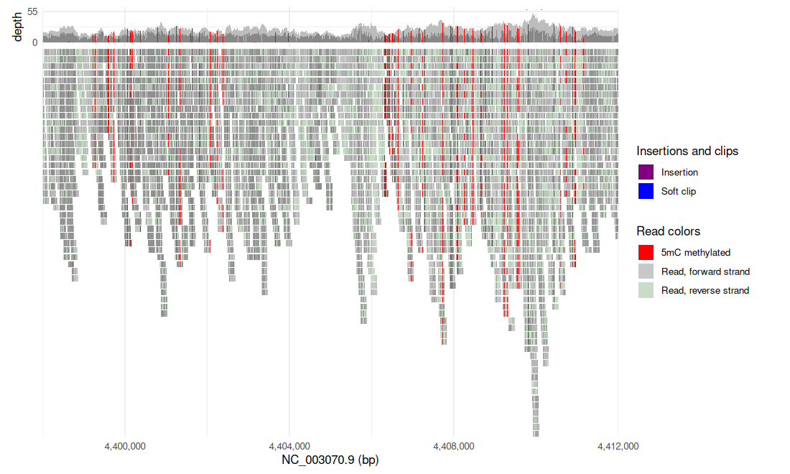
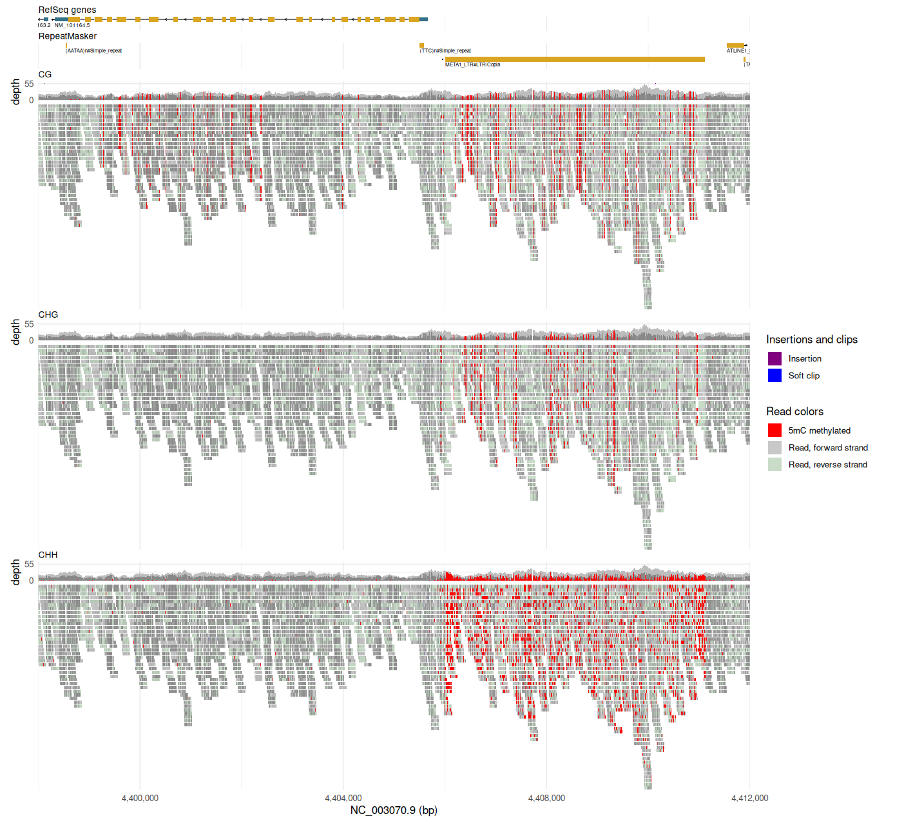
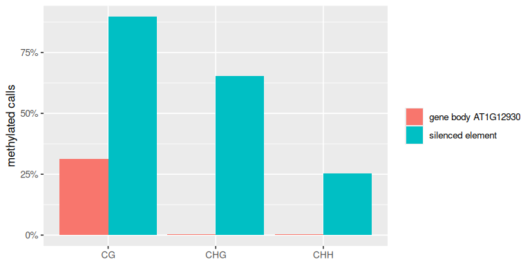

<!-- Generated by scripts/tutorials.R from tutorials/bisulfite.Rmd and GMOD/jbrowse-components's website/docs/tutorials/bisulfite.md at bc811717e7. Edit those, not this file. -->

# Methylation (bisulfite) in R

Whole-genome bisulfite sequencing (WGBS) and enzymatic methyl sequencing
(EM-seq) measure DNA methylation with short reads. We'll align an _Arabidopsis
thaliana_ WGBS run with bwameth, read the reads into R with ggjbrowse, and draw
each read's methylation in the CpG, CHG and CHH contexts as a ggplot. Then we'll
count the calls per context over a gene and a transposon, and check those
numbers against MethylDackel's.

- **In:** a WGBS or EM-seq BAM or CRAM, and the reference it was aligned to.
- **Out:** a data frame of every cytosine call on every read, and a figure you
  restyle with ggplot2.
- **No methylation caller runs first:** ggjbrowse runs JBrowse's own engine,
  which calls each cytosine from the C→T changes in the reads, so the BAM needs
  no base-modification tags (`MM`/`ML`).

The same analysis in the JBrowse app is the
[bisulfite tutorial](https://jbrowse.org/jb2/docs/tutorials/bisulfite/).

## Prerequisites

In R:

```r
install.packages(c("remotes", "ggplot2", "dplyr"))
remotes::install_github("GMOD/ggjbrowse")
```

To align your own run, which the code below skips by reading a hosted clip:

- the NCBI
  [`datasets`](https://www.ncbi.nlm.nih.gov/datasets/docs/v2/download-and-install/)
  CLI, and `wget`
- [Trim Galore](https://www.bioinformatics.babraham.ac.uk/projects/trim_galore/)
  (with cutadapt)
- [bwameth](https://github.com/brentp/bwa-meth)
- [samtools](http://www.htslib.org/)
- [MethylDackel](https://github.com/dpryan79/MethylDackel), for the
  [conversion-rate check](#checking-the-bisulfite-conversion-rate) and the
  per-position calls we check against

```bash
# Debian/Ubuntu
sudo apt install samtools tabix nodejs
# or conda, which has every tool above
conda install -c bioconda -c conda-forge samtools htslib nodejs \
  ucsc-bedgraphtobigwig ncbi-datasets-cli
# or Linux x86_64 binaries for the tools apt lacks
wget -P ~/.local/bin \
  https://hgdownload.soe.ucsc.edu/admin/exe/linux.x86_64/bedGraphToBigWig \
  https://ftp.ncbi.nlm.nih.gov/pub/datasets/command-line/v2/linux-amd64/datasets \
  https://ftp.ncbi.nlm.nih.gov/pub/datasets/command-line/v2/linux-amd64/dataformat
chmod +x ~/.local/bin/bedGraphToBigWig ~/.local/bin/datasets ~/.local/bin/dataformat
# any platform
npm install -g @jbrowse/cli
```

## The data

TAIR10 (RefSeq `GCF_000001735.4`) and one wild-type Col-0 WGBS run from the
European Nucleotide Archive, `DRR029742` (paired-end 150 bp).

This page reads the aligned reads over one 14 kb window from a clip on
jbrowse.org, so every chunk runs without the alignment step. The
[build script](https://jbrowse.org/jb2/docs/tutorials/bisulfite/#reproduce-it-end-to-end) fetches everything itself. To produce
the BAM, supply your own bisulfite FASTQ and reference.

| What it is                                                                            | File                                                                                                            |
| ------------------------------------------------------------------------------------- | --------------------------------------------------------------------------------------------------------------- |
| The TAIR10 reference the reads align to, fetched by accession with the `datasets` CLI | [GCF_000001735.4_TAIR10.1/](https://ftp.ncbi.nlm.nih.gov/genomes/all/GCF/000/001/735/GCF_000001735.4_TAIR10.1/) |
| The WGBS run's paired-end reads                                                       | [DRR029742/](https://ftp.sra.ebi.ac.uk/vol1/fastq/DRR029/DRR029742/)                                            |

## What bisulfite data looks like

A chemical (sodium bisulfite) or enzymatic (APOBEC, in EM-seq) step converts
every unmethylated cytosine to uracil, which reads as T, and a methylated
cytosine still reads as C. Comparing each read to the reference recovers the
methylation: a C→T change means unmethylated, and a retained C means methylated.
JBrowse's engine makes that comparison per read, in the browser and in
ggjbrowse alike.

Plants methylate in three sequence contexts: CpG, CHG, and CHH (H is A, C, or
T). The engine calls one context at a time.

## Producing the BAM

The [reproduce script](https://jbrowse.org/jb2/docs/tutorials/bisulfite/#reproduce-it-end-to-end) trims the reads of
[`DRR029742`](https://www.ebi.ac.uk/ena/browser/view/DRR029742) with Trim Galore
and aligns them with [bwameth](https://github.com/brentp/bwa-meth), which C→T
converts reads and reference in silico and runs `bwa mem`. The BAM keeps the
original read sequences, so the C→T changes are still there for the engine to find;
Bismark BAMs work the same way. Trimming and alignment, on any pair of WGBS or
EM-seq FASTQs:

```bash
trim_galore --paired R1.fastq.gz R2.fastq.gz
# index once per reference: bwameth aligns against a C->T copy of it
bwameth.py index tair10.fa
# the BAM keeps the original read sequences for JBrowse to compare
bwameth.py --reference tair10.fa -t 8 R1_val_1.fq.gz R2_val_2.fq.gz \
  | samtools sort -o arabidopsis_wgbs.bam -
samtools index arabidopsis_wgbs.bam
```

`bwameth.py index` writes the converted reference beside the original, so that
directory has to be writable.

### Checking the bisulfite conversion rate

An unconverted cytosine is indistinguishable from a methylated one, so measure
the library's conversion rate first. The chloroplast is unmethylated, which
makes it the control:

```bash
MethylDackel extract --CHH -r NC_000932.1 -o conversion \
  tair10.fa arabidopsis_wgbs.bam
```

Column 4 of `conversion_CHH.bedGraph` is the methylated percentage at each
cytosine, which on an unmethylated sequence is the fraction the conversion
missed. Modern libraries convert above 99%. An organism with no plastid uses the
library's spike-in, usually unmethylated lambda or pUC19, added to the reference
as an extra contig.

### Optional aggregate methylation bigWigs from MethylDackel

[MethylDackel](https://github.com/dpryan79/MethylDackel) calls a per-position
methylation fraction in all three plant contexts, one bedGraph each, which
becomes a bigWig once the header line is dropped and the percentage column
kept. We'll read these three bigWigs back into R to check the per-read calls:

```bash
# CpG is emitted always; --CHG --CHH add the two plant contexts.
# -o fixes the output prefix, which the loop below reads back.
MethylDackel extract --CHG --CHH -o arabidopsis_wgbs \
  tair10.fa arabidopsis_wgbs.bam
samtools faidx tair10.fa
cut -f1,2 tair10.fa.fai > tair10.chrom.sizes  # two columns, not the .fai itself
for ctx in CpG CHG CHH; do
  # tail drops MethylDackel's track line; cut keeps the percentage column
  tail -n +2 arabidopsis_wgbs_${ctx}.bedGraph | cut -f1-4 |
    sort -k1,1 -k2,2n > ${ctx}.bg
  bedGraphToBigWig ${ctx}.bg tair10.chrom.sizes arabidopsis_wgbs_${ctx}.bw
done
```

## Reading the reads into R

We'll start by reading the reads over the window the website tutorial opens
on, `NC_003070.9:4,398,001-4,412,000`. It holds the gene AT1G12930
(RefSeq `NM_101164.5`) on the left and a transposon on the right.

- **`assembly`:** a CRAM stores its reads against a reference, here TAIR10's
  2bit from the UCSC genome browser. A BAM needs it only for `bisulfite`
  coloring, which reads each cytosine's context off the reference.
- **`display`:** the alignments track's settings, spelled as a JBrowse track
  config spells its `displayDefaults`.


``` r
library(ggjbrowse)
library(ggplot2)

tair10 <- "https://hgdownload.soe.ucsc.edu/hubs/GCF/000/001/735/GCF_000001735.4"
tair10_2bit <- file.path(tair10, "GCF_000001735.4.2bit")
cram <- "https://jbrowse.org/demos/bisulfite/arabidopsis_wgbs_bisulfite.cram"
locus <- "NC_003070.9:4,398,001-4,412,000"

cg <- jbrowse_alignments(cram, locus, assembly = tair10_2bit,
  display = list(pileup = list(bases = list(show = TRUE, encoding = list(color = "bisulfite"))),
    modifications = list(cytosineContext = "CG")))
```

In [grammar-of-graphics](https://jbrowse.org/jb2/docs/config_guides/mark_display) terms, `pileup.bases`
is a color channel for each base, here set from the `bisulfite` field.
[`cytosineContext`](https://jbrowse.org/jb2/docs/config/linearalignmentsdisplay/#slot-modifications)
takes `CG`, `CHG`, `CHH` or `all`.

`autoplot()` draws the result as the browser draws the track: the coverage band
over the pileup, each methylated CpG painted red on its read.


``` r
autoplot(cg)
```



The figure is drawn from data frames you can use directly. `cg$modifications`
holds one row per call, with the read it sits on, which `cg$reads` places on
its pileup row:


``` r
head(cg$modifications[, c("position", "read", "name", "unmodified",
  "color")])
#>   position read name unmodified   color
#> 1  4398128   28  5mC      FALSE #ff0000
#> 2  4398627  102  5mC      FALSE #ff0000
#> 3  4398658  113  5mC      FALSE #ff0000
#> 4  4398734  119  5mC      FALSE #ff0000
#> 5  4398810  137  5mC      FALSE #ff0000
#> 6  4399223  171  5mC      FALSE #ff0000
```

## Gene body methylation and transposon silencing

Plants run two unrelated methylation programs, and the three contexts
distinguish them:

| Program                         | CpG | CHG | CHH | Effect on the locus                                                  |
| ------------------------------- | --- | --- | --- | -------------------------------------------------------------------- |
| Gene body methylation (gbM)     | yes | no  | no  | None obvious, the gene stays transcribed. Depleted at both gene ends |
| Transposon and repeat silencing | yes | yes | yes | Heterochromatin, transcriptionally off                               |

Red in the CpG context alone is gene body methylation, and red in all three
contexts is silencing.

### The three contexts over genes and repeats

We'll read the context the browser shows one track at a time into three
results, and the TAIR10 genome hub's RefSeq genes and RepeatMasker annotation
beside them:

- **Genes and repeats:** `jbrowse_features()` reads the hub's BigBed files by
  URL.
- **Long repeats only:** RepeatMasker's table is a data frame, so `subset()`
  keeps repeats longer than 1 kb, which drops the short simple repeats and keeps
  the LTR retrotransposon `META1_LTR#LTR/Copia`. No RefSeq transcript overlaps
  it.
- **Contexts:** `lapply()` reads the CRAM once per context.


``` r
bbi <- file.path(tair10, "bbi", "GCF_000001735.4_TAIR10.1.")
genes <- jbrowse_features(paste0(bbi, "ncbiRefSeq.bb"), locus)
repeats <- jbrowse_features(paste0(bbi, "rmsk.bb"), locus)
subset(repeats$features, end - start > 1000, c(name, start, end))
#>                  name   start     end
#> 3 META1_LTR#LTR/Copia 4406005 4411120

contexts <- c("CG", "CHG", "CHH")
reads <- lapply(contexts, function(context)
  jbrowse_alignments(cram, locus, assembly = tair10_2bit,
    display = list(pileup = list(bases = list(show = TRUE, encoding = list(color = "bisulfite"))),
      modifications = list(cytosineContext = context))))

fig <- jbrowse_stack(`RefSeq genes` = genes, RepeatMasker = repeats,
  setNames(reads, contexts))
```

`jbrowse_stack()` stacks them as the view does, each titled by its name.
AT1G12930 is red in CpG only, and the LTR/Copia element on the right is red in
all three:


``` r
fig
```



## Counting the calls per context

The figure is the reading; the numbers are the check. With
`unmodified = "calls"` the engine returns the unmethylated calls as well, one
row each with `unmodified = TRUE`, so the methylated share of a context is a
mean over a data frame.

We'll count over the two regions the build script compares, the gene body of
AT1G12930 and the silenced element:


``` r
library(dplyr)

regions <- data.frame(
  region = c("gene body AT1G12930", "silenced element"),
  from = c(4398322, 4406000), to = c(4405669, 4410000))

calls <- bind_rows(lapply(contexts, function(context) {
  r <- jbrowse_alignments(cram, locus, assembly = tair10_2bit,
    display = list(pileup = list(bases = list(show = TRUE, encoding = list(color = "bisulfite"))),
      modifications = list(cytosineContext = context, unmodified = "calls")))
  mutate(r$modifications, context = context, region = NULL)
}))

per_read <- calls |>
  inner_join(regions, by = join_by(between(position, from, to))) |>
  group_by(region, context) |>
  summarise(methylated = mean(!unmodified), calls = n(), .groups = "drop")
per_read
#> # A tibble: 6 × 4
#>   region              context methylated calls
#>   <chr>               <chr>        <dbl> <int>
#> 1 gene body AT1G12930 CG         0.313    2523
#> 2 gene body AT1G12930 CHG        0.00349  5441
#> 3 gene body AT1G12930 CHH        0.00471 19764
#> 4 silenced element    CG         0.897    1448
#> 5 silenced element    CHG        0.654    1332
#> 6 silenced element    CHH        0.254   12378
```


``` r
ggplot(per_read, aes(context, methylated, fill = region)) +
  geom_col(position = "dodge") +
  scale_y_continuous(labels = scales::percent) +
  labs(x = NULL, y = "methylated calls", fill = NULL)
```



Gene body methylation shows as CpG alone, and silencing as all three contexts,
the two programs in the table above.

### Checking against MethylDackel

MethylDackel calls the same cytosines independently, and jbrowse.org hosts the
three bigWigs the [aggregate step](#optional-aggregate-methylation-bigwigs-from-methyldackel)
writes. `jbrowse_wiggle()` reads them as one multi-row track, and each bin's
`score` is the percentage methylated:


``` r
demo <- "https://jbrowse.org/demos/bisulfite/arabidopsis_wgbs_"
methyldackel <- list(type = "MultiWiggleAdapter",
  subadapters = lapply(c("CpG", "CHG", "CHH"), function(context)
    list(type = "BigWigAdapter", name = context,
      bigWigLocation = list(uri = paste0(demo, context, ".bw")))))
aggregate <- jbrowse_wiggle(methyldackel, locus)

per_site <- aggregate$bins |>
  mutate(context = sub("CpG", "CG", source), region = NULL) |>
  inner_join(regions, by = join_by(between(start, from, to))) |>
  group_by(region, context) |>
  summarise(methyldackel = mean(score) / 100, .groups = "drop")

per_read |>
  select(region, context, ggjbrowse = methylated) |>
  inner_join(per_site, by = c("region", "context"))
#> # A tibble: 6 × 4
#>   region              context ggjbrowse methyldackel
#>   <chr>               <chr>       <dbl>        <dbl>
#> 1 gene body AT1G12930 CG        0.313        0.315  
#> 2 gene body AT1G12930 CHG       0.00349      0.00319
#> 3 gene body AT1G12930 CHH       0.00471      0.00465
#> 4 silenced element    CG        0.897        0.896  
#> 5 silenced element    CHG       0.654        0.672  
#> 6 silenced element    CHH       0.254        0.264
```

The two agree within two percentage points in every context. They differ at
all because the bigWig averages per cytosine across a bin, where the per-read
count weighs each cytosine by its coverage.

## Your own data

To run this on your own WGBS or EM-seq run:

- Align it as [above](#producing-the-bam), or use a Bismark BAM, which keeps
  the original read sequences too.
- Pass the BAM's path and the FASTA you aligned to:
  `jbrowse_alignments("my_wgbs.bam", "chr1:1-20000", assembly = "ref.fa", display = ...)`.
  A FASTA needs its `.fai`; a bgzipped one needs its `.gzi` as well.
- Name the locus the way the BAM's header names the chromosome. ggjbrowse has
  no alias table, so a BAM aligned to RefSeq TAIR10 takes `NC_003070.9`, not
  `chr1`.
- Set `cytosineContext` to `"all"` for every context at once.

The website's [build script](https://github.com/GMOD/jbrowse-components/blob/main/scripts/build_arabidopsis_wgbs.sh)
runs the whole alignment for this run and prints the conversion rate and the
per-context fractions.

## See also

- [Methylation (bisulfite)](https://jbrowse.org/jb2/docs/tutorials/bisulfite/),
  the same analysis in the JBrowse app
- [The ggjbrowse gallery](../gallery.md#bisulfite), which draws the CHH reads
  beside JBrowse's own picture
