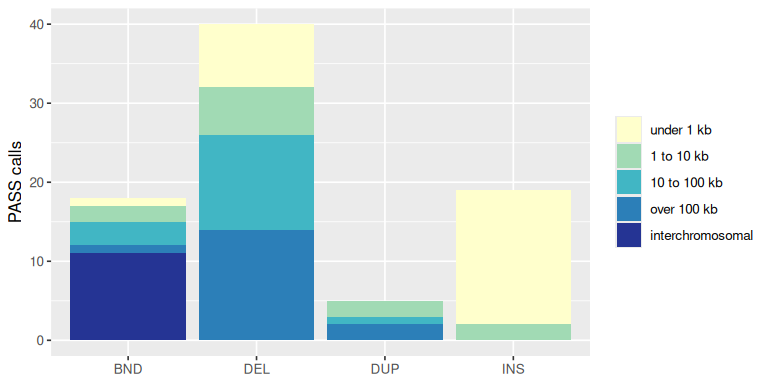
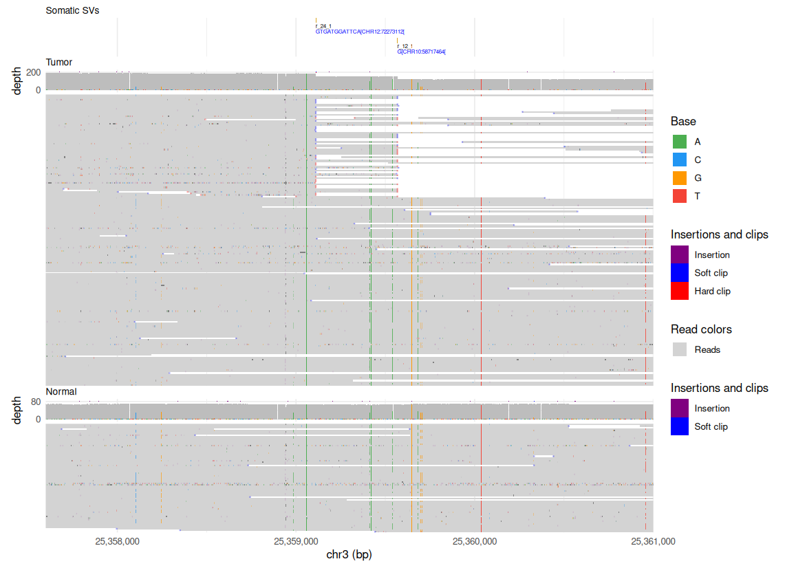
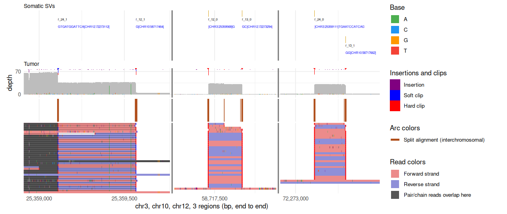
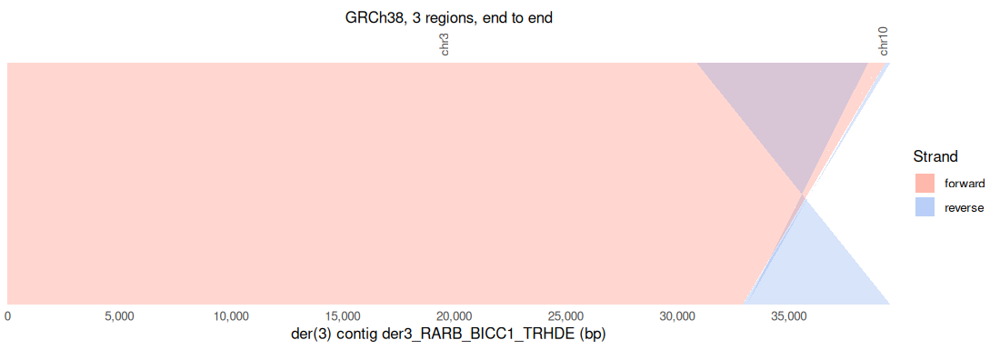
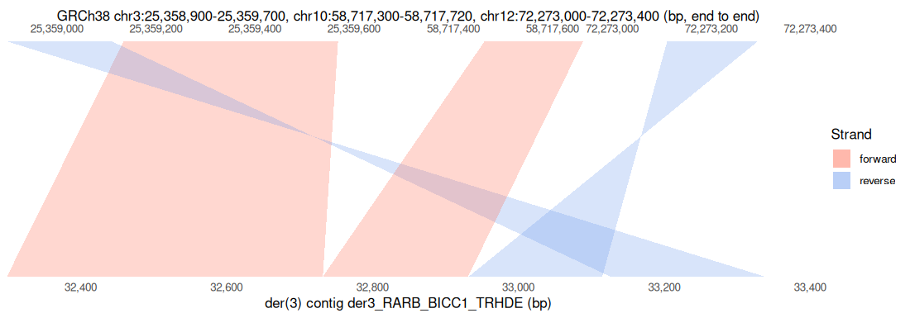

<!-- Generated by scripts/tutorials.R from tutorials/cancer_sv.Rmd and GMOD/jbrowse-components's website/docs/tutorials/cancer_sv.md at a618b83933. Edit those, not this file. -->

# Complex rearrangements and derivative alleles (COLO829) in R

A cancer genome can join pieces of several chromosomes into one molecule
through a chain of junctions. We'll follow one such chain in the COLO829
melanoma cell line in R: tabulate ONT's somatic SV calls, walk the chain across
chr3, chr10 and chr12 in the callset, count the tumor reads that split at each
breakend against the matched normal, and draw the reads and the derivative
allele assembled from them with ggjbrowse.

- **In:** the somatic SV calls, tumor and matched-normal ONT reads, the
  derivative contig's alignment to GRCh38, and the multi-platform truth set.
- **Out:** a table of calls by type and size, the chain's six breakends with
  their read support, and ggplot figures of the reads and the allele.
- **The check:** the matched normal, which has no split read at any breakend,
  and the truth set, which called each junction on other platforms.

The same analysis in the JBrowse app is the
[complex rearrangements tutorial](https://jbrowse.org/jb2/docs/tutorials/cancer_sv/).

## Prerequisites

In R:

```r
install.packages(c("remotes", "ggplot2", "dplyr", "tidyr", "readr"))
remotes::install_github("GMOD/ggjbrowse")
```

Every chunk reads its files by URL, so samtools and minimap2 stay out of it.
Only the optional `minimap2` command under
[the derivative allele](#the-derivative-allele) needs them.

## Where the data comes from

All but the last file come from the ONT COLO829 open-data release and its
`wf-somatic-variation` run; the last is the multi-platform truth set
([Valle-Inclán et al. 2022](https://doi.org/10.1016/j.xgen.2022.100139)).

The code below reads each of these files by URL, and reads the 3 GB FASTA by
range request, so R fetches only the bases it needs.

- COLO829 tumor reads (ONT R10, haplotagged):
  https://ont-open-data.s3.amazonaws.com/colo829_2024.03/wf_somatic_variation/sup/COLO829_tumor.ht.cram
- COLO829BL matched normal reads:
  https://ont-open-data.s3.amazonaws.com/colo829_2024.03/basecalls/colo829bl/sup/PAU59807.d052sup4305mCG_5hmCGvHg38.bam
- the somatic SV calls this page works from:
  https://ont-open-data.s3.amazonaws.com/colo829_2024.03/wf_somatic_variation/sup/COLO829.wf-somatic-sv.vcf.gz
- mosdepth coverage regions, tumor:
  https://ont-open-data.s3.amazonaws.com/colo829_2024.03/wf_somatic_variation/sup/COLO829/qc/coverage/COLO829_tumor.regions.bed.gz
- mosdepth coverage regions, normal:
  https://ont-open-data.s3.amazonaws.com/colo829_2024.03/wf_somatic_variation/sup/COLO829/qc/coverage/COLO829_normal.regions.bed.gz
- the GRCh38 build the CRAM decodes against, and the der(3) (derivative
  chromosome 3) contig aligns to:
  https://ont-open-data.s3.amazonaws.com/colo829_2024.03/wf_somatic_variation/sup/GCA_000001405.15_GRCh38_no_alt_analysis_set.fasta
- the COLO829 somatic SV truth set, lifted to GRCh38:
  https://zenodo.org/api/records/4716169/files/truthset_somaticSVs_COLO829_hg38lifted.vcf/content

The website page's track configs give each address above, which the code takes
as it stands:


``` r
tumor <- "https://ont-open-data.s3.amazonaws.com/colo829_2024.03/wf_somatic_variation/sup/COLO829_tumor.ht.cram"
normal <- "https://ont-open-data.s3.amazonaws.com/colo829_2024.03/basecalls/colo829bl/sup/PAU59807.d052sup4305mCG_5hmCGvHg38.bam"
calls_vcf <- "https://ont-open-data.s3.amazonaws.com/colo829_2024.03/wf_somatic_variation/sup/COLO829.wf-somatic-sv.vcf.gz"
truth_vcf <- "https://zenodo.org/api/records/4716169/files/truthset_somaticSVs_COLO829_hg38lifted.vcf/content"
```


``` r
library(ggjbrowse)
library(ggplot2)
library(dplyr)
library(tidyr)
library(readr)

reference <- paste0("https://ont-open-data.s3.amazonaws.com/colo829_2024.03/",
  "wf_somatic_variation/sup/GCA_000001405.15_GRCh38_no_alt_analysis_set.fasta")
```

## The somatic SV calls

nanomonsv's calls come as a VCF with one sample column, whose FORMAT holds the
tumor's read counts (`DP`, `AF`, `AD`) and the normal's (`NDP`, `NAF`, `NAD`).
`readr` reads the 260 KB file whole, and a breakend record writes its partner
into ALT:


``` r
info <- function(x, key) {
  value <- regmatches(x,
    regexec(paste0("(?:^|;)", key, "=([^;]*)"), x, perl = TRUE))
  vapply(value, function(m) if (length(m)) m[2] else NA_character_, "")
}

vcf <- read_tsv(calls_vcf, comment = "##", show_col_types = FALSE) |>
  rename(chrom = `#CHROM`, pos = POS, id = ID, filter = FILTER)
stopifnot(n_distinct(vcf$FORMAT) == 1)
counts <- do.call(rbind, strsplit(vcf$COLO829, ":"))
colnames(counts) <- strsplit(vcf$FORMAT[1], ":")[[1]]
partner <- "[\\[\\]](CHR[0-9XYM]+):([0-9]+)[\\[\\]]"

calls <- vcf |>
  transmute(chrom, pos, id, filter, type = info(INFO, "SVTYPE"),
    mate_id = info(INFO, "MATEID"),
    mate_chrom = sub("^CHR", "chr", sub(paste0(".*", partner, ".*"), "\\1",
      ifelse(type == "BND", ALT, NA), perl = TRUE)),
    mate_pos = as.numeric(sub(paste0(".*", partner, ".*"), "\\2",
      ifelse(type == "BND", ALT, NA), perl = TRUE)),
    length = case_when(
      type %in% c("DEL", "DUP") ~ abs(as.numeric(info(INFO, "SVLEN"))),
      type == "INS" ~ as.numeric(info(INFO, "SVINSLEN")),
      mate_chrom == chrom ~ abs(mate_pos - pos)),
    tumor_reads = as.integer(counts[, "AD"]),
    normal_reads = as.integer(counts[, "NAD"])) |>
  mutate(junction = if_else(type == "BND", pmin(id, mate_id), id))
count(distinct(calls, junction, .keep_all = TRUE), type, filter) |>
  pivot_wider(names_from = filter, values_from = n, values_fill = 0)
#> # A tibble: 4 × 4
#>   type   PASS Too_low_VAF Too_small_size
#>   <chr> <int>       <int>          <int>
#> 1 BND      18          15              0
#> 2 DEL      40          15              5
#> 3 DUP       5           2              0
#> 4 INS      19          12              4
```

The caller's `Too_low_VAF` and `Too_small_size` filters leave the `PASS`
calls, which we sort by size. A breakend pair is one junction, and a junction
between chromosomes has no size:


``` r
size_classes <- c("under 1 kb", "1 to 10 kb", "10 to 100 kb", "over 100 kb",
  "interchromosomal")
passed <- calls |>
  filter(filter == "PASS") |>
  distinct(junction, .keep_all = TRUE) |>
  mutate(size = factor(size_classes[ifelse(is.na(length), 5,
    cut(length, c(0, 1e3, 1e4, 1e5, Inf), labels = FALSE))],
    size_classes))
count(passed, type, size) |>
  pivot_wider(names_from = size, values_from = n, values_fill = 0)
#> # A tibble: 4 × 6
#>   type  `under 1 kb` `1 to 10 kb` `10 to 100 kb` `over 100 kb` interchromosomal
#>   <chr>        <int>        <int>          <int>         <int>            <int>
#> 1 BND              1            2              3             1               11
#> 2 DEL              8            6             12            14                0
#> 3 DUP              0            2              1             2                0
#> 4 INS             17            2              0             0                0
ggplot(passed, aes(type, fill = size)) +
  geom_bar() +
  scale_fill_brewer(palette = "YlGnBu") +
  labs(x = NULL, y = "PASS calls", fill = NULL)
```



## The rearrangement chain across chr3, chr10 and chr12

A series of junctions can bring two genes together, as in the KLHDC2-SNTB1
fusion of the SK-BR-3 breast cancer line
([Nattestad et al. 2018](https://doi.org/10.1101/gr.231100.117)). The chain this
page follows is COLO829's der(3), a derivative chromosome 3 assembled from
pieces of three chromosomes, whose three junctions close a triangle across chr3,
chr10 and chr12:

```text
chr3:25,359,111  <-> chr12:72,273,112
chr3:25,359,568  <-> chr10:58,717,464
chr10:58,717,662 <-> chr12:72,273,294
```

The genes involved are _RARB_ (a tumor suppressor) on chr3, _BICC1_ on chr10,
and _TRHDE_ on chr12.

## Walking the chain in the callset

A breakpoint split view stacks the loci a rearrangement visits, one panel per
locus, and draws the reads that leave one panel and arrive in another.

A breakend (BND) record names one partner, so on its own it opens two panels.
The dialog's **Follow further breakends at each end** adds the rest of the
chain by this search, which `walk()` below repeats in R:

- The dialog searches the callset at each end for another junction leaving from
  the same place and adds it when exactly one exists.
- The search stops at a locus with two candidates, or at one leading back into
  the chain.
- The search assumes two junctions leaving one locus belong to one molecule, and
  reads crossing both are the evidence.
- From the chr3 record this chain starts at, the search finds three panels: the
  chr10 breakend has a second junction a couple of hundred bases away, and its
  far end is on chr12.

The `PASS` breakend records are the search's pool. `walk()` starts at one
record, adds the locus its ALT names, and looks within `reach` bases of that
locus for a second junction:


``` r
junctions <- filter(calls, type == "BND", filter == "PASS")

walk <- function(start, reach = 300, rejoin = 1000) {
  here <- start
  panels <- tibble(chrom = start$chrom, pos = start$pos)
  repeat {
    far <- tibble(chrom = here$mate_chrom, pos = here$mate_pos)
    if (any(panels$chrom == far$chrom & abs(panels$pos - far$pos) <= rejoin)) {
      break
    }
    panels <- bind_rows(panels, far)
    onward <- filter(junctions, chrom == far$chrom,
      abs(pos - far$pos) <= reach, id != here$mate_id)
    if (nrow(onward) != 1) break
    here <- onward
  }
  panels
}

panels <- walk(filter(junctions, chrom == "chr3", pos == 25359568))
panels
#> # A tibble: 3 × 2
#>   chrom      pos
#>   <chr>    <dbl>
#> 1 chr3  25359568
#> 2 chr10 58717464
#> 3 chr12 72273294
```

The panels are the loci the chain visits. Every `PASS` breakend within a
kilobase of one belongs to the chain, and pairing each with its partner gives
the three junctions the website lists:


``` r
chain <- junctions |>
  inner_join(mutate(panels, lo = pos - 1000, hi = pos + 1000) |>
      select(chrom, lo, hi),
    by = join_by(chrom, between(pos, lo, hi))) |>
  distinct(id, .keep_all = TRUE) |>
  arrange(match(chrom, panels$chrom), pos) |>
  mutate(breakend = paste0(chrom, ":", pos),
    partner = paste0(mate_chrom, ":", mate_pos))
chain |> select(breakend, partner, type, tumor_reads, normal_reads)
#> # A tibble: 6 × 5
#>   breakend       partner        type  tumor_reads normal_reads
#>   <chr>          <chr>          <chr>       <int>        <int>
#> 1 chr3:25359111  chr12:72273112 BND            29            0
#> 2 chr3:25359568  chr10:58717464 BND            29            0
#> 3 chr10:58717464 chr3:25359568  BND            29            0
#> 4 chr10:58717662 chr12:72273294 BND            29            0
#> 5 chr12:72273112 chr3:25359111  BND            29            0
#> 6 chr12:72273294 chr10:58717662 BND            29            0
```

`tumor_reads` and `normal_reads` are the caller's own counts, `AD` and `NAD`,
which the read counts below check. Each junction appears at both of its ends:


``` r
c(breakends = nrow(chain), junctions = n_distinct(chain$junction))
#> breakends junctions 
#>         6         3
```

Reading RefSeq's hosted GFF3 over the chain's loci with `jbrowse_features()`
and joining on position names the gene each breakend sits in:


``` r
loci <- chain |>
  group_by(chrom) |>
  summarise(start = min(pos) - 200, end = max(pos) + 200) |>
  arrange(match(chrom, panels$chrom)) |>
  with(sprintf("%s:%d-%d", chrom, start, end))

refseq <- "https://jbrowse.org/ucsc/hg38/ncbiRefSeq.gff.gz"
genes <- jbrowse_features(refseq, loci, index = paste0(refseq, ".csi"))$features |>
  filter(gene)
chain |>
  inner_join(select(genes, chrom, gene = name, start, end),
    by = join_by(chrom, between(pos, start, end))) |>
  summarise(genes = paste(unique(gene), collapse = ", "), .by = chrom)
#> # A tibble: 3 × 2
#>   chrom genes           
#>   <chr> <chr>           
#> 1 chr3  RARB            
#> 2 chr10 BICC1, FAM133CP 
#> 3 chr12 TRHDE, TRHDE-AS1
```

The chr3 breakends are in _RARB_, the chr10 ones in _BICC1_ and the chr12 ones
in _TRHDE_, with a pseudogene, _FAM133CP_, and an antisense gene,
_TRHDE-AS1_, beside two of them.

## Coverage in the tumor and the normal

The demo's tumor and normal coverage tracks are the `wf-somatic-variation` run's
`mosdepth` output in 50 kb windows, converted to bigWig for the browser. `readr` reads the BED as it is.
We'll take the ratio of the two samples' depth per window, each over its own
median, and mark the chain's breakends on it:


``` r
mosdepth <- paste0("https://ont-open-data.s3.amazonaws.com/colo829_2024.03/",
  "wf_somatic_variation/sup/COLO829/qc/coverage/COLO829_%s.regions.bed.gz")
depth <- function(sample) read_tsv(sprintf(mosdepth, sample),
  show_col_types = FALSE, col_names = c("chrom", "start", "end", sample))
windows <- inner_join(depth("tumor"), depth("normal"),
  by = c("chrom", "start", "end")) |>
  filter(normal > 20) |>
  mutate(log2ratio = log2((tumor / median(tumor)) / (normal / median(normal))))

by_chrom <- function(x) mutate(x, chrom = factor(chrom, unique(panels$chrom)))
windows |>
  filter(chrom %in% panels$chrom) |>
  by_chrom() |>
  ggplot(aes((start + end) / 2e6, log2ratio)) +
  geom_point(size = 0.4) +
  geom_vline(aes(xintercept = pos / 1e6), colour = "red", data = by_chrom(chain)) +
  facet_wrap(~chrom, ncol = 1, scales = "free_x") +
  coord_cartesian(ylim = c(-2, 2)) +
  labs(x = "position (Mb)", y = "log2 tumor / normal depth")
```


The run of windows above a log2 ratio of 1 that holds the chr3 breakends has
these bounds:


``` r
chr3 <- windows |> filter(chrom == "chr3") |> arrange(start)
first_breakend <- min(chain$pos[chain$chrom == "chr3"])
at <- which(chr3$start < first_breakend & chr3$end >= first_breakend)
gain <- chr3$log2ratio > 1
run <- cumsum(!gain)
inside <- gain & run == run[at]
c(start = min(chr3$start[inside]), end = max(chr3$end[inside]),
  windows = sum(inside))
#>    start      end  windows 
#> 24500000 26650000       43
```

## Tumor and normal reads at the chr3 breakpoints

The ONT reads are aligned to GRCh38. Each read file needs its index beside
it, a `.crai` for the CRAM and a `.bai` for the BAM, and a CRAM needs the
FASTA it was encoded against as `reference`.

We'll read the SV calls and the tumor and normal reads at
`chr3:25,357,600-25,361,000`. The tumor reads end in soft clipping, an end the
aligner left unaligned, because every read crossing the junction continues on
another chromosome. The matched normal is clean.

The track menu's choices are `display` settings. `showSoftClipping` draws the
clipped ends, and a `sort` of `"split"` lifts the reads that continue on
another chromosome to the top. `featureHeight = 3` packs the pileup compact:


``` r
locus <- "chr3:25,357,600-25,361,000"
display <- list(showSoftClipping = TRUE, sort = list(type = "split"),
  featureHeight = 3)
fig <- jbrowse_stack(
  `Somatic SVs` = jbrowse_features(calls_vcf, locus, width = 1200),
  Tumor = jbrowse_alignments(tumor, locus, reference = reference,
    display = display),
  Normal = jbrowse_alignments(normal, locus, display = display))
```


``` r
fig
```



## Counting the split reads at each breakend

We'll count the reads in each sample that clip at least 100 bases within 25
bases of a breakend. The chain's three windows hold all six breakends, so one
read per sample covers them:


``` r
clipped_reads <- function(alignments, breakends, within = 25, at_least = 100) {
  clips <- alignments$clips |>
    filter(length >= at_least) |>
    left_join(select(alignments$reads, read, name), by = "read")
  unname(Map(function(chrom, pos)
    unique(clips$name[clips$chrom == chrom &
      abs(clips$position - pos) <= within]),
    breakends$chrom, breakends$pos))
}

window_reads <- list(
  tumor = jbrowse_alignments(tumor, loci, reference = reference,
    display = list(showCoverage = FALSE)),
  normal = jbrowse_alignments(normal, loci,
    display = list(showCoverage = FALSE)))
tumor_names <- clipped_reads(window_reads$tumor, chain)
normal_names <- clipped_reads(window_reads$normal, chain)
support <- chain |>
  transmute(breakend, tumor_clipped = lengths(tumor_names),
    normal_clipped = lengths(normal_names),
    caller_tumor = tumor_reads, caller_normal = normal_reads)
support
#> # A tibble: 6 × 5
#>   breakend       tumor_clipped normal_clipped caller_tumor caller_normal
#>   <chr>                  <int>          <int>        <int>         <int>
#> 1 chr3:25359111             32              0           29             0
#> 2 chr3:25359568             33              0           29             0
#> 3 chr10:58717464            33              0           29             0
#> 4 chr10:58717662            31              0           29             0
#> 5 chr12:72273112            29              0           29             0
#> 6 chr12:72273294            29              0           29             0
```

Each breakend has 29 to 33 tumor reads clipped at it and the normal has none at
any of the six. A read that crosses the whole chain clips at all six, and the
caller counts 29 at each:


``` r
length(Reduce(intersect, tumor_names))
#> [1] 29
```

## Following the chain across the three loci

`jbrowse_stack()` lays the three loci end to end, as the breakpoint split view
lays out its panels. `unit = "chain"` puts a read's split segments on one row
with a hairline across it, and `readConnections = "arc"` draws an arc for each
split between chromosomes:


``` r
chain_display <- list(unit = "chain", readConnections = "arc",
  color = list(field = "strand"), filter = list(split = "only"),
  featureHeight = 3)
fig <- jbrowse_stack(
  `Somatic SVs` = jbrowse_features(calls_vcf, loci, width = 1200),
  Tumor = jbrowse_alignments(tumor, loci, reference = reference,
    display = chain_display))
```


``` r
fig
```



## The derivative allele

The cancer SV demo config, https://jbrowse.org/demos/cancer_sv/config.json,
includes a der(3) contig assembled from the tumor reads that span all three
loci, so every base in it comes from those reads.

To build one from your own data, pull the reads crossing the loci with
`samtools view`, assemble them with
[Flye](https://github.com/mikolmogorov/Flye),
[Shasta](https://github.com/paoloshasta/shasta) or
[hifiasm](https://github.com/chhylp123/hifiasm), and align the contigs to the
reference:

```bash
# asm5: same-species preset; -c: base-level CIGAR, to draw junctions at base scale
# -s 50: asm5 keeps only chains scoring 200 or more, which drops the 199 bp
# chr10 and 184 bp chr12 inserts
minimap2 -cx asm5 -s 50 GRCh38.fa contigs.fa > der3.vs_reference.paf
```

The published contig aligns to the reference in four blocks:

```text
    derivative       0-32732   + -> chr3:25,326,821-25,359,568
    derivative   32732-32931   + -> chr10:58,717,463-58,717,662
    derivative   32932-33115   - -> chr12:72,273,111-72,273,294
    derivative   33126-39549   - -> chr3:25,352,683-25,359,111
```

The chr10 and chr12 pieces are templated insertions: stretches of other
chromosomes copied in where the break was repaired.

`jbrowse_synteny()` reads that PAF as it is. The demo hosts the indexed PIF its
build script makes from it, which holds the published contig's four blocks:


``` r
der3 <- "https://jbrowse.org/demos/cancer_sv/der3_RARB.vs_reference.pif.gz"
contig <- "der3_RARB_BICC1_TRHDE"
blocks <- jbrowse_synteny(der3, contig, c("chr3", "chr10", "chr12"))$alignments |>
  arrange(query_start) |>
  select(query_start, query_end, strand, target_chrom, target_start,
    target_end)
blocks
#>   query_start query_end strand target_chrom target_start target_end
#> 1           0     32732      1         chr3     25326821   25359568
#> 2       32732     32931      1        chr10     58717463   58717662
#> 3       32932     33115     -1        chr12     72273111   72273294
#> 4       33126     39549     -1         chr3     25352683   25359111
```

The website lists the same four blocks as `derivative` against GRCh38. The
table matches its coordinates, with the strand written as `+` and `-`:


``` r
listed <- tribble(
  ~query_start, ~query_end, ~strand, ~target_chrom, ~target_start, ~target_end,
  0, 32732, 1, "chr3", 25326821, 25359568,
  32732, 32931, 1, "chr10", 58717463, 58717662,
  32932, 33115, -1, "chr12", 72273111, 72273294,
  33126, 39549, -1, "chr3", 25352683, 25359111)
isTRUE(all.equal(as.data.frame(blocks), as.data.frame(listed),
  check.attributes = FALSE))
#> [1] TRUE
```

The ribbons color by strand. The top row lays the three source loci end to end
and the bottom row is the contig:


``` r
sources <- c("chr3:25,326,821-25,359,568", "chr10:58,717,463-58,717,662",
  "chr12:72,273,111-72,273,294")
allele <- jbrowse_synteny(der3, sources, contig, swap = TRUE, width = 1200,
  view = list(color = list(field = "strand")),
  labels = c(query = "der(3) contig", target = "GRCh38"))
autoplot(allele)
```



Zoomed to the kilobase around the junctions, the inserts have ribbons of their
own:


``` r
zoom <- jbrowse_synteny(der3, c("chr3:25,358,900-25,359,700",
  "chr10:58,717,300-58,717,720", "chr12:72,273,000-72,273,400"),
  paste0(contig, ":32,300-33,400"), swap = TRUE, width = 1200,
  view = list(color = list(field = "strand")),
  labels = c(query = "der(3) contig", target = "GRCh38"))
autoplot(zoom)
```



## Checking against the truth set

The truth set was called on five platforms before this ONT run existed, so
every junction has an independent call to check against.

The consensus was polished from these reads, so the realignment shows that they
agree with each other. The truth set, called from other platforms, is the
independent check.

The truth set names chromosomes without the `chr` prefix. We'll match each of
the chain's breakends to the nearest truth-set breakend on its chromosome:


``` r
truth <- read_tsv(truth_vcf, comment = "##", show_col_types = FALSE) |>
  transmute(chrom = paste0("chr", `#CHROM`), truth_pos = POS, truth_id = ID,
    platforms = info(INFO, "SUPP_SEQ"))
matched <- chain |>
  select(breakend, chrom, pos) |>
  inner_join(truth, by = "chrom", relationship = "many-to-many") |>
  mutate(distance = abs(pos - truth_pos)) |>
  slice_min(distance, by = breakend, n = 1, with_ties = FALSE)
matched |> select(breakend, truth_id, distance, platforms)
#> # A tibble: 6 × 4
#>   breakend       truth_id      distance platforms
#>   <chr>          <chr>            <dbl> <chr>    
#> 1 chr3:25359111  truthset_7_1         0 ILL      
#> 2 chr3:25359568  truthset_8_1         0 ILL,ONT  
#> 3 chr10:58717464 truthset_8_2         0 ILL,ONT  
#> 4 chr10:58717662 truthset_43_1        0 ILL      
#> 5 chr12:72273112 truthset_7_2         0 ILL      
#> 6 chr12:72273294 truthset_43_2        1 ILL
```

All six breakends have a truth-set call within a base. Putting the counts and
the matches in one line:


``` r
cat(sprintf(paste("%d breakends: %d tumor reads clipped at all of them,",
  "%d normal reads clipped at any; truth set within %d bp at %d of %d\n"),
  nrow(chain), length(Reduce(intersect, tumor_names)),
  length(unlist(normal_names)), max(matched$distance),
  sum(matched$distance <= 1), nrow(matched)))
#> 6 breakends: 29 tumor reads clipped at all of them, 0 normal reads clipped at any; truth set within 1 bp at 6 of 6
```

## Your own data

- Swap `calls_vcf`, `tumor`, `normal` and `reference` for your own files. A
  CRAM needs its `.crai` beside it and the FASTA it was encoded against as
  `reference`.
- Rename the caller's FORMAT fields in `counts`. Other callers write a
  breakend's partner into ALT the same way, but not tumor and normal counts
  into one sample column.
- Start `walk()` at any breakend record. `reach` and `rejoin` set how near a
  second junction must be to join the chain.
- Point `jbrowse_synteny()` at your own contig's PAF, or at the PIF that
  `jbrowse make-pif` writes from it.

## See also

- [Complex rearrangements and derivative alleles](https://jbrowse.org/jb2/docs/tutorials/cancer_sv/),
  the same analysis in the JBrowse app
- [COLO829 split reads](../gallery.md#long_reads_sv), the gallery's chained
  read figure
- [Differential transcript usage in R](dtu.md)

## Citations

- Valle-Inclán JE, et al. A multi-platform reference for somatic structural
  variation detection. _Cell Genomics_ (2022).
  https://doi.org/10.1016/j.xgen.2022.100139
- Nattestad M, et al. Complex rearrangements and oncogene amplifications
  revealed by long-read DNA and RNA sequencing of a breast cancer cell line.
  _Genome Research_ (2018). https://doi.org/10.1101/gr.231100.117
- Nattestad M, Aboukhalil R, Chin CS, Schatz MC. Ribbon: intuitive visualization
  for complex genomic variation. _Bioinformatics_ (2021).
  https://doi.org/10.1093/bioinformatics/btaa1080
