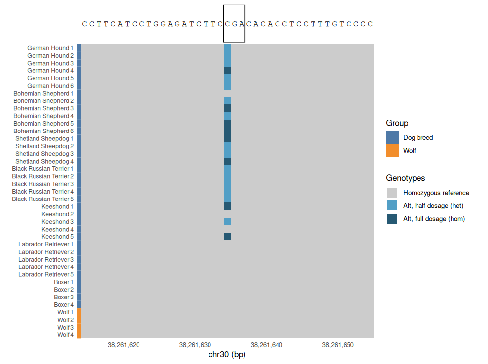
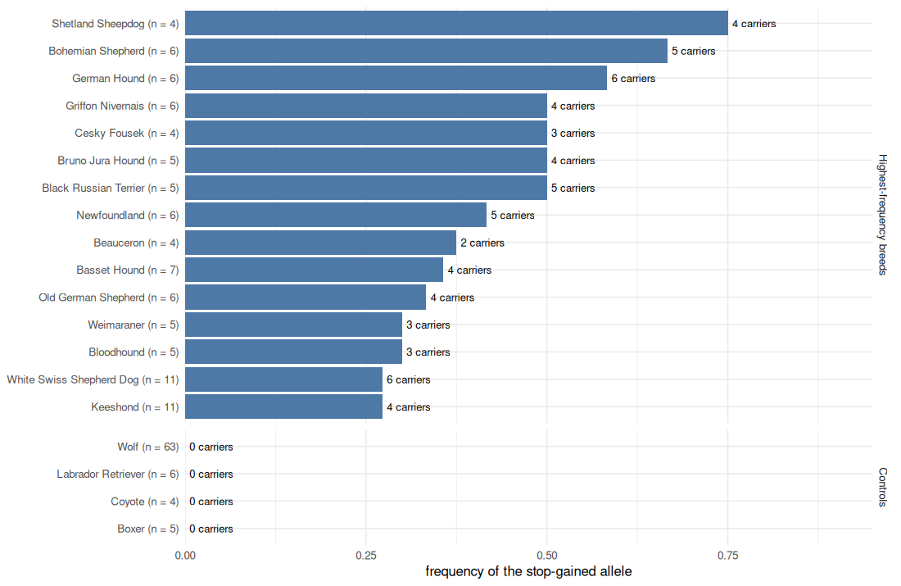

<!-- Generated by scripts/tutorials.R from tutorials/dog10k_lof.Rmd and GMOD/jbrowse-components's website/docs/tutorials/dog10k_lof.md at 297904d98d. Edit those, not this file. -->

# A loss-of-function allele across breeds (Dog10K) in R

Some dogs are poor metabolizers of the drugs the liver enzyme CYP1A2 clears,
because they have a premature stop codon in _CYP1A2_. The literature names the
variant only by its protein change. We'll do the whole analysis in R: derive
its genome coordinate by translating the reference coding sequence, read its
genotypes out of the 397 GB Dog10K SNV callset over HTTP, join them to the
sample table, and plot the allele's frequency per breed with ggjbrowse and
ggplot2, with the wild canids as the control. A copy-number figure then shows
the gene's expansion across the same animals.

- **In:** the Dog10K SNV callset and sample table, the canFam4 reference, and
  RefSeq's _CYP1A2_ exons.
- **Out:** the stop codon's coordinate, a genotype matrix of 39 animals, a
  per-breed allele-frequency figure and a copy-number figure.
- **The check:** the callset's own allele count at the stop site, which the
  genotypes we read have to add up to, and the Boxers, who stay at two copies.

The same analysis in the JBrowse app is the
[Dog10K loss-of-function tutorial](https://jbrowse.org/jb2/docs/tutorials/dog10k_lof/).

## Prerequisites

In R:

```r
install.packages(c("remotes", "ggplot2", "dplyr", "tidyr", "readr",
  "jsonlite"))
remotes::install_github("GMOD/ggjbrowse")
```

## The data

The Dog10K consortium's public share
([Meadows et al. 2023](https://doi.org/10.1186/s13059-023-03023-7)), read
directly over HTTP with no local copy of the 397 GB callset.

The code below reads each of these files by URL, so there is nothing to
download by hand.

| What it is                                                                          | File                                                                                                                                                            |
| ----------------------------------------------------------------------------------- | --------------------------------------------------------------------------------------------------------------------------------------------------------------- |
| The SNV/indel callset the gene is sliced from, 397 GB over 1,987 canids             | [AutoAndXPAR.SNPs.vqsr99.vcf.gz](https://kiddlabshare.med.umich.edu/dog10K/SNP_and_indel_calls_2021-10-17/AutoAndXPAR.SNPs.vqsr99.vcf.gz)                       |
| The sample table, breed and category per animal                                     | [dog10K-alignment-sample-table.2022-02-23-v7.txt](https://kiddlabshare.med.umich.edu/dog10K/sample-information/dog10K-alignment-sample-table.2022-02-23-v7.txt) |
| The reference sequence the stop codon is derived from, over UCSC's canFam4 REST API | [sequence](https://api.genome.ucsc.edu/getData/sequence?genome=canFam4;chrom=chr30;start=38258000;end=38265000)                                                 |
| The RefSeq gene structure that same derivation reads exon boundaries from           | [track](https://api.genome.ucsc.edu/getData/track?genome=canFam4;track=ncbiRefSeqCurated;chrom=chr30;start=38258000;end=38265000)                               |

## The CYP1A2 nonsense variant

_CYP1A2_ is a drug-metabolizing cytochrome P450 in which dogs have a nonsense
variant. The truncating allele acts recessively: liver microsomes from dogs
homozygous for it have no CYP1A2 protein and those dogs are poor metabolizers of
drugs the enzyme clears, while heterozygotes express the enzyme normally
([Mise et al. 2004](https://pubmed.ncbi.nlm.nih.gov/15564884/)). We ask which
breeds have the allele and whether wild canids do. Wolves are the control,
because an allele they share predates domestication.

## Deriving the stop codon's coordinate in R

The literature names this variant by its protein consequence, p.Arg373Ter. We'll rebuild _CYP1A2_'s coding sequence from the reference and the
RefSeq exon structure, then translate it to find codon 373.

`jbrowse_sequence()` reads the reference bases through JBrowse's own 2bit
reader, and UCSC's REST API serves the exon structure. Each exon is clipped to
the coding region, and the codons come out of a standard codon table:


``` r
library(ggjbrowse)
library(dplyr)
library(readr)
library(ggplot2)

twobit <- "https://hgdownload.soe.ucsc.edu/goldenPath/canFam4/bigZips/canFam4.2bit"
refseq <- paste0("https://api.genome.ucsc.edu/getData/track?genome=canFam4;",
  "track=ncbiRefSeqCurated;chrom=chr30;start=38258000;end=38265000")
window <- c(start = 38258000, end = 38265000)

tx <- jsonlite::fromJSON(refseq)$ncbiRefSeqCurated |>
  filter(startsWith(name, "NM_"))
exons <- tibble(
  start = as.integer(strsplit(tx$exonStarts, ",")[[1]]),
  end = as.integer(strsplit(tx$exonEnds, ",")[[1]])) |>
  mutate(start = pmax(start, tx$cdsStart), end = pmin(end, tx$cdsEnd)) |>
  filter(start < end)

reference <- strsplit(toupper(
  jbrowse_sequence(twobit, data.frame(chrom = "chr30",
    start = window[["start"]], end = window[["end"]]))), "")[[1]]
position <- unlist(Map(seq, exons$start, exons$end - 1))
cds <- paste(reference[position - window[["start"]] + 1], collapse = "")

first <- c("T", "C", "A", "G")
grid <- expand.grid(third = first, second = first, first = first)
code <- setNames(
  strsplit("FFLLSSSSYY**CC*WLLLLPPPPHHQQRRRRIIIMTTTTNNKKSSRRVVVVAAAADDEEGGGG",
    "")[[1]],
  paste0(grid$first, grid$second, grid$third))
codons <- substring(cds, seq(1, nchar(cds) - 2, 3), seq(3, nchar(cds), 3))
protein <- unname(code[codons])

stop_site <- position[3 * 373 - 2] + 1
cat(sprintf("%s CDS %d bp, %d codons\ncodon 373 = %s (%s) at chr30:%d\n",
  tx$name, nchar(cds), length(codons), codons[373], protein[373], stop_site))
#> NM_001008720.1 CDS 1539 bp, 513 codons
#> codon 373 = CGA (R) at chr30:38261635
```

The C>T at chr30:38,261,635 truncates the protein at residue 373 of 513.
Reading the callset at exactly that position finds it, passing every
filter.

`jbrowse_variants()` takes the 397 GB callset's URL and fetches the records
under one locus by range request, so a single base costs a few seconds. Each
record carries its `filter` and INFO fields as columns, and the table has a row
for every canid in the callset and a cell for each non-reference call:


``` r
callset <- "https://kiddlabshare.med.umich.edu/dog10K/SNP_and_indel_calls_2021-10-17/AutoAndXPAR.SNPs.vqsr99.vcf.gz"
everyone <- jbrowse_variants(callset, sprintf("chr30:%d-%d", stop_site, stop_site))
everyone$variants |> select(start, ref, alt, filter, AC, AN)
#>      start ref alt filter  AC   AN
#> 1 38261634   C   T   PASS 174 3974
everyone
#> <jbrowse_variants> chr30:38,261,635-38,261,635, 1 records, 1987 rows, 158 cells
```

## Slicing CYP1A2 out of the Dog10K SNV callset

The Dog10K SNV callset is a single 397 GB VCF over 1,987 canids with a tabix
index, so `bcftools` fetches one gene over HTTP:

```bash
SNVS=https://kiddlabshare.med.umich.edu/dog10K/SNP_and_indel_calls_2021-10-17/AutoAndXPAR.SNPs.vqsr99.vcf.gz
# --force-samples: proceed even if a name in cyp.samples isn't in the VCF's
# sample list, instead of exiting
bcftools view -r chr30:38258000-38265000 -S cyp.samples --force-samples \
  -Oz -o dog10k_cyp1a2_snvs.vcf.gz "$SNVS"
tabix -p vcf dog10k_cyp1a2_snvs.vcf.gz
```

`cyp.samples` holds breeds that have the allele, two that do not, and four Greek
gray wolves.

The figures below read a hosted copy of that slice, which JBrowse keeps beside its
test data:


``` r
slice <- "https://jbrowse.org/code/jb2/main/test_data/dog10k/dog10k_cyp1a2_snvs.vcf.gz"
```

## Genotypes across breeds and wolves

The slice's samples come from the Dog10K sample table, which gives each animal's
breed and category. The matrix labels each row with its breed, and
`rowColor` marks the rows by a `group` column of the `samples` file:


``` r
meta <- read_tsv("https://kiddlabshare.med.umich.edu/dog10K/sample-information/dog10K-alignment-sample-table.2022-02-23-v7.txt",
  show_col_types = FALSE) |>
  transmute(name = sampleName, breed = Breed.Type, category = Category)

locus <- "chr30:38,261,615-38,261,655"
slice_rows <- jbrowse_variants(slice, locus)$rows$sample
panel <- meta |>
  filter(name %in% slice_rows) |>
  arrange(match(name, slice_rows)) |>
  mutate(label = paste(ifelse(category == "Wolf", "Wolf", breed),
    ave(seq_along(name), breed, FUN = seq_along)))
```

Three other variants lie within about a hundred bases of the stop site, and the
filter below drops them. Dropping the filter shows them: two are reference
in every animal of this sample set, including the one at the codon's second
base, so each draws an empty column, and the third sits 15 bp along, and every
wolf has it.


``` r
nearby <- jbrowse_variants(slice, "chr30:38,261,590-38,261,690")
wolf_cells <- filter(nearby$cells, grepl("^CLUP", row))
nearby$variants |>
  mutate(carriers = tabulate(match(nearby$cells$variant, variant), n()),
    wolves = tabulate(match(wolf_cells$variant, variant), n())) |>
  select(start, ref, alt, carriers, wolves)
#>      start ref alt carriers wolves
#> 1 38261634   C   T       23      0
#> 2 38261635   G   A        0      0
#> 3 38261649   G   A       27      4
#> 4 38261661   A   G        0      0
```

The reference bases above the matrix come from the same 2bit. The box marks
codon 373, and the variant sits on its first base:


``` r
display <- list(
  filter = "jexl:feature.start == 38261634",
  rowHeight = 20,
  rowColor = list(field = "group"),
  rows = list(domain = panel$name,
    labels = setNames(as.list(panel$label), panel$name)))

samples_file <- tempfile(fileext = ".tsv")
write_tsv(mutate(panel, group = ifelse(category == "Breed_Dogs", "Dog breed",
  category)), samples_file)
genotypes <- jbrowse_variants(slice, locus, samples = samples_file,
  display = display)

bases <- strsplit(jbrowse_sequence(twobit, "chr30:38,261,615-38,261,655"), "")[[1]]
codon <- ggplot(tibble(x = 38261614 + seq_along(bases) - 0.5, base = bases),
  aes(x, 1, label = base)) +
  annotate("rect", xmin = 38261634, xmax = 38261637, ymin = 0.5, ymax = 1.5,
    fill = NA, colour = "black") +
  geom_text(family = "mono", size = 4) +
  theme_void() +
  ylim(0.5, 1.5)
fig <- jbrowse_stack(codon, genotypes)
```


``` r
fig
```



## Allele frequency per breed

The callset read at the stop site above covers every canid, so R can join it to
the sample table and count alleles. A homozygous call counts twice, and a canid
with no cell is homozygous reference:


``` r
calls <- everyone$cells |>
  inner_join(filter(everyone$variants, start == stop_site - 1) |>
    select(variant), by = "variant") |>
  transmute(name = as.character(row), alt = round(dosage * 2))

alleles <- tibble(name = everyone$rows$sample) |>
  left_join(calls, by = "name") |>
  mutate(alt = coalesce(alt, 0)) |>
  left_join(meta, by = "name") |>
  mutate(group = ifelse(category == "Breed_Dogs", breed, category))

frequency <- alleles |>
  filter(category %in% c("Breed_Dogs", "Wolf", "Coyote")) |>
  group_by(group, category) |>
  summarise(animals = n(), carriers = sum(alt > 0), homozygous = sum(alt == 2),
    frequency = sum(alt) / (2 * n()), .groups = "drop")

frequency |>
  filter(category == "Breed_Dogs", animals >= 4) |>
  slice_max(frequency, n = 8, with_ties = FALSE)
#> # A tibble: 8 × 6
#>   group                 category   animals carriers homozygous frequency
#>   <chr>                 <chr>        <int>    <int>      <int>     <dbl>
#> 1 Shetland Sheepdog     Breed_Dogs       4        4          2     0.75 
#> 2 Bohemian Shepherd     Breed_Dogs       6        5          3     0.667
#> 3 German Hound          Breed_Dogs       6        6          1     0.583
#> 4 Black Russian Terrier Breed_Dogs       5        5          0     0.5  
#> 5 Bruno Jura Hound      Breed_Dogs       5        4          1     0.5  
#> 6 Cesky Fousek          Breed_Dogs       4        3          1     0.5  
#> 7 Griffon Nivernais     Breed_Dogs       6        4          2     0.5  
#> 8 Newfoundland          Breed_Dogs       6        5          0     0.417
```

We'll draw the breeds with the highest frequency among those sampled at least
four times. The negative controls follow them: Labrador Retrievers and Boxers,
the two breeds the matrix shows without the allele, and the wolves and coyotes,
whose callset rows sit in the same table:


``` r
shown <- bind_rows(
  frequency |> filter(category == "Breed_Dogs", animals >= 4) |>
    slice_max(frequency, n = 15, with_ties = FALSE) |>
    mutate(kind = "Highest-frequency breeds"),
  frequency |> filter(group %in% c("Labrador Retriever", "Boxer", "Wolf",
    "Coyote")) |>
    mutate(kind = "Controls")) |>
  mutate(kind = factor(kind, c("Highest-frequency breeds", "Controls")),
    label = sprintf("%s (n = %d)", group, animals))

ggplot(shown, aes(frequency, reorder(label, frequency))) +
  geom_col(fill = "#4e79a7") +
  geom_text(aes(label = sprintf("%d carriers", carriers)), hjust = -0.1,
    size = 3) +
  facet_grid(kind ~ ., scales = "free_y", space = "free_y") +
  scale_x_continuous(limits = c(0, 0.95), expand = c(0, 0)) +
  labs(x = "frequency of the stop-gained allele", y = NULL) +
  theme_minimal()
```



Counting over the whole callset gives the allele's reach:


``` r
breeds <- frequency |> filter(category == "Breed_Dogs")
wild <- frequency |> filter(category != "Breed_Dogs")
tibble(
  breeds_with_allele = sprintf("%d of %d", sum(breeds$carriers > 0),
    nrow(breeds)),
  wild_carriers = sprintf("%d of %d", sum(wild$carriers), sum(wild$animals)),
  german_hounds = sprintf("%d of %d carry it",
    frequency$carriers[frequency$group == "German Hound"],
    frequency$animals[frequency$group == "German Hound"]),
  shetland_sheepdogs = sprintf("%d of %d carry it",
    frequency$carriers[frequency$group == "Shetland Sheepdog"],
    frequency$animals[frequency$group == "Shetland Sheepdog"]))
#> # A tibble: 1 × 4
#>   breeds_with_allele wild_carriers german_hounds   shetland_sheepdogs
#>   <chr>              <chr>         <chr>           <chr>             
#> 1 74 of 324          0 of 67       6 of 6 carry it 4 of 4 carry it
```

## Copy number at CYP1A2

The Dog10K paper reports half the collection at three or more copies of
_CYP1A2_. The per-animal estimates are unpublished, but the SNV callset records
a per-sample read depth (`DP`) at every site, so one slice of it, stripped to
that field, covers every canid in the collection:

```bash
# -r reads only the locus over HTTP; -x keeps FORMAT/DP and drops the rest
bcftools view -r chr30:38205000-38400000 -Ou "$SNVS" |
  bcftools annotate -x 'INFO,^FORMAT/DP' -Oz -o dp.vcf.gz
bcftools query -l dp.vcf.gz > cohort.samples
bcftools query -f '%POS[\t%DP]\n' dp.vcf.gz > cohort.dp
```

The build script converts depth to copy number within each dog, taking the
sequence around the element in that dog as two copies:

```text
CN = 2 * depth over the element / depth over the sequence around it
```

The flanking sequence should come back at two copies in every dog, which checks
the ratio.

Each window is 5 kb of depth stepped by 1 kb, so a call rests on 5 kb of
evidence and is painted at 1 kb resolution.

The build script's output is a BED with one row per animal and run of equal
copy number, the color in `itemRgb` and the rounded call in `copyNumber`. R
reads it as a table:


``` r
cohort <- read_tsv(
  "https://jbrowse.org/code/jb2/main/test_data/dog10k/dog10k_cyp1a2_cohort_cn.bed.gz",
  col_names = c("chrom", "start", "end", "name", "score", "strand",
    "thickStart", "thickEnd", "itemRgb", "name_sample", "copyNumber"),
  col_types = cols(itemRgb = "c", .default = col_guess())) |>
  rename(sample = name_sample) |>
  left_join(rename(meta, sample = name), by = "sample")

cn_palette <- c("CN 0" = "#2166ac", "CN 1" = "#92c5de", "CN 2" = "#e0e0e0",
  "CN 3" = "#f4a582", "CN 4" = "#d6604d", "CN 5" = "#b2182b",
  "CN 6+" = "#67001f")
```

The figure draws every Golden Retriever, Labrador Retriever and Boxer in the
collection, with the four Greek wolves from the genotype matrix and the four
coyotes as the wild canids. The black bar above the rows marks _CYP1A2_'s
coding sequence, and white stripes are windows with no call:


``` r
rows <- cohort |>
  mutate(row = case_when(
    breed %in% c("Golden Retriever", "Labrador Retriever", "Boxer") ~ breed,
    sample %in% sprintf("CLUPGR%06d", 1:4) ~ "Wolf",
    category == "Coyote" ~ "Coyote")) |>
  filter(!is.na(row)) |>
  mutate(row = factor(row, c("Golden Retriever", "Labrador Retriever", "Boxer",
    "Wolf", "Coyote"))) |>
  arrange(row, sample) |>
  mutate(y = n_distinct(sample) + 1 - match(sample, unique(sample)),
    call = factor(ifelse(copyNumber >= 6, "CN 6+", paste("CN", copyNumber)),
      names(cn_palette)))

ggplot(rows) +
  geom_rect(aes(xmin = start, xmax = end, ymin = y - 0.45, ymax = y + 0.45,
    fill = call)) +
  annotate("rect", xmin = min(exons$start), xmax = max(exons$end),
    ymin = max(rows$y) + 0.8, ymax = max(rows$y) + 1.2) +
  annotate("text", x = min(exons$start) - 1500, y = max(rows$y) + 1,
    label = "CYP1A2", fontface = "italic", hjust = 1, size = 3.5) +
  scale_fill_manual(values = cn_palette, drop = FALSE) +
  scale_y_continuous(breaks = tapply(rows$y, rows$row, mean),
    labels = levels(rows$row), expand = c(0, 0.3)) +
  scale_x_continuous(labels = scales::label_number(big.mark = ","),
    expand = c(0, 0)) +
  labs(x = "chr30", y = NULL, fill = "Copy number") +
  theme_minimal() +
  theme(panel.grid = element_blank())
```


A table makes the same reading at the gene's coding start, one call per animal:


``` r
at_gene <- rows |>
  filter(start <= min(exons$start), end > min(exons$start)) |>
  group_by(row) |>
  summarise(animals = n(), copy_numbers = paste(sort(unique(copyNumber)),
    collapse = ", "), .groups = "drop")
at_gene
#> # A tibble: 5 × 3
#>   row                animals copy_numbers
#>   <fct>                <int> <chr>       
#> 1 Golden Retriever         6 4           
#> 2 Labrador Retriever       6 3, 4, 5     
#> 3 Boxer                    5 2           
#> 4 Wolf                     4 4, 6        
#> 5 Coyote                   4 2
```

The depth-based estimate puts far more of the collection at three or more copies
than the paper reports. The two counts cover different intervals: the paper ran
QuicK-mer2 over an element whose extent is unpublished, and the build script
counts the windows the collection puts above two.

Here is how the collection splits at the gene:


``` r
cohort |>
  filter(start <= min(exons$start), end > min(exons$start)) |>
  summarise(animals = n(), three_or_more = sum(copyNumber >= 3),
    share = mean(copyNumber >= 3))
#> # A tibble: 1 × 3
#>   animals three_or_more share
#>     <int>         <int> <dbl>
#> 1    1987          1599 0.805
```

## The check

Two numbers test the figures' reading. The first is the callset's own count of
alleles at the stop site, which `bcftools query` prints from the same URL:

```bash
SNVS=https://kiddlabshare.med.umich.edu/dog10K/SNP_and_indel_calls_2021-10-17/AutoAndXPAR.SNPs.vqsr99.vcf.gz
bcftools query -r chr30:38261635 -f '%CHROM\t%POS\t%REF\t%ALT\t%FILTER\t%AC\t%AN\n' \
  "$SNVS"
# chr30  38261635  C  T  PASS  174  3974
```

`AC` counts the alt alleles and `AN` the alleles called. R read the same record's
INFO above, and the genotypes it counted per animal have to add up to both:


``` r
called <- 2 * nrow(everyone$rows) -
  2 * sum(grepl(".", everyone$cells$genotype, fixed = TRUE))
record <- filter(everyone$variants, start == stop_site - 1)
rbind(record = c(AC = unlist(record$AC), AN = record$AN),
  genotypes = c(AC = sum(alleles$alt), AN = called))
#>            AC   AN
#> record    174 3974
#> genotypes 174 3974
```

The second is the control of the copy-number figure. Every Boxer sits at two
copies where the Golden Retrievers sit at four or five:


``` r
at_gene |> filter(row %in% c("Boxer", "Golden Retriever"))
#> # A tibble: 2 × 3
#>   row              animals copy_numbers
#>   <fct>              <int> <chr>       
#> 1 Golden Retriever       6 4           
#> 2 Boxer                  5 2
```

## Reproducing the files with the build scripts

[`build_dog10k_cyp1a2.sh`](https://github.com/GMOD/jbrowse-components/blob/main/scripts/build_dog10k_cyp1a2.sh)
builds the genotype track. It:

1. derives the stop codon's position from the reference
2. builds the sample list from the Dog10K sample table and slices the gene out
   of the callset
3. prints the genotypes at the stop so you can check the figure against the data
4. genotypes that one site over all 1,987 canids for the breed and wild-canid
   counts this page computes in R

```bash
curl -fO https://raw.githubusercontent.com/GMOD/jbrowse-components/main/scripts/build_dog10k_cyp1a2.sh
bash build_dog10k_cyp1a2.sh   # writes ./dog10k_cyp1a2_build/
```

[`build_dog10k_cyp1a2_cn.sh`](https://github.com/GMOD/jbrowse-components/blob/main/scripts/build_dog10k_cyp1a2_cn.sh)
builds the copy-number tracks. It:

1. reads depth over the gene and the sequence around it from each of the 15
   published CRAMs, counting only positions RepeatMasker leaves unmasked, the
   same restriction QuicK-mer2's unique k-mers make
2. scales each window against that dog's own flanks, taken as two copies, and
   prints each dog's copy number over the element beside the spread of its
   flanks around two
3. takes the same ratio from the callset's per-sample depth for every canid, and
   prints how closely it agrees with the CRAM estimate in the 15 dogs
4. drops any flanking window whose median across the animals is off two, rounds
   the rest to whole copies, and writes one painted row per animal

```bash
curl -fO https://raw.githubusercontent.com/GMOD/jbrowse-components/main/scripts/build_dog10k_cyp1a2_cn.sh
bash build_dog10k_cyp1a2_cn.sh   # writes ./dog10k_cyp1a2_cn_build/
```

## Your own data

- Point `jbrowse_variants()` at your own bgzipped, indexed VCF. A tab-separated
  `samples` file with a `name` column and one column per attribute colors the
  rows through `rowColor`.
- Read a different site by changing `stop_site`. Derive it from a protein change
  with the same steps: exon starts and ends from the gene's annotation, the CDS
  translated, the codon's first base.
- `frequency` is a plain table. Group `alleles` by any column of your sample
  sheet to get the allele's frequency in that grouping.
- Keep a control group in the sample sheet, as the wolves are here, so the
  figure has a row that ought to come out empty.

## See also

- [Dog10K loss-of-function tutorial](https://jbrowse.org/jb2/docs/tutorials/dog10k_lof/),
  the same analysis in the JBrowse app
- [Variant matrices](../variants.md)

## Citations

- Meadows et al. (2023).
  [Genome sequencing of 2000 canids by the Dog10K consortium advances the understanding of demography, genome function and architecture](https://doi.org/10.1186/s13059-023-03023-7)
- Court (2013).
  [Canine cytochrome P450 pharmacogenetics](https://doi.org/10.1016/j.cvsm.2013.05.001)
