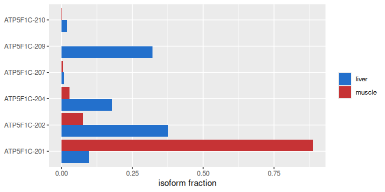
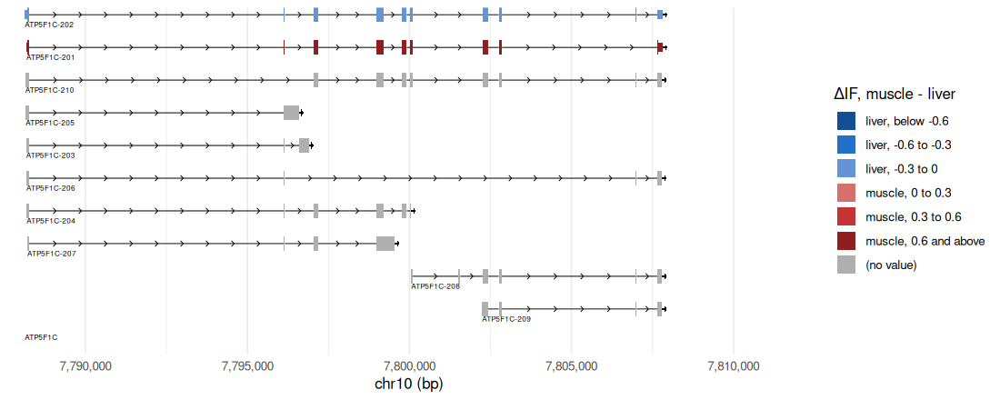
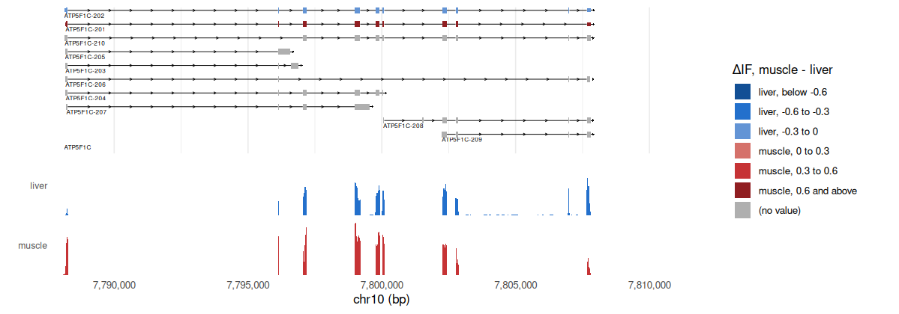

<!-- Generated by scripts/tutorials.R from tutorials/dtu.Rmd and GMOD/jbrowse-components's website/docs/tutorials/dtu.md at 557791197f. Edit those, not this file. -->

# Differential transcript usage in R

Differential transcript usage tests whether a gene changes which of its isoforms
it expresses between two conditions, here skeletal muscle and liver. We'll do
the whole analysis in R: read ENCODE's quantifications, test usage with satuRn,
write each transcript's statistic into the GENCODE GFF3, and draw _ATP5F1C_'s
isoforms colored by it over each tissue's RNA-seq coverage with ggjbrowse.

- **In:** RSEM per-transcript quantifications, and the GENCODE GFF3 they were
  made against.
- **Out:** a satuRn results table, a GFF3 that colors each isoform by its usage
  change, and ggplot figures of both.
- **The check:** each tissue's coverage over the exon that tells the isoforms
  apart, which satuRn never saw.

The first steps read 250 MB of quantifications and fit satuRn to every
transcript, a few minutes' work, so this page shows that code without running
it. From [Reading the statistics back](#reading-the-statistics-back) on, every
chunk runs, on the GFF3 the same code wrote from the same run.

The same analysis in the JBrowse app is the
[differential transcript usage tutorial](https://jbrowse.org/jb2/docs/tutorials/dtu/).

## Prerequisites

In R, from CRAN and Bioconductor:

```r
install.packages(c("remotes", "BiocManager", "ggplot2", "dplyr", "tidyr",
  "readr"))
BiocManager::install(c("satuRn", "SummarizedExperiment", "edgeR", "limma"))
remotes::install_github("GMOD/ggjbrowse")
```

htslib's `bgzip` and `tabix` index the GFF3 the analysis writes.

## The data

ENCODE's ENTEx panel, four skeletal-muscle and four liver donors, quantified
with RSEM against GENCODE v29.

You don't need these files to follow the page: the code below reads the
hosted results by URL. The [build script](https://jbrowse.org/jb2/docs/tutorials/dtu/#reproduce-it-end-to-end) fetches them to
rebuild those results. The test step takes any transcript-by-sample count matrix
with a sample table and a transcript-to-gene table.

| What it is                                                                                                      | File                                                                                                                                                                                                                                                                                                                                                                                                                                                                                                                                                                                                                                                                                                                                                                                                 |
| --------------------------------------------------------------------------------------------------------------- | ---------------------------------------------------------------------------------------------------------------------------------------------------------------------------------------------------------------------------------------------------------------------------------------------------------------------------------------------------------------------------------------------------------------------------------------------------------------------------------------------------------------------------------------------------------------------------------------------------------------------------------------------------------------------------------------------------------------------------------------------------------------------------------------------------- |
| Eight RSEM per-transcript quantification tables, the four muscle donors then the four liver donors: , , , , , , | [ENCFF353NZM.tsv](https://www.encodeproject.org/files/ENCFF353NZM/@@download/ENCFF353NZM.tsv)<br>[ENCFF172SLW.tsv](https://www.encodeproject.org/files/ENCFF172SLW/@@download/ENCFF172SLW.tsv)<br>[ENCFF140GJI.tsv](https://www.encodeproject.org/files/ENCFF140GJI/@@download/ENCFF140GJI.tsv)<br>[ENCFF576DOG.tsv](https://www.encodeproject.org/files/ENCFF576DOG/@@download/ENCFF576DOG.tsv)<br>[ENCFF996LRE.tsv](https://www.encodeproject.org/files/ENCFF996LRE/@@download/ENCFF996LRE.tsv)<br>[ENCFF641ADT.tsv](https://www.encodeproject.org/files/ENCFF641ADT/@@download/ENCFF641ADT.tsv)<br>[ENCFF392VYD.tsv](https://www.encodeproject.org/files/ENCFF392VYD/@@download/ENCFF392VYD.tsv)<br>[ENCFF383KWZ.tsv](https://www.encodeproject.org/files/ENCFF383KWZ/@@download/ENCFF383KWZ.tsv) |
| The GENCODE v29 annotation those quantifications were made against                                              | [gencode.v29.annotation.gff3.gz](https://ftp.ebi.ac.uk/pub/databases/gencode/Gencode_human/release_29/gencode.v29.annotation.gff3.gz)                                                                                                                                                                                                                                                                                                                                                                                                                                                                                                                                                                                                                                                                |

<details>
<summary>Read by URL (no download needed)</summary>

| What it is                                                                                                | File                                                                                                                                                                                                                                                                                                                                                                                                                     |
| --------------------------------------------------------------------------------------------------------- | ------------------------------------------------------------------------------------------------------------------------------------------------------------------------------------------------------------------------------------------------------------------------------------------------------------------------------------------------------------------------------------------------------------------------ |
| The four coverage bigWigs the demo's track config loads, one donor per tissue, plus and minus strand: , , | [ENCFF007ZBY.bigWig](https://www.encodeproject.org/files/ENCFF007ZBY/@@download/ENCFF007ZBY.bigWig)<br>[ENCFF518WGP.bigWig](https://www.encodeproject.org/files/ENCFF518WGP/@@download/ENCFF518WGP.bigWig)<br>[ENCFF565QRM.bigWig](https://www.encodeproject.org/files/ENCFF565QRM/@@download/ENCFF565QRM.bigWig)<br>[ENCFF253OSP.bigWig](https://www.encodeproject.org/files/ENCFF253OSP/@@download/ENCFF253OSP.bigWig) |

</details>

## Building the matrices

We'll start by reading the eight RSEM tables into two transcript-by-sample
matrices:

- **counts** from `expected_count`, which satuRn models
- **TPM**, which gives each transcript's isoform fraction, since a count-based
  fraction leans toward long isoforms
- **only `ENST` rows**: RSEM's tables carry the ERCC and phiX spike-ins too,
  which have no gene to take a share of


``` r
library(readr)
library(dplyr)
library(tidyr)
library(SummarizedExperiment)

samples <- tribble(
  ~tissue,  ~donor,        ~file,
  "muscle", "ENCDO271OUW", "ENCFF353NZM",
  "muscle", "ENCDO793LXB", "ENCFF172SLW",
  "muscle", "ENCDO845WKR", "ENCFF140GJI",
  "muscle", "ENCDO451RUA", "ENCFF576DOG",
  "liver",  "ENCDO575WHY", "ENCFF996LRE",
  "liver",  "ENCDO793LXB", "ENCFF641ADT",
  "liver",  "ENCDO575EGL", "ENCFF392VYD",
  "liver",  "ENCDO912EIY", "ENCFF383KWZ") |>
  mutate(sample = paste(tissue, donor, sep = "_"))

encode <- function(accession) sprintf(
  "https://www.encodeproject.org/files/%s/@@download/%s.tsv", accession,
  accession)

quant <- bind_rows(lapply(seq_len(nrow(samples)), function(i)
  read_tsv(encode(samples$file[i]), show_col_types = FALSE,
    col_select = c(transcript_id, gene_id, expected_count, TPM)) |>
    filter(startsWith(transcript_id, "ENST")) |>
    mutate(sample = samples$sample[i])))

as_matrix <- function(column) {
  wide <- quant |>
    select(transcript_id, sample, value = all_of(column)) |>
    pivot_wider(names_from = sample, values_from = value, values_fill = 0)
  m <- as.matrix(wide[samples$sample])
  rownames(m) <- wide$transcript_id
  m
}
cnt <- round(as_matrix("expected_count"))
tpm <- as_matrix("TPM")
txinfo <- distinct(quant, isoform_id = transcript_id, gene_id) |>
  as.data.frame()
rownames(txinfo) <- txinfo$isoform_id
txinfo <- txinfo[rownames(cnt), ]
coldata <- data.frame(tissue = samples$tissue, row.names = samples$sample)
```

ENCDO793LXB gave both a muscle and a liver sample, which is why each sample
takes its donor's name.

## Testing usage with satuRn

[satuRn](https://doi.org/10.12688/f1000research.51749.1) fits a
quasi-binomial model to each transcript's share of its gene's reads and tests
that share between the two tissues. It takes three inputs:

```r
# after filterByExpr, any gene left with one isoform goes too: usage is a
# within-gene proportion, so a lone isoform is always 100%
keep <- edgeR::filterByExpr(cnt, group = coldata$tissue)
cnt <- cnt[keep, ]
txinfo <- txinfo[rownames(cnt), ]
multi <- names(which(table(txinfo$gene_id) > 1))
txinfo <- txinfo[txinfo$gene_id %in% multi, ]
cnt <- cnt[txinfo$isoform_id, ]

# rowData has to carry isoform_id and gene_id: satuRn reads each transcript's
# gene from there, since usage is a share of the gene's reads
se <- SummarizedExperiment(
  assays = list(counts = cnt),
  colData = coldata,
  rowData = txinfo
)

# the formula names the colData column holding the groups. 0 + tissue drops the
# intercept, so each tissue gets its own coefficient and the contrast below is
# the difference between two of them
se <- satuRn::fitDTU(object = se, formula = ~ 0 + tissue, parallel = FALSE)

design <- model.matrix(~ 0 + tissue, data = coldata)
colnames(design) <- levels(factor(coldata$tissue))
L <- limma::makeContrasts(muscle_vs_liver = muscle - liver, levels = design)

# sort = FALSE leaves the result rows in the order the assay had them, which is
# what lets the isoform fractions be indexed straight into the result
se <- satuRn::testDTU(object = se, contrasts = L, sort = FALSE)
res <- rowData(se)[["fitDTUResult_muscle_vs_liver"]]
```

`res` holds, per transcript, the p-value, the regular and empirical FDRs and the
model estimates. We'll compute each transcript's isoform fraction, its
share of the gene's expression, from the TPM matrix.

The isoform-fraction change, `dIF`, is the mean fraction in muscle minus the
mean in liver:


``` r
fraction <- as.data.frame(tpm[rownames(cnt), ]) |>
  mutate(isoform_id = rownames(cnt), gene_id = txinfo$gene_id) |>
  pivot_longer(all_of(samples$sample), names_to = "sample",
    values_to = "tpm") |>
  group_by(gene_id, sample) |>
  mutate(fraction = tpm / sum(tpm)) |>
  ungroup() |>
  left_join(select(samples, sample, tissue), by = "sample") |>
  group_by(isoform_id, tissue) |>
  summarise(fraction = mean(fraction, na.rm = TRUE), .groups = "drop") |>
  pivot_wider(names_from = tissue, values_from = fraction,
    names_prefix = "IF_")

results <- data.frame(isoform_id = rownames(res),
  regular_FDR = res$regular_FDR) |>
  left_join(fraction, by = "isoform_id") |>
  mutate(dIF = IF_muscle - IF_liver)
```

satuRn's empirical FDR assumes most tests are null, which a contrast between
two tissues breaks, so the calls below gate on its regular FDR.

## Writing the statistics into GENCODE

The annotation has to be the release the
quantifications were made against:

We'll append each transcript's numbers to its row of the GENCODE v29 GFF3, and
two summaries to the row of each gene with a called transcript:

- **`dif`, `fdr` and `dtu`** on every tested transcript, `dtu` being `muscle`,
  `liver` or `ns`
- **`dif_called`** on the called transcripts only: an FDR under 0.05 and a
  fraction change over 0.1
- **`dtu_transcripts` and `dtu_top_dif`** on the gene: how many isoforms it
  calls, and the largest change among them
- **`na_matches = "never"`** in the joins, since every row but a transcript has
  no `transcript_id` to match on


``` r
gff_columns <- c("seqid", "source", "type", "start", "end", "score",
  "strand", "phase", "attributes")
attribute <- function(attributes, key) {
  value <- regmatches(attributes,
    regexec(paste0("(?:^|;)", key, "=([^;]*)"), attributes, perl = TRUE))
  vapply(value, function(m) if (length(m)) m[2] else NA_character_, "")
}

calls <- results |>
  filter(!is.na(regular_FDR), !is.na(dIF)) |>
  mutate(dtu = case_when(
    regular_FDR < 0.05 & dIF > 0.1 ~ "muscle",
    regular_FDR < 0.05 & dIF < -0.1 ~ "liver",
    .default = "ns"))

gencode <- read_tsv(paste0("https://ftp.ebi.ac.uk/pub/databases/gencode/",
  "Gencode_human/release_29/gencode.v29.annotation.gff3.gz"),
  comment = "#", col_names = gff_columns,
  col_types = cols(.default = "c")) |>
  mutate(transcript_id = if_else(type == "transcript",
    attribute(attributes, "transcript_id"), NA)) |>
  left_join(calls, by = c(transcript_id = "isoform_id"),
    na_matches = "never")

per_gene <- gencode |>
  filter(type == "transcript", dtu != "ns") |>
  group_by(gene_id = attribute(attributes, "Parent")) |>
  summarise(dtu_transcripts = n(), dtu_top_dif = dIF[which.max(abs(dIF))])

annotated <- gencode |>
  mutate(id = attribute(attributes, "ID")) |>
  left_join(per_gene, by = c(id = "gene_id"), na_matches = "never") |>
  mutate(attributes = paste0(attributes,
    if_else(is.na(dIF), "", sprintf(";dif=%.3f;fdr=%.3g;dtu=%s", dIF,
      regular_FDR, dtu)),
    if_else(!is.na(dtu) & dtu != "ns", sprintf(";dif_called=%.3f", dIF), ""),
    if_else(type == "gene" & !is.na(dtu_transcripts),
      sprintf(";dtu_transcripts=%d;dtu_top_dif=%.3f", dtu_transcripts,
        dtu_top_dif), ""))) |>
  arrange(seqid, as.integer(start), as.integer(end)) |>
  select(all_of(gff_columns))

write_lines("##gff-version 3", "dtu_muscle_vs_liver.gff3")
write_tsv(annotated, "dtu_muscle_vs_liver.gff3", append = TRUE,
  col_names = FALSE, escape = "none")
```

The rows come out in coordinate order, so indexing is the ordinary pair:

```bash
bgzip -f dtu_muscle_vs_liver.gff3
tabix -f -p gff dtu_muscle_vs_liver.gff3.gz
```

## The statistics in the attribute column

The track reads each transcript's statistics from the attribute column. A
transcript row from the finished file, wrapped:

```text
chr10  HAVANA  transcript  7788129  7807815  .  +  .
  ID=ENST00000356708.11;Parent=ENSG00000165629.19;gene_name=ATP5F1C;
  transcript_name=ATP5F1C-202;...;
  dif=-0.299;fdr=0.0022;if_muscle=0.075;if_liver=0.375;
  tpm_muscle=10.03;tpm_liver=28.88;dtu=liver;dif_called=-0.299
```

The transcript statistics sit on the transcript row, and the exons, CDS and UTRs
take the transcript value. The gene row has two more keys, which the track's
`mouseover` reads:

- `dtu_transcripts`, the count of called isoforms
- `dtu_top_dif`, the largest ΔIF among them

The keys are lowercase because the GFF parser lowercases them, so a color field
named `dIF` reads nothing and paints every transcript grey.

`dtu` is `muscle`, `liver` or `ns`, as the script above calls it. `dif_called`
is `dif` on the called transcripts and absent on the rest, so a transcript the
test could not separate has no value to color and stays grey.

## Reading the statistics back

From here on every chunk runs. The website's build script published the GFF3
this code writes, with a few more attributes and only the genes with a called
transcript. `jbrowse_features()` reads it back:

- **Given no region**, it reads the whole file, every contig the file lists.
- **`geneGlyphMode = "all"`** keeps every isoform of a gene, where the display
  would show fewer at this zoom.
- **Each transcript's attributes** are columns of `subfeatures`, keyed as the
  file writes them. A GFF3 declares no types, so `dif` and the rest arrive as
  text.


``` r
library(ggjbrowse)
library(ggplot2)
library(dplyr)

published <- "https://jbrowse.org/demos/dtu/dtu_muscle_vs_liver.gff3.gz"
annotation <- jbrowse_features(published,
  display = list(geneGlyphMode = "all"))

transcripts <- annotation$subfeatures |>
  filter(type == "transcript") |>
  arrange(chrom, start, end) |>
  as_tibble() |>
  transmute(gene = gene_name, transcript = transcript_name,
    dif = as.numeric(dif), fdr = as.numeric(fdr),
    muscle = as.numeric(if_muscle), liver = as.numeric(if_liver), dtu)
count(transcripts, dtu)
#> # A tibble: 4 × 2
#>   dtu        n
#>   <chr>  <int>
#> 1 liver    314
#> 2 muscle   317
#> 3 ns      1950
#> 4 <NA>    3137
```

_ATP5F1C_, an ATP synthase subunit, has one isoform called for each tissue:


``` r
atp5f1c <- filter(transcripts, gene == "ATP5F1C", !is.na(dif))
atp5f1c
#> # A tibble: 6 × 7
#>   gene    transcript     dif    fdr muscle liver dtu   
#>   <chr>   <chr>        <dbl>  <dbl>  <dbl> <dbl> <chr> 
#> 1 ATP5F1C ATP5F1C-202 -0.299 0.0022  0.075 0.375 liver 
#> 2 ATP5F1C ATP5F1C-210 -0.018 0.166   0.002 0.02  ns    
#> 3 ATP5F1C ATP5F1C-201  0.791 0.0203  0.888 0.097 muscle
#> 4 ATP5F1C ATP5F1C-204 -0.15  0.0754  0.029 0.178 ns    
#> 5 ATP5F1C ATP5F1C-207 -0.004 0.329   0.006 0.009 ns    
#> 6 ATP5F1C ATP5F1C-209 -0.321 0.319   0     0.321 ns
```

Each isoform's fraction in the two tissues, from the same table:


``` r
atp5f1c |>
  tidyr::pivot_longer(c(muscle, liver), names_to = "tissue",
    values_to = "fraction") |>
  ggplot(aes(fraction, transcript, fill = tissue)) +
  geom_col(position = "dodge") +
  scale_fill_manual(values = c(liver = "#2370cc", muscle = "#c63335")) +
  labs(x = "isoform fraction", y = NULL, fill = NULL)
```



## Coloring each isoform by its usage change

In [grammar-of-graphics](https://jbrowse.org/jb2/docs/config_guides/mark_display) terms,
`encoding.color` is a color scale: its `field`, `dif_called` (a called
transcript's isoform-fraction change), goes through the `threshold` cuts in
`scale.domain` to the colors in `scale.range`, liver-preferred below zero and
muscle-preferred above. A value on a cut takes the interval above it.

- The key lists every interval under the `legend.title`, plus a `(no value)` row
  for uncalled transcripts.
- A UTR follows `encoding.color` unless `utrColor` is set.

The track config's `uri` and `displayDefaults` become R values as they stand,
and `jbrowse_features()` reads the GFF3 with them:


``` r
gff <- "https://jbrowse.org/demos/dtu/dtu_muscle_vs_liver.gff3.gz"
display <- list(
  subfeatureLabels = "below",
  encoding = list(
    color = list(
      field = "dif_called",
      scale = list(
        type = "threshold",
        domain = c(-0.6, -0.3, 0, 0.3, 0.6),
        range = c("#124f95", "#2370cc", "#6394d5", "#d5716a", "#c63335", "#901e21"),
        names = c(
          "liver, below -0.6",
          "liver, -0.6 to -0.3",
          "liver, -0.3 to 0",
          "muscle, 0 to 0.3",
          "muscle, 0.3 to 0.6",
          "muscle, 0.6 and above"
        )
      ),
      legend = list(title = "ΔIF, muscle - liver")
    )
  ),
  labels = list(
    name = "jexl:feature.transcript_name||feature.gene_name||feature.name||feature.id"
  ),
  mouseover = "jexl:feature.gene_name+': '+feature.dtu_transcripts+' isoform(s) with a usage shift, largest ΔIF '+feature.dtu_top_dif"
)
```


``` r
locus <- "chr10:7,787,600-7,812,400"
genes <- jbrowse_features(gff, locus, display = display, width = 1200)
autoplot(genes)
```



## Coverage as the check

We'll read each tissue's RNA-seq coverage over the same window,
`chr10:7,787,600-7,812,400`, the whole of _ATP5F1C_.

`jbrowse_wiggle()` reads the two plus-strand bigWigs as one track with a row
per tissue on a shared axis, and `jbrowse_stack()` puts it under the
transcripts:


``` r
liver_plus <- "https://jbrowse.org/demos/dtu/ENCFF565QRM.liver.plus.bigWig"
muscle_plus <- "https://jbrowse.org/demos/dtu/ENCFF007ZBY.muscle.plus.bigWig"
```


``` r
coverage <- list(type = "MultiWiggleAdapter", subadapters = list(
  list(type = "BigWigAdapter", name = "liver", color = "#2370cc",
    bigWigLocation = list(uri = liver_plus)),
  list(type = "BigWigAdapter", name = "muscle", color = "#c63335",
    bigWigLocation = list(uri = muscle_plus))))
fig <- jbrowse_stack(genes,
  jbrowse_wiggle(coverage, locus, display = list(mark = "bar"), width = 1200))
```


``` r
fig
```



The exon that tells the two called isoforms apart is one ATP5F1C-202 has and
ATP5F1C-201 skips. Each box in `genes$rects` names its transcript by
`subfeature`, and a UTR box touching a CDS box is one exon, which we write in
GFF3's 1-based start. An anti-join on overlapping coordinates finds it:


``` r
exons <- genes$rects |>
  left_join(select(genes$subfeatures, subfeature, region,
    transcript = transcript_name), by = c("subfeature", "region")) |>
  filter(!is.na(transcript)) |>
  arrange(transcript, start) |>
  group_by(transcript) |>
  mutate(exon = cumsum(start > lag(cummax(end), default = -1L))) |>
  group_by(transcript, exon) |>
  summarise(start = min(start) + 1, end = max(end), .groups = "drop")
skips <- filter(exons, transcript == "ATP5F1C-201")
cassette <- exons |>
  filter(transcript == "ATP5F1C-202") |>
  anti_join(skips, by = join_by(overlaps(start, end, start, end)))
cassette |> select(transcript, start, end)
#> # A tibble: 1 × 3
#>   transcript    start     end
#>   <chr>         <dbl>   <int>
#> 1 ATP5F1C-202 7806974 7807010
```

We'll compare each tissue's depth over it with the exons on either side, which
both isoforms share:


``` r
flanks <- bind_rows(
  skips |> filter(end < cassette$start) |> slice_max(end),
  skips |> filter(start > cassette$end) |> slice_min(start))
windows <- bind_rows(
  mutate(select(flanks, start, end), exon = c("upstream", "downstream")),
  mutate(select(cassette, start, end), exon = "cassette"))

depth <- jbrowse_wiggle(coverage,
  data.frame(chrom = "chr10", start = windows$start - 1, end = windows$end),
  width = sum(windows$end - windows$start + 1))
depth$bins |>
  mutate(exon = windows$exon[region]) |>
  group_by(tissue = source, exon) |>
  summarise(depth = weighted.mean(score, end - start), .groups = "drop") |>
  tidyr::pivot_wider(names_from = exon, values_from = depth)
#> # A tibble: 2 × 4
#>   tissue cassette downstream upstream
#>   <chr>     <dbl>      <dbl>    <dbl>
#> 1 liver    7.19         6.47     4.78
#> 2 muscle   0.0611       1.89     5.20
```

Liver covers the cassette exon as deeply as its neighbours, and muscle, whose
dominant isoform skips it, barely covers it at all.

## Your own data

- Swap the `samples` table for your own quantifications. Any table with
  per-transcript counts and TPM works once its columns are renamed to
  `transcript_id`, `gene_id`, `expected_count` and `TPM`.
- Join against the GTF or GFF3 release your quantifier used, named on each
  ENCODE file page as its genome annotation.
- `formula` and the contrast name your own groups; `coldata` holds them.
- Point `jbrowse_features()` at your bgzipped, indexed GFF3. The `display`
  list colors any numeric attribute through `field`.

## See also

- [Differential transcript usage](https://jbrowse.org/jb2/docs/tutorials/dtu/),
  the same analysis in the JBrowse app
- [Methylation (bisulfite) in R](bisulfite.md)
- [Methylation (long-read) in R](methylation.md)

## Citations

- Gilis et al. (2021).
  [satuRn: Scalable analysis of differential transcript usage for bulk and single-cell RNA-sequencing applications](https://doi.org/10.12688/f1000research.51749.1),
  the method behind the statistic drawn here.
- Li and Dewey (2011).
  [RSEM: accurate transcript quantification from RNA-Seq data with or without a reference genome](https://doi.org/10.1186/1471-2105-12-323),
  the quantifier ENCODE ran.

[^tpm]:
    The script takes the isoform fraction from TPM, because read counts scale
    with effective length and bias a count-based fraction toward long isoforms.
    It gates on satuRn's regular FDR, because the empirical FDR assumes most
    tests are null and this contrast breaks that assumption.
