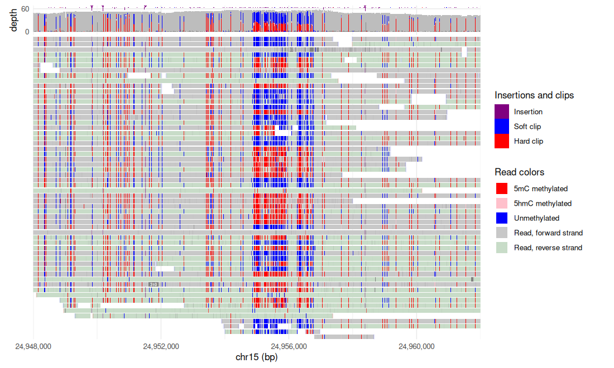
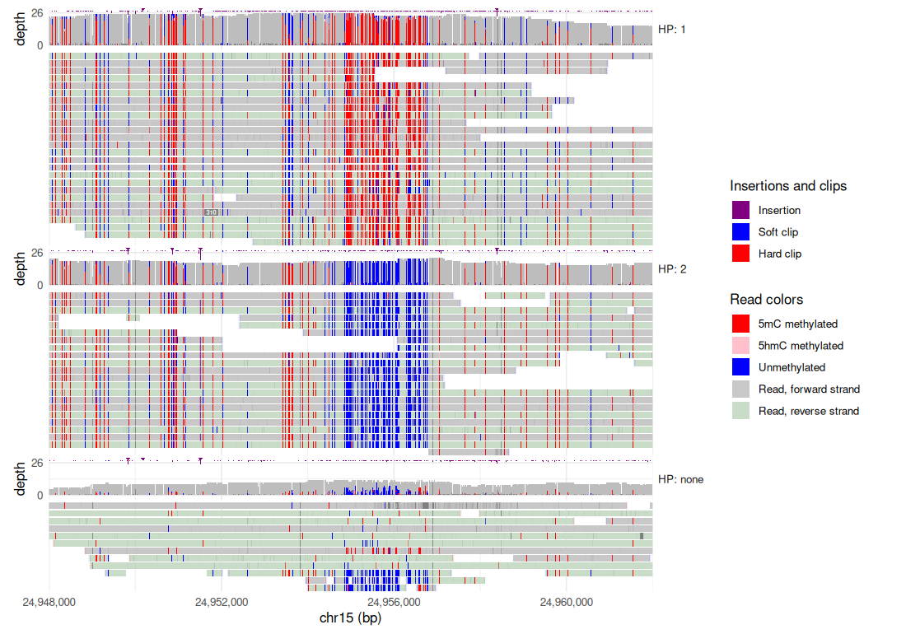
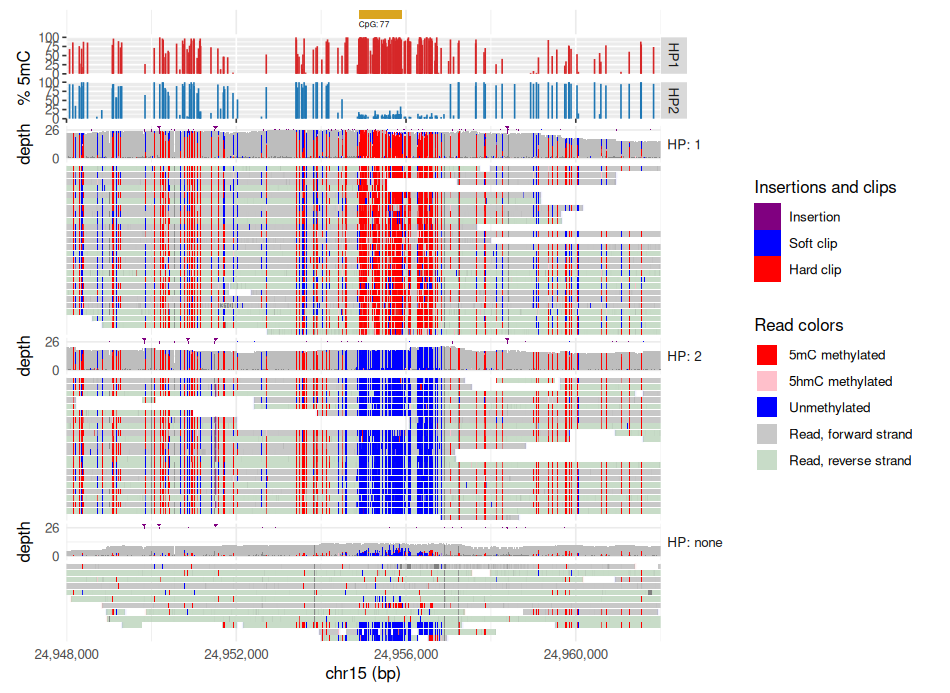
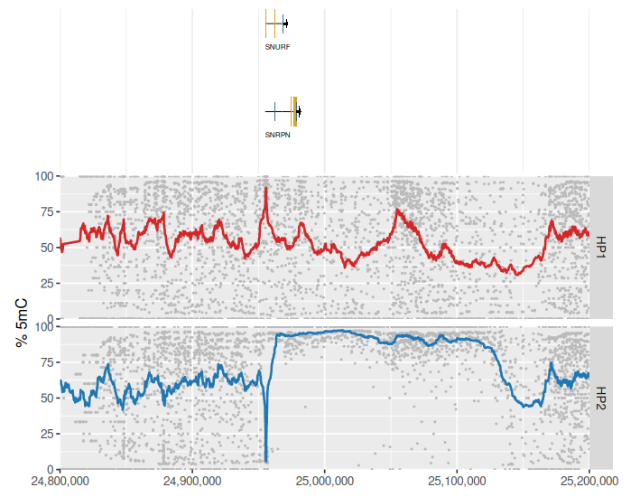
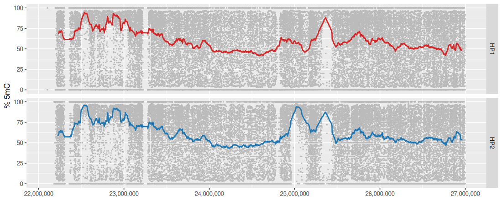

<!-- Generated by scripts/tutorials.R from tutorials/methylation.Rmd and GMOD/jbrowse-components's website/docs/tutorials/methylation.md at c0cfa906fe. Edit those, not this file. -->

# Methylation (long-read) in R

Nanopore and PacBio basecallers record each read's DNA methylation in
base-modification tags (`MM` and `ML`). We'll read those calls into R with
ggjbrowse for HG002 nanopore reads over the _SNRPN_ imprinting center, where one
parent's copy is methylated and the other's is not. We follow one dataset from
the per-read calls, to the two parental alleles split apart, to modkit's
per-CpG fractions, and end with a moving average of each allele across the
imprinted domain computed in R.

- **In:** a modBAM or modCRAM, and modkit's bedMethyl output.
- **Out:** a data frame of every read's 5mC calls, faceted by haplotype, and
  ggplot figures you restyle.
- **The check:** the reads and modkit's aggregate have to agree on which allele
  is methylated.

The same analysis in the JBrowse app is the
[long-read methylation tutorial](https://jbrowse.org/jb2/docs/tutorials/methylation/).

## Prerequisites

In R:

```r
install.packages(c("remotes", "ggplot2", "dplyr", "readr"))
remotes::install_github("GMOD/ggjbrowse")
```

For your own data:

- for your own data, long reads whose BAM or CRAM already has `MM`/`ML`
  modification tags, which modern ONT and PacBio basecallers write by default
- [modkit](https://github.com/nanoporetech/modkit/releases) 0.6 or later, Oxford
  Nanopore's single-binary tool for tallying per-read calls into per-CpG
  methylation fractions, for the aggregate section only
- [WhatsHap](https://whatshap.readthedocs.io/), to haplotag reads of your own
  that have no `HP` tag

```bash
pip install whatshap
```

## The data

The files are region slices of public
[ONT open data](https://labs.epi2me.io/dataindex/) on the `ont-open-data` S3
bucket.

Every chunk below reads region slices we host, cut from these files, by URL, so
no download is needed. Reads of your own with `MM` and `ML` tags load by swapping
`uri`, as _Per-read methylation from the alignments_ shows.

<details>
<summary>The files</summary>

| What it is                                                                                                                                                                                                         | File                                                                                                                                                                     |
| ------------------------------------------------------------------------------------------------------------------------------------------------------------------------------------------------------------------ | ------------------------------------------------------------------------------------------------------------------------------------------------------------------------ |
| The HP1 bedMethyl (per-CpG methylation fractions) from the `wf-human-variation` sup run on HG002, restricted to `m` (5mC) rows and cut to the SNRPN locus, and to chr15:22,000,000-27,000,000 for the last section | [SAMPLE.wf_mods.1.bedmethyl.gz](https://ont-open-data.s3.amazonaws.com/giab_2025.01/analysis/wf-human-variation/sup/HG002/PAW70337/output/SAMPLE.wf_mods.1.bedmethyl.gz) |
| The HP2 bedMethyl from that same run                                                                                                                                                                               | [SAMPLE.wf_mods.2.bedmethyl.gz](https://ont-open-data.s3.amazonaws.com/giab_2025.01/analysis/wf-human-variation/sup/HG002/PAW70337/output/SAMPLE.wf_mods.2.bedmethyl.gz) |
| The reads, from the HG002 sup basecalls, sliced to the same locus and haplotagged with `whatshap haplotag` against the phased SNP calls from that same `wf-human-variation` run                                    | [PAO83395.pass.cram](https://ont-open-data.s3.amazonaws.com/giab_2023.05/analysis/hg002/sup/PAO83395.pass.cram)                                                          |

</details>

## Per-read methylation from the alignments

Every figure until the last section is at `chr15:24,948,000-24,962,000`, the
_SNRPN_ imprinting center. We'll start by reading the reads with their 5mC
calls. The `display` list holds the alignments track's settings, as a JBrowse
track config spells them:

- **`pileup = list(bases = list(show = TRUE, encoding = list(color = "modifications")))`** paints each read with the
  calls its `MM`/`ML` tags hold, as **Color by → Modifications** does in the
  browser.
- **`unmodified = list(show = TRUE)`** also returns every CpG the tags left
  implicit as unmethylated, in blue, as the browser's **One color per type, plus
  low-probability & unmodified in blue** mode (IGV's "2-color" scheme) does.
  Without it a read with no methylation draws bare, and its CpGs are missing
  from the table.

A modBAM needs no `reference`: the tags hold the calls.


``` r
library(ggjbrowse)
library(ggplot2)
library(dplyr)

demo <- "https://jbrowse.org/demos/methylation/"
bam <- paste0(demo, "HG002_SNRPN_5mC_haplotagged.bam")
locus <- "chr15:24,948,000-24,962,000"

bases <- list(bases = list(show = TRUE,
  encoding = list(color = "modifications"), unmodified = list(show = TRUE)))
reads <- jbrowse_alignments(bam, locus, display = list(pileup = bases))
```


``` r
autoplot(reads)
```



Every call is a row of `reads$modifications`, with its read, its probability
and whether the call is unmodified:


``` r
reads$modifications |>
  count(name)
#>             name    n
#> 1           5hmC  277
#> 2            5mC 5885
#> 3 Unmodified 5mC 4189
```

The reads interleave methylated and unmethylated molecules, so the figure looks
mixed until the alleles come apart.

## Splitting the alleles apart

Each long read is one DNA molecule, so reads with an `HP` haplotype tag (from
WhatsHap, HiPhase or ONT's `wf-human-variation`) separate by allele. In
[grammar-of-graphics](https://jbrowse.org/jb2/docs/config_guides/mark_display) terms, `facet` splits the display into stacked
sections, one per value of a field, as **Group by** does in the browser.

We'll facet on the `HP` tag, which `tags.HP` names:


``` r
by_haplotype <- jbrowse_alignments(bam, locus,
  display = list(pileup = bases, facet = list(field = "tags.HP")))
by_haplotype$sections
#>   key    label
#> 1   1    HP: 1
#> 2   2    HP: 2
#> 3     HP: none
```

The pileup stacks into one section per haplotype, one methylated over the
island and the other unmethylated, and an `HP: none` section for the reads the
haplotagging could not assign:


``` r
autoplot(by_haplotype)
```



Each call names its read, whose section `reads` gives, so the split is also a
number.
We'll count the methylated share per haplotype over UCSC's CpG island here.
`!unmodified` counts 5mC and 5hmC calls alike, as modkit's `--combine-mods`
does in the next section:


``` r
ucsc <- "https://jbrowse.org/ucsc/hg38/"
islands <- jbrowse_features(paste0(ucsc, "cpgIslandExt.bed.gz"), locus,
  index = paste0(ucsc, "cpgIslandExt.bed.gz.csi"))
island <- islands$features[1, c("name", "start", "end")]
island
#>      name    start      end
#> 1 CpG: 77 24954888 24955907

reads_share <- by_haplotype$modifications |>
  filter(between(position, island$start, island$end)) |>
  inner_join(select(by_haplotype$reads, read, region, section),
    by = c("read", "region")) |>
  group_by(section) |>
  summarise(methylated = mean(!unmodified), calls = n())
reads_share
#> # A tibble: 3 × 3
#>   section  methylated calls
#>   <fct>         <dbl> <int>
#> 1 HP: 1        0.939   1913
#> 2 HP: 2        0.0145  1452
#> 3 HP: none     0.181    298
```

Reads of your own without an `HP` tag get one from `whatshap haplotag`, which
reads a phased VCF:

```bash
whatshap haplotag --reference reference.fa -o haplotagged.bam phased.vcf.gz reads.bam
samtools index haplotagged.bam
```

## Aggregate methylation with modkit bedMethyl

[modkit pileup](https://nanoporetech.github.io/modkit/) collapses the per-read
calls into a bedMethyl file with one row per CpG per modification type, each
holding the fraction of reads that were modified. The file is much smaller than
the reads.

```bash
# --cpg: count at CpG sites only
# --combine-strands: one row per CpG, the two strands summed
# --combine-mods with --modified-bases C: 5mC and 5hmC summed into one fraction
modkit pileup sample.bam output.bedmethyl --ref reference.fa \
  --cpg --combine-strands --combine-mods --modified-bases C
bgzip output.bedmethyl
tabix -p bed output.bedmethyl.gz
```

Two `modkit pileup` options shape the output:

- `--combine-mods` collapses 5mC and 5hmC into a single fraction
  (bisulfite-equivalent). Pass `--modified-bases 5mC 5hmC` without it to keep
  separate rows per modification type (`m` for 5mC, `h` for 5hmC)
- `--phased` writes one file per haplotype from the reads' `HP` tags, and this
  dataset uses it

With `--phased` the output argument is a directory, which gets `hp1.bedmethyl`,
`hp2.bedmethyl` and `combined.bedmethyl`:

```bash
modkit pileup sample.bam hp_bedmethyl/ --ref reference.fa \
  --cpg --combine-strands --combine-mods --modified-bases C --phased
```

A bedMethyl file is a tab-separated table, so `readr` reads it into a data
frame directly. modkit documents its 18 columns; the three we use are the
modification code, `n_valid_cov`, the reads that called the site, and
`fraction_modified`, the percent methylated:


``` r
library(readr)

bedmethyl_columns <- c("chrom", "start", "end", "code", "score", "strand",
  "thick_start", "thick_end", "rgb", "n_valid_cov", "fraction_modified",
  "n_mod", "n_canonical", "n_other_mod", "n_delete", "n_fail", "n_diff",
  "n_nocall")
read_bedmethyl <- function(haplotype, file) {
  read_tsv(file, col_names = bedmethyl_columns, show_col_types = FALSE) |>
    filter(code == "m") |>
    mutate(haplotype = haplotype)
}
snrpn <- bind_rows(
  read_bedmethyl("HP1", paste0(demo, "HG002_SNRPN_hp1.modkit.bed.gz")),
  read_bedmethyl("HP2", paste0(demo, "HG002_SNRPN_hp2.modkit.bed.gz")))
```

The reads and the aggregate should agree on which allele is methylated. We'll
weight each CpG's fraction by its coverage over the same island, so the two
numbers count the same calls:


``` r
modkit_share <- snrpn |>
  filter(between(start, island$start, island$end)) |>
  group_by(haplotype) |>
  summarise(methylated = weighted.mean(fraction_modified, n_valid_cov) / 100)
modkit_share
#> # A tibble: 2 × 2
#>   haplotype methylated
#>   <chr>          <dbl>
#> 1 HP1           0.916 
#> 2 HP2           0.0731
```

HP1 is methylated and HP2 is not, in the reads and in modkit alike.

### The profile over the reads

The bedMethyl table draws as any data frame does. We'll draw each CpG's
fraction as a bar, a row per haplotype on one 0 to 100 axis, and
`jbrowse_stack()` puts that plot of our own between the CpG island and the
faceted reads, on their axis:


``` r
haplotype_colours <- scale_colour_manual(
  values = c(HP1 = "#d62728", HP2 = "#1f77b4"), guide = "none")
profile <- ggplot(snrpn, aes(start, colour = haplotype)) +
  geom_segment(aes(xend = start, y = 0, yend = fraction_modified)) +
  haplotype_colours +
  facet_grid(haplotype ~ .) +
  scale_y_continuous(limits = c(0, 100)) +
  labs(y = "% 5mC")
fig <- jbrowse_stack(`CpG islands` = islands, `modkit 5mC` = profile,
  `HG002 ONT reads` = by_haplotype)
```


``` r
fig
```



## Smoothing across the imprinted domain

A single CpG's fraction rests on the few reads covering it, so per-site values
scatter from 0 to 100 and a difference spread over many sites is hard to see. A
moving average over a fixed number of neighbouring CpGs fixes that, and a CpG
island weighs as many sites as it holds. We'll read both haplotypes around
_SNRPN_ and compute the average in R.

`stats::filter()` sums a sliding window, so a coverage-weighted mean over the
50 CpGs on either side is two of those sums divided. `group_by()` keeps each
haplotype's average over its own CpGs:


``` r
moving_average <- function(value, weight, flank) {
  window <- rep(1, 2 * flank + 1)
  as.numeric(stats::filter(value * weight, window) /
    stats::filter(weight, window))
}

domain <- bind_rows(
  read_bedmethyl("HP1", paste0(demo, "HG002_chr15_imprinted_hp1.modkit.bed.gz")),
  read_bedmethyl("HP2", paste0(demo, "HG002_chr15_imprinted_hp2.modkit.bed.gz"))) |>
  arrange(haplotype, start) |>
  group_by(haplotype) |>
  mutate(meth = moving_average(fraction_modified, n_valid_cov, 50)) |>
  ungroup()
```

The figure is ordinary ggplot: each CpG in grey under its haplotype's average,
a row per haplotype, and the RefSeq genes from the hg38 hub above it.
`jbrowse_stack()` takes a ggplot of your own and draws it on the genes' axis:


``` r
window <- "chr15:24,800,000-25,200,000"
genes <- jbrowse_features(paste0(ucsc, "ncbiRefSeqSelect.gff.gz"), window,
  index = paste0(ucsc, "ncbiRefSeqSelect.gff.gz.csi"))

smoothed <- function(data) {
  ggplot(data, aes(start)) +
    geom_point(aes(y = fraction_modified), colour = "#bbbbbb", size = 0.3) +
    geom_line(aes(y = meth, colour = haplotype), linewidth = 0.8,
      na.rm = TRUE) +
    haplotype_colours +
    facet_grid(haplotype ~ .) +
    scale_x_continuous(labels = scales::label_comma()) +
    labs(x = NULL, y = "% 5mC")
}
fig <- jbrowse_stack(`RefSeq Select` = genes,
  smoothed(filter(domain, between(start, 24800000, 25200000))))
```


``` r
fig
```



At the _SNRPN_ promoter HP1 is methylated and HP2 unmethylated, as the reads
showed, and upstream of _SNRPN_ the two rows sit at about the same level.

A wider window takes the same data across the whole Prader-Willi and Angelman
domain. A 1,001-CpG average is one argument away:


``` r
domain |>
  group_by(haplotype) |>
  mutate(meth = moving_average(fraction_modified, n_valid_cov, 500)) |>
  smoothed()
```



## Your own data

To run this on your own reads:

- Pass your modBAM or modCRAM's path or URL to `jbrowse_alignments()`, with the
  `.bai` or `.crai` beside it. A CRAM also needs `reference =`.
- Facet on any tag your pipeline writes with `facet = list(field = "tags.XX")`.
- Read modkit's `--phased` output, `hp1.bedmethyl` and `hp2.bedmethyl`, with
  `read_bedmethyl()` above, bgzipped or not.

## See also

- [Methylation (long-read)](https://jbrowse.org/jb2/docs/tutorials/methylation/),
  the same analysis in the JBrowse app
- [Methylation (bisulfite) in R](bisulfite.md)
- [modkit documentation](https://nanoporetech.github.io/modkit/)
