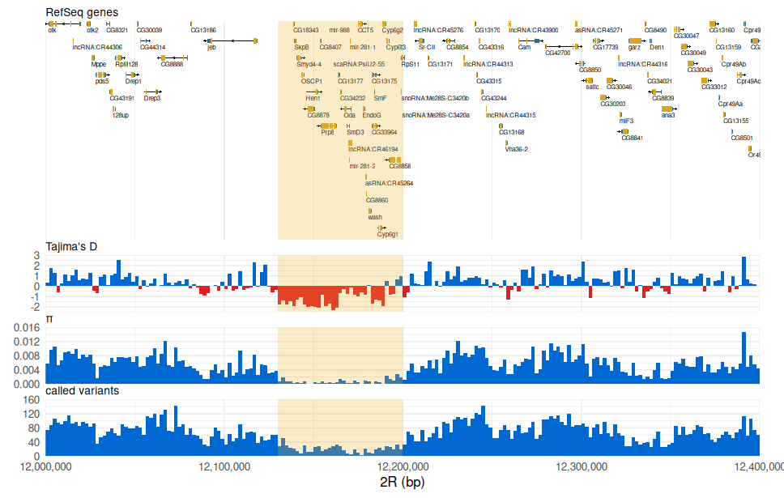
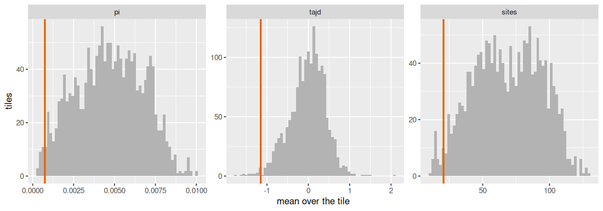
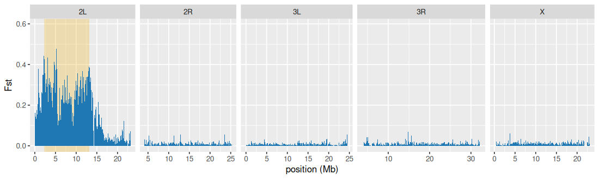

<!-- Generated by scripts/tutorials.R from tutorials/population_genomics.Rmd and GMOD/jbrowse-components's website/docs/tutorials/population_genomics.md at 4c759deb02. Edit those, not this file. -->

# Selection scans (Drosophila DGRP) in R

Selection leaves marks in population-genetic statistics. We'll read three
vcftools scans of 205 inbred _Drosophila melanogaster_ lines into R with
ggjbrowse: Fst, nucleotide diversity (π) and Tajima's D in 2 kb windows. We'll
use them to put a number on the selective sweep at the insecticide-resistance
gene _Cyp6g1_, then on the `In(2L)t` inversion on chromosome 2L, and draw both
with ggplot2.

- **In:** the scans' bigWigs, the RefSeq gene annotation and a VCF genotyping
  `In(2L)t`, all read by URL.
- **Out:** data frames of every window's statistics, and figures of the sweep
  and the inversion.
- **The check:** the rest of the genome, which has no sweep like _Cyp6g1_'s
  and no inversion, and a π ratio recomputed in R that matches the hosted
  bigWig.

The same analysis in the JBrowse app is the
[selection scans tutorial](https://jbrowse.org/jb2/docs/tutorials/population_genomics/).

## Prerequisites

In R:

```r
install.packages(c("remotes", "ggplot2", "dplyr"))
remotes::install_github("GMOD/ggjbrowse")
```

To rebuild the scans from the VCF, which the code below skips by reading the
hosted bigWigs:

- `curl`
- [vcftools](https://vcftools.github.io/), for the windowed statistics
- [bcftools](https://samtools.github.io/bcftools/), to read the VCF header and
  sample list
- [htslib](https://www.htslib.org/) (`bgzip`, `tabix`), to index a VCF
- [`bedGraphToBigWig`](https://hgdownload.soe.ucsc.edu/admin/exe/), to pack a
  bedGraph into a bigWig

```bash
# Debian/Ubuntu
sudo apt install samtools bcftools tabix vcftools nodejs
# or conda, which has every tool above
conda install -c bioconda -c conda-forge samtools bcftools htslib vcftools \
  nodejs ucsc-bedgraphtobigwig
# or Linux x86_64 binaries for the tools apt lacks
wget -P ~/.local/bin \
  https://hgdownload.soe.ucsc.edu/admin/exe/linux.x86_64/bedGraphToBigWig
chmod +x ~/.local/bin/bedGraphToBigWig
# any platform
npm install -g @jbrowse/cli
```

## The data

The [Drosophila Genetic Reference Panel](https://dgrpool.epfl.ch/) (DGRP) has
205 inbred lines ([Mackay et al. 2012](https://doi.org/10.1038/nature10811)),
lifted to dm6. You don't need these files to follow the page: the code
below reads the scans' outputs by URL. The [build script](https://jbrowse.org/jb2/docs/tutorials/population_genomics/#reproduce-it-end-to-end)
fetches them to rebuild those results. The vcftools steps take your own VCF and
two sample lists.

| What it is                                                                       | File                                                                                                                                             |
| -------------------------------------------------------------------------------- | ------------------------------------------------------------------------------------------------------------------------------------------------ |
| The DGRP freeze-2 genotype calls                                                 | [DGRP2.source_NCSU.dm6.final.SNPs_only.vcf.gz](https://resources.aertslab.org/DGRP2/NCSU/final/dm6/DGRP2.source_NCSU.dm6.final.SNPs_only.vcf.gz) |
| The `In(2L)t` inversion karyotype for each line, from DGRPool's phenotype record | [download](https://dgrpool.epfl.ch/phenotypes/1520/download)                                                                                     |

## The two signals

In _Drosophila melanogaster_, a selective sweep at the insecticide-resistance
gene _Cyp6g1_ ([Daborn et al. 2002](https://doi.org/10.1126/science.1074170))
and the `In(2L)t` inversion on chromosome 2L each leave a mark in
population-genetic statistics: π dips at the sweep and Fst rises across the
inversion. The inversion flips a stretch of 2L end to end and suppresses
recombination between the inverted and standard arrangements in a heterozygote
([Corbett-Detig & Hartl 2012](https://doi.org/10.1371/journal.pgen.1003056)).
From a multi-sample VCF of inbred lines, vcftools computes Fst (the distance
between two groups' allele frequencies), π (diversity within a group) and
Tajima's D (below zero after a sweep) per window; the code below reads each
scan and draws it beside the genes.

## Building Fst, π and Tajima's D bigWigs with vcftools

DGRPool records each line's `In(2L)t` arrangement
([Gardeux et al. 2023](https://doi.org/10.7554/eLife.88981)), harmonizing the
typing of [Huang et al. 2015](https://doi.org/10.1534/g3.115.019554): `0` for
standard homozygotes, `2` for inverted and `1` for heterozygotes.
[`build_dgrp_popgen.sh`](https://github.com/GMOD/jbrowse-components/blob/main/scripts/build_dgrp_popgen.sh)
drops the heterozygotes and writes the two sample lists, one name per line, that
[vcftools](https://vcftools.github.io/) takes for `--weir-fst-pop` and `--keep`.
It also renames DGRPool's `DGRP_021` to the VCF's `DGRP-021`. DGRPool types
`In(3R)Payne` too, so the same grouping on that phenotype scans `3R`.

Each scan is a vcftools run, an `awk` step that turns its table into a bedGraph,
and a `bedGraphToBigWig` pack. Fst uses the Weir & Cockerham estimator[^hudson]
([Weir & Cockerham 1984](https://doi.org/10.2307/2408641)):

```bash
# chrom.sizes from the VCF header, so it uses the contig names of the scans
bcftools view -h dgrp2.vcf.gz |
  awk -F'[=,>]' '/^##contig/{print $3"\t"$5}' > dm6.chrom.sizes

# window equal to step, so windows tile the genome
vcftools --gzvcf dgrp2.vcf.gz \
  --weir-fst-pop In2Lt_INV.txt --weir-fst-pop In2Lt_STD.txt \
  --fst-window-size 2000 --fst-window-step 2000 --out fst_In2Lt
# BIN_START is 1-based here, hence -1
# negative Fst is an estimator artifact at low-differentiation sites; floor at 0
# $5 is WEIGHTED_FST, the ratio of summed variance components
# $6, MEAN_FST, averages per-site ratios and swings on a few uninformative sites
# BIN_END is the nominal window end, so the last window of a contig passes its
# end; clamp it, or bedGraphToBigWig refuses the whole file
awk -F'\t' 'NR==FNR{len[$1]=$2; next}
     FNR>1 && $5!="nan" && $5!="-nan" {
       v=$5+0; if (v<0) v=0
       end=$3; if (end>len[$1]) end=len[$1]
       if (end>$2-1) print $1"\t"($2-1)"\t"end"\t"v
     }' dm6.chrom.sizes fst_In2Lt.windowed.weir.fst |
  sort -k1,1 -k2,2n > fst_In2Lt.bedgraph
bedGraphToBigWig fst_In2Lt.bedgraph dm6.chrom.sizes fst_In2Lt.bw
```

Diversity is the same three steps with `--window-pi 2000`, reading `$5` of
`pi_all.windowed.pi`, with `--keep` restricting it to one arrangement:

```bash
vcftools --gzvcf dgrp2.vcf.gz --window-pi 2000 --out pi_all
vcftools --gzvcf dgrp2.vcf.gz --keep In2Lt_INV.txt --window-pi 2000 --out pi_INV
```

`$4` of the same table is the called-variant count the figure below stacks under
π, packed into a bigWig by the same `awk` and `bedGraphToBigWig` pair.

Tajima's D ([Tajima 1989](https://doi.org/10.1093/genetics/123.3.585)) reports
`BIN_START` 0-based, so there is no `-1` shift, and has no `BIN_END`, so the
`awk` builds the window end before the clamp:

```bash
vcftools --gzvcf dgrp2.vcf.gz --TajimaD 2000 --out tajimad_all
# BIN_START is already 0-based, and there is no BIN_END
# build the end here and clamp it to the contig length
awk -F'\t' 'NR==FNR{len[$1]=$2; next}
     FNR>1 && $4!="nan" && $4!="-nan" {
       end=$2+2000; if (end>len[$1]) end=len[$1]
       if (end>$2) print $1"\t"$2"\t"end"\t"$4
     }' dm6.chrom.sizes tajimad_all.Tajima.D |
  sort -k1,1 -k2,2n > tajimad_all.bedgraph
bedGraphToBigWig tajimad_all.bedgraph dm6.chrom.sizes tajimad_all.bw
```

2 kb windows resolve a single-gene sweep like _Cyp6g1_; widen toward 5-10 kb for
genome-wide overviews.

The bigWigs take contig names from the VCF header (`2L`, `2R`, `X`, FlyBase
style) while UCSC dm6 writes `chr2L`, and
the R code below names each file's contigs the way that file spells them.

The DGRP VCF holds variant sites only, so `--window-pi` counts every position
missing from the file as invariant and callable, and a window that lost sites to
filtering shows low diversity.[^pixy] Filtering also shifts the whole baseline
of Tajima's D, so read D at a locus against the genome-wide background of all
the lines.

## Reading the scans

The website's track configs name the hosted files, and `assign` turns them into
R variables as they stand:


``` r
genes_adapter <- list(
  type = "Gff3TabixAdapter",
  uri = "https://jbrowse.org/ucsc/dm6/ncbiRefSeq.gff.gz",
  csi = TRUE
)
fst_bw <- "https://jbrowse.org/demos/popgen/fst_In2Lt.bw"
tajd_bw <- "https://jbrowse.org/demos/popgen/tajimad_all.bw"
pi_bw <- "https://jbrowse.org/demos/popgen/pi_all.bw"
sites_bw <- "https://jbrowse.org/demos/popgen/sites_all.bw"
pi_arrangements <- list(
  list(
    type = "BigWigAdapter",
    source = "π In(2L)t",
    uri = "https://jbrowse.org/demos/popgen/pi_INV.bw"
  ),
  list(
    type = "BigWigAdapter",
    source = "π standard",
    uri = "https://jbrowse.org/demos/popgen/pi_STD.bw"
  )
)
ratio_bw <- "https://jbrowse.org/demos/popgen/pi_ratio_In2Lt.bw"
ratio_display <- list(
  encoding = list(
    y = list(
      scale = list(domainMin = -1.5, domainMax = 1.5),
      axis = list(title = "log2 ratio")
    ),
    color = list(
      scale = list(
        type = "threshold",
        domain = 0,
        range = c("#e66100", "#1f78b4"),
        names = c("inverted lower", "inverted higher")
      ),
      legend = list(title = "π, In(2L)t vs standard")
    )
  )
)
vcf <- "https://jbrowse.org/demos/popgen/dgrp_In2Lt_sv.vcf.gz"
karyotypes <- "https://jbrowse.org/demos/popgen/dgrp_In2Lt_samples.tsv"
vcf_displays <- list(
  list(
    type = "LinearMultiSampleVariantDisplay",
    facet = list(field = "karyotype", sort = c("Standard", "In(2L)t")),
    rowColor = "karyotype"
  )
)
inversion_adapter <- list(
  type = "FromConfigAdapter",
  features = list(
    list(
      uniqueId = "in2lt",
      refName = "chr2L",
      start = 2225744,
      end = 13154180,
      name = "In(2L)t"
    )
  )
)
```

`jbrowse_wiggle()` reads a bigWig at the zoom its `width` picks. A width of one
pixel per 2 kb returns the file's own windows, one row of `bins` each, so we can
read every arm of dm6 into one table per scan:


``` r
library(ggjbrowse)
library(ggplot2)
library(dplyr)

arms <- tibble(chrom = c("2L", "2R", "3L", "3R", "4", "X"),
  length = c(23513712, 25286936, 28110227, 32079331, 1348131, 23542271))

read_scan <- function(bigwig, column) {
  bind_rows(lapply(seq_len(nrow(arms)), function(i) {
    scan <- jbrowse_wiggle(bigwig,
      data.frame(chrom = arms$chrom[i], start = 0, end = arms$length[i]),
      width = ceiling(arms$length[i] / 2000))
    tibble(chrom = arms$chrom[i], start = scan$bins$start, end = scan$bins$end,
      "{column}" := scan$bins$score)
  }))
}

scans <- read_scan(pi_bw, "pi") |>
  left_join(read_scan(tajd_bw, "tajd"), by = c("chrom", "start", "end")) |>
  left_join(read_scan(sites_bw, "sites"), by = c("chrom", "start", "end"))
fst <- read_scan(fst_bw, "fst")
count(scans, window = end - start)
#> # A tibble: 1 × 2
#>   window     n
#>    <int> <int>
#> 1   2000 58307
scans |> group_by(chrom) |> summarise(windows = n(), median_pi = median(pi))
#> # A tibble: 6 × 3
#>   chrom windows median_pi
#>   <chr>   <int>     <dbl>
#> 1 2L      11109  0.00541 
#> 2 2R      10262  0.00476 
#> 3 3L      11886  0.00513 
#> 4 3R      13664  0.00377 
#> 5 4         627  0.000617
#> 6 X       10759  0.00328
```

## Reading the Cyp6g1 sweep in Tajima's D and π

We'll read the gene track over `chr2R:12,000,000-12,400,000` with the three
scans under it. The gene file spells the arm `chr2R` and the bigWigs spell it
`2R`, so each read names its own, and `jbrowse_stack()` draws the two as one
contig. The website's figure bands `chr2R:12,130,000-12,200,000`, which we'll
shade:


``` r
locus <- "chr2R:12,000,000-12,400,000"
sweep <- c(12130000, 12200000)
genes <- jbrowse_features(genes_adapter, locus, width = 1200)
scan_at <- function(bigwig) jbrowse_wiggle(bigwig,
  "2R:12,000,000-12,400,000", width = 1200)
fig <- jbrowse_stack(`RefSeq genes` = genes,
  `Tajima's D` = scan_at(tajd_bw), π = scan_at(pi_bw),
  `called variants` = scan_at(sites_bw)) &
  annotate("rect", xmin = sweep[1], xmax = sweep[2], ymin = -Inf,
    ymax = Inf, fill = "#f0b429", alpha = 0.25)
```


``` r
fig
```



The swept window holds 35 of the scan's 2 kb windows. We'll average each statistic
over it, over the 70 kb on either side, and over every other 70 kb tile of the
genome, tiled from the same offset so that the swept window is one tile among
them:


``` r
tiles <- scans |>
  mutate(tile = (start - sweep[1]) %/% 70000) |>
  group_by(chrom, tile) |>
  summarise(across(c(pi, tajd, sites), mean), windows = n(), .groups = "drop") |>
  filter(windows >= 30)
swept <- filter(tiles, chrom == "2R", tile == 0)
flanks <- filter(tiles, chrom == "2R", abs(tile) == 1)
stats <- c("pi", "tajd", "sites")
bind_rows(
  mutate(swept[stats], tiles = "swept window"),
  mutate(as_tibble(as.list(colMeans(flanks[stats]))), tiles = "flanking tiles"),
  mutate(as_tibble(lapply(tiles[stats], median)), tiles = "median tile")) |>
  select(tiles, everything())
#> # A tibble: 3 × 4
#>   tiles                pi    tajd sites
#>   <chr>             <dbl>   <dbl> <dbl>
#> 1 swept window   0.000746 -1.15    20.7
#> 2 flanking tiles 0.00564   0.354   72.7
#> 3 median tile    0.00470   0.0135  69.1
```

The tiles are the control: every 70 kb tile of five other arms and the rest of
2R. We'll draw their distributions with the swept window marked, and ask what
fraction of tiles sit at or below it:


``` r
long <- tiles |>
  tidyr::pivot_longer(all_of(stats), names_to = "statistic") |>
  mutate(statistic = factor(statistic, stats))
marked <- swept |>
  tidyr::pivot_longer(all_of(stats), names_to = "statistic") |>
  mutate(statistic = factor(statistic, stats))
ggplot(long, aes(value)) +
  geom_histogram(bins = 60, fill = "grey70") +
  geom_vline(aes(xintercept = value), marked, colour = "#e66100",
    linewidth = 1) +
  facet_wrap(vars(statistic), scales = "free") +
  labs(x = "mean over the tile", y = "tiles")
```



``` r
vapply(stats, function(s) mean(tiles[[s]] <= swept[[s]]), 0)
#>         pi       tajd      sites 
#> 0.01516990 0.01213592 0.02184466
```

Called variants fall under the sweep because a duplication of _Cyp6g1_
segregates alongside the resistance allele
([Schmidt et al. 2010](https://doi.org/10.1371/journal.pgen.1000998)), and the
duplicated sequence lowers the number of sites called in the window.

## The In(2L)t inversion in Fst and π

The inversion itself is one `<INV>` record spanning the published breakpoints,
genotyped `1/1` in the inverted lines and `0/0` in the standard ones. The `END`
field holds the far breakpoint:

```text
#CHROM  POS      ID     REF  ALT    QUAL  FILTER  INFO                     FORMAT  DGRP-026  DGRP-032
2L      2225744  In2Lt  N    <INV>  .     PASS    SVTYPE=INV;END=13154180  GT      1/1       0/0
```

The VCF holds that record, so R can read the inversion's extent and each line's
genotype from it. The samples file names each line's karyotype, which the
website's track facets by. Reading the record with that file gives one row per
line:


``` r
inversion <- jbrowse_variants(vcf,
  data.frame(chrom = "2L", start = 0, end = arms$length[1]),
  samples = karyotypes,
  display = c(vcf_displays[[1]][c("facet", "rowColor")],
    referenceDrawingMode = "draw"))
inversion$variants[c("name", "alt", "start", "end")]
#>    name   alt   start      end
#> 1 In2Lt <INV> 2225743 13154180
calls <- inversion$rows |>
  left_join(select(inversion$cells, row, genotype), by = c(name = "row"))
count(calls, karyotype = band, genotype)
#>   karyotype genotype   n
#> 1   In(2L)t      1/1  19
#> 2  Standard      0/0 161
```

Each karyotype holds one genotype, and these are the two groups vcftools
compared. The inverted arrangement is the rarer one.

We'll bin Fst to 50 kb and draw the five large arms with the inversion's
extent shaded on 2L. The arms without an inversion are the control:


``` r
span <- inversion$variants[1, c("start", "end")]
shade <- data.frame(chrom = "2L", xmin = span$start / 1e6, xmax = span$end / 1e6)
binned <- fst |>
  filter(chrom != "4") |>
  group_by(chrom, bin = start %/% 50000) |>
  summarise(fst = mean(fst), .groups = "drop") |>
  mutate(mb = (bin + 0.5) * 0.05)
ggplot(binned, aes(mb, fst)) +
  geom_rect(aes(xmin = xmin, xmax = xmax, ymin = -Inf, ymax = Inf), shade,
    inherit.aes = FALSE, fill = "#f0b429", alpha = 0.3) +
  geom_col(width = 0.05, fill = "#1f78b4") +
  facet_grid(cols = vars(chrom), scales = "free_x", space = "free_x") +
  labs(x = "position (Mb)", y = "Fst")
```



Each arrangement's π swings several fold between 2 kb windows, far more than the
two arrangements differ, so two rows of it look alike. Pool into 250 kb bins and
take log2 of inverted over standard to get one track that sits at zero where the
arrangements have equal diversity. We'll write the same step in R from the two π
bigWigs, then compare it with the hosted bigWig:

```bash
# B: bin width; each bin's pi is the length-weighted mean of its 2 kb windows
awk -F'\t' -v OFS='\t' -v B=250000 '
  NR==FNR { len[$1]=$2; next }
  FNR==1 { g++ }
  { k=$1 SUBSEP int($2/B); w=$3-$2; s[g,k]+=$4*w; n[g,k]+=w; seen[k] }
  END {
    for (k in seen) if (s[1,k]>0 && s[2,k]>0) {
      split(k, a, SUBSEP); end=(a[2]+1)*B; if (end>len[a[1]]) end=len[a[1]]
      print a[1], a[2]*B, end, log((s[1,k]/n[1,k])/(s[2,k]/n[2,k]))/log(2)
    }
  }' dm6.chrom.sizes pi_INV.bedgraph pi_STD.bedgraph |
  sort -k1,1 -k2,2n > pi_ratio_In2Lt.bedgraph
bedGraphToBigWig pi_ratio_In2Lt.bedgraph dm6.chrom.sizes pi_ratio_In2Lt.bw
```


``` r
pi_inverted <- read_scan(pi_arrangements[[1]]$uri, "inverted")
pi_standard <- read_scan(pi_arrangements[[2]]$uri, "standard")

pool <- function(d, column) d |>
  mutate(bin = start %/% 250000, length = end - start) |>
  group_by(chrom, bin) |>
  summarise(pi = sum(.data[[column]] * length) / sum(length), .groups = "drop")
ratio <- inner_join(pool(pi_inverted, "inverted"), pool(pi_standard,
  "standard"), by = c("chrom", "bin"), suffix = c("_inverted", "_standard")) |>
  filter(pi_inverted > 0, pi_standard > 0) |>
  mutate(start = bin * 250000, log2_ratio = log2(pi_inverted / pi_standard))

hosted <- bind_rows(lapply(seq_len(nrow(arms)), function(i) {
  bins <- jbrowse_wiggle(ratio_bw,
    data.frame(chrom = arms$chrom[i], start = 0, end = arms$length[i]),
    width = ceiling(arms$length[i] / 250000))$bins
  tibble(chrom = arms$chrom[i], start = bins$start, hosted = bins$score)
}))
compared <- inner_join(ratio, hosted, by = c("chrom", "start"))
c(bins = nrow(ratio), hosted = nrow(hosted), both = nrow(compared),
  max_difference = max(abs(compared$log2_ratio - compared$hosted)))
#>           bins         hosted           both max_difference 
#>   4.900000e+02   4.900000e+02   4.900000e+02   1.911154e-06
```

In [grammar-of-graphics](https://jbrowse.org/jb2/docs/config_guides/mark_display) terms,
`encoding.color` is a color scale: the score mapped through `scale.domain` to a
`scale.range` of colors. Here a `threshold` scale colors each bin by its side of
zero, and `encoding.y` pins the y scale to ±1.5.

The website's `displayDefaults` for that track are already in `ratio_display`.
The website's In(2L)t track writes the published extent as one feature inline
in its config, and `jbrowse_features()` reads that adapter as it stands. We'll
stack it over the Fst scan and the hosted ratio on 2L:


``` r
arm <- function(chrom) data.frame(chrom = chrom, start = 0,
  end = arms$length[1])
extent <- jbrowse_features(inversion_adapter, arm("chr2L"), width = 1200)
fig <- jbrowse_stack(`In(2L)t` = extent,
  Fst = jbrowse_wiggle(fst_bw, arm("2L"), display = list(extent = "none"),
    width = 1200),
  `log2 π, inverted over standard` = jbrowse_wiggle(ratio_bw, arm("2L"),
    display = ratio_display, width = 1200))
```


``` r
fig
```


The inverted lines have less diversity than the standard ones across the
inverted region, most near the breakpoints, where the suppressed recombination
is strongest. Toward the centromere past the inversion, where the arrangements
recombine freely, the ratio sits at zero. Differentiation decays gradually
outside the breakpoints
([Corbett-Detig & Hartl](https://doi.org/10.1371/journal.pgen.1003056)).

## Checking the reading

We'll classify every window by where it sits against the breakpoints, on 2L
inside, on 2L outside at growing distance, and on the other arms, and take
each scan's median:


``` r
breakpoints <- c(span$start, span$end)
where <- function(chrom, start, end) {
  mid <- (start + end) / 2
  distance <- ifelse(mid > breakpoints[1] & mid < breakpoints[2], 0,
    pmin(abs(mid - breakpoints[1]), abs(mid - breakpoints[2])))
  case_when(
    chrom != "2L" ~ "other arms",
    distance == 0 ~ "inside In(2L)t",
    distance < 2e6 ~ "2L, within 2 Mb outside",
    .default = "2L, further outside")
}
zones <- c("inside In(2L)t", "2L, within 2 Mb outside",
  "2L, further outside", "other arms")
by_fst <- fst |>
  mutate(where = factor(where(chrom, start, end), zones)) |>
  group_by(where) |>
  summarise(windows = n(), fst = median(fst))
by_ratio <- ratio |>
  mutate(where = factor(where(chrom, start, start + 250000), zones)) |>
  group_by(where) |>
  summarise(bins = n(), share_inverted_lower = mean(log2_ratio < 0),
    log2_ratio = median(log2_ratio))
by_fst
#> # A tibble: 4 × 3
#>   where                   windows    fst
#>   <fct>                     <int>  <dbl>
#> 1 inside In(2L)t             5353 0.255 
#> 2 2L, within 2 Mb outside    1947 0.191 
#> 3 2L, further outside        3808 0.0304
#> 4 other arms                47185 0
by_ratio
#> # A tibble: 4 × 4
#>   where                    bins share_inverted_lower log2_ratio
#>   <fct>                   <int>                <dbl>      <dbl>
#> 1 inside In(2L)t             44                0.864    -0.165 
#> 2 2L, within 2 Mb outside    16                0.75     -0.176 
#> 3 2L, further outside        33                0.364     0.0212
#> 4 other arms                397                0.912    -0.121
```

Reading the tables against the figures:

- Fst falls from inside the inversion, through the flanks, to the flat median
  of the arms without one.
- The π ratio is below zero in most bins inside the inversion and near zero
  along the far end of 2L.
- The other arms' ratio also leans below zero, so Fst is the control that
  comes out flat.

## Your own data

- Point `fst_bw`, `tajd_bw`, `pi_bw` and `sites_bw` at the bigWigs your
  vcftools run wrote. `jbrowse_wiggle()` takes each file's contig names as the
  file spells them.
- Replace `arms` with your assembly's contig lengths, the `chrom.sizes` the
  build wrote.
- Point `vcf` and `karyotypes` at your own genotyped event and samples file. The
  `facet` field of `jbrowse_variants()`'s `display` names any column of that
  file.
- Give `jbrowse_features()` your gene file, or an adapter config as a JBrowse
  track writes it, with `csi = TRUE` where the file has a CSI index beside it,
  as the RefSeq file here does.

## See also

- [Selection scans (Drosophila DGRP)](https://jbrowse.org/jb2/docs/tutorials/population_genomics/),
  the same analysis in the JBrowse app
- [Differential transcript usage in R](dtu.md)
- [Methylation (bisulfite) in R](bisulfite.md)

## Citations

- Bhatia et al. (2013).
  [Estimating and interpreting FST: the impact of rare variants](https://doi.org/10.1101/gr.154831.113)
- Corbett-Detig & Hartl (2012).
  [Population genomics of inversion polymorphisms in Drosophila melanogaster](https://doi.org/10.1371/journal.pgen.1003056)
- Daborn et al. (2002).
  [A single P450 allele associated with insecticide resistance in Drosophila](https://doi.org/10.1126/science.1074170)
- Danecek et al. (2011).
  [The variant call format and VCFtools](https://doi.org/10.1093/bioinformatics/btr330)
- Gardeux et al. (2023).
  [DGRPool: A web tool leveraging harmonized Drosophila Genetic Reference Panel phenotyping data](https://doi.org/10.7554/eLife.88981)
- Huang et al. (2015).
  [Linkage disequilibrium and inversion-typing of the Drosophila melanogaster Genome Reference Panel](https://doi.org/10.1534/g3.115.019554)
- Korunes & Samuk (2021).
  [pixy: Unbiased estimation of nucleotide diversity and divergence in the presence of missing data](https://doi.org/10.1111/1755-0998.13326)
- Mackay et al. (2012).
  [The Drosophila melanogaster Genetic Reference Panel](https://doi.org/10.1038/nature10811)
- Schmidt et al. (2010).
  [Copy number variation and transposable elements feature in recent, ongoing adaptation at the Cyp6g1 locus](https://doi.org/10.1371/journal.pgen.1000998)
- Tajima (1989).
  [Statistical method for testing the neutral mutation hypothesis by DNA polymorphism](https://doi.org/10.1093/genetics/123.3.585)
- Weir & Cockerham (1984).
  [Estimating F-statistics for the analysis of population structure](https://doi.org/10.2307/2408641)

[^pixy]:
    [pixy](https://pixy.readthedocs.io/)
    ([Korunes & Samuk 2021](https://doi.org/10.1111/1755-0998.13326)) takes an
    allSites VCF and reports π, dxy and Fst per window without that bias, and
    its output packs into a bigWig the same way.

[^hudson]:
    The inverted and standard groups are very unequal in size, since the
    inverted arrangement is the rarer one. Hudson's estimator is the usual
    recommendation where groups differ this much
    ([Bhatia et al. 2013](https://doi.org/10.1101/gr.154831.113));
    [A selected haplotype (Dog10K)](https://jbrowse.org/jb2/docs/tutorials/dog10k_selection) scans with that one.
