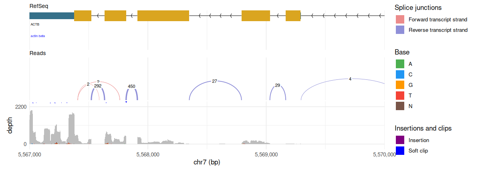
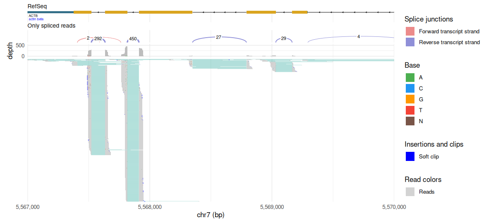
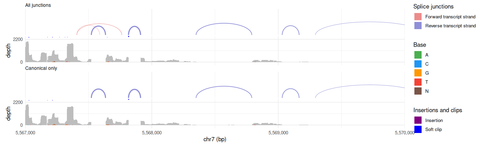
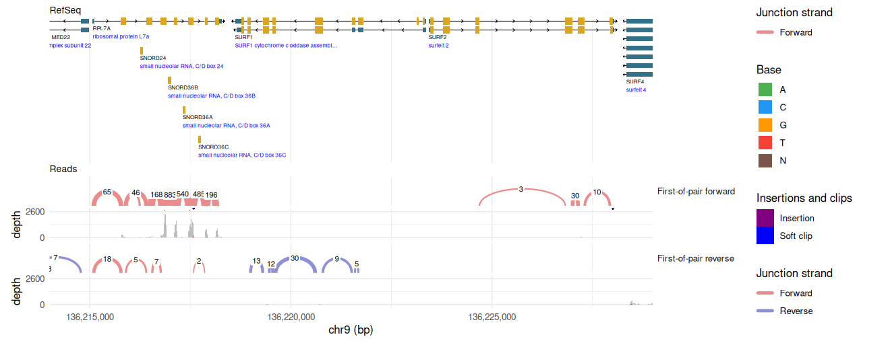
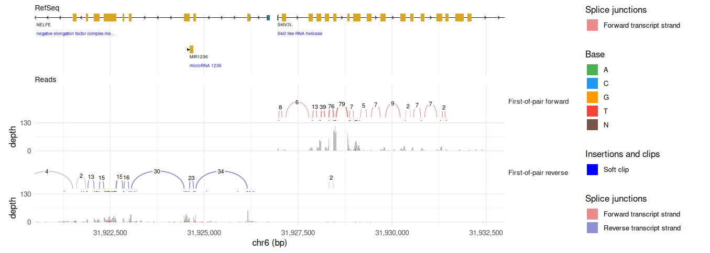
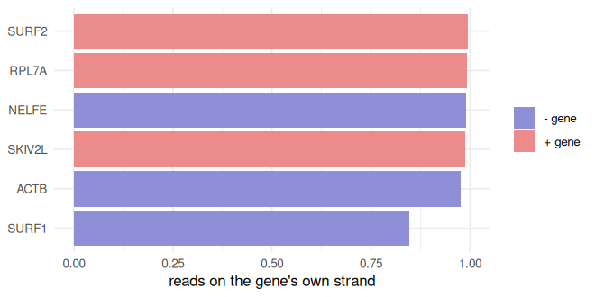
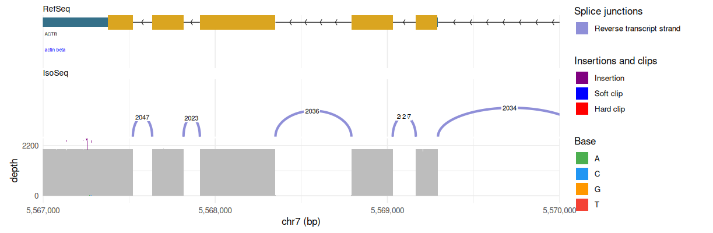
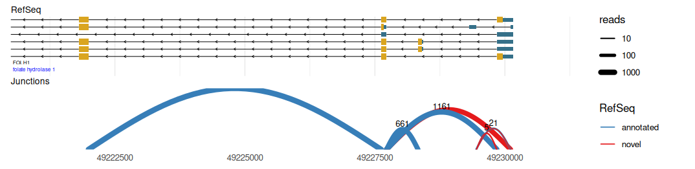
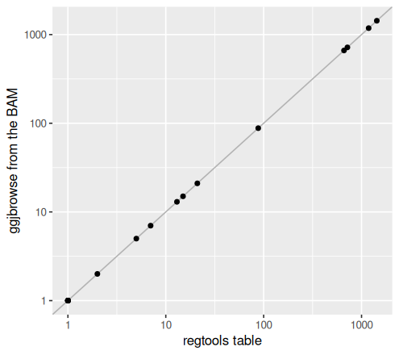

<!-- Generated by scripts/tutorials.R from tutorials/rnaseq.Rmd and GMOD/jbrowse-components's website/docs/tutorials/rnaseq.md at c0cfa906fe. Edit those, not this file. -->

# RNA-seq splicing and strand in R

A spliced RNA-seq read records the introns it jumps in its CIGAR string, and a
stranded library records the transcript's strand in the read pair's flags. We'll
read stranded paired-end alignments over _ACTB_, the surfeit locus and _FOLH1_
with ggjbrowse, count junctions and strand in R, and compare a pipeline's
junction table to the reads it came from.

- **In:** a stranded paired-end RNA-seq BAM, an IsoSeq BAM, the RefSeq gene
  models and a regtools junction table, all read by URL.
- **Out:** tables of junctions, spliced reads and per-gene strand counts, and
  ggplot figures of each.
- **The check:** the antisense reads at genes on the opposite strand, and the
  junction table's read counts against the counts the engine takes from the BAM.

The same analysis in the JBrowse app is the
[RNA-seq tutorial](https://jbrowse.org/jb2/docs/tutorials/rnaseq/).

## Prerequisites

In R:

```r
install.packages(c("remotes", "ggplot2", "dplyr", "tidyr", "readr"))
remotes::install_github("GMOD/ggjbrowse")
```

The code below reads every file by URL, so it needs nothing else. To build a
junction table from your own BAM, see
[the junction table recipes](#junction-tables-from-star-regtools-and-portcullis).

## The data

The hg19 alignments, gene models and junction table behind the figures, hosted
on jbrowse.org's demo bucket.

Nothing to download: the code below reads these files by URL. _Loading
your own RNA-seq data_ covers reads of your own.

<details>
<summary>The files</summary>

| What it is                                                                                                                                                      | File                                                                                                                                                           |
| --------------------------------------------------------------------------------------------------------------------------------------------------------------- | -------------------------------------------------------------------------------------------------------------------------------------------------------------- |
| The paired-end stranded RNA-seq alignments behind every short-read figure on this page, from the sample files listed at [RSeQC](https://rseqc.sourceforge.net/) | [Pairend_StrandSpecific_51mer_Human_hg19.bam](https://s3.amazonaws.com/jbrowse.org/genomes/hg19/paired_end_rnaseq/Pairend_StrandSpecific_51mer_Human_hg19.bam) |

</details>

## Reading the alignments and genes

The website's configs name the BAMs, the gene file and the hg19 assembly, and
`assign` turns them into R variables as they stand:


``` r
bam <- "https://s3.amazonaws.com/jbrowse.org/genomes/hg19/paired_end_rnaseq/Pairend_StrandSpecific_51mer_Human_hg19.bam"
gff <- "https://s3.amazonaws.com/jbrowse.org/genomes/hg19/ncbi_refseq/GRCh37_latest_genomic.sort.gff.gz"
isoseq <- "https://s3.amazonaws.com/jbrowse.org/genomes/hg19/alzheimers_isoseq/hq_isoforms.fasta.bam"
hg19 <- list(
  name = "hg19",
  uri = "https://jbrowse.org/genomes/hg19/fasta/hg19.fa.gz",
  refNameAliases = list(
    uri = "https://s3.amazonaws.com/jbrowse.org/genomes/hg19/hg19_aliases.txt"
  ),
  cytobands = "https://jbrowse.org/ucsc/hg19/cytoBandIdeo.bed.gz"
)
```

The website loads hg19 with an alias file, because the files spell chromosomes
their own way:

- **the BAM:** UCSC names, `chr7`
- **the FASTA:** bare numbers, `7`, which the engine reads splice motifs from
- **the RefSeq GFF:** accessions, `NC_000007.13`

Each reader takes the assembly config as `assembly`, as each track names its
assembly. A reader asked for `chr7` reads each file under that file's own name
for it and names the contig `chr7` in its tables, so `jbrowse_stack()` draws
the files on one axis. The engine reads the alignments against the assembly's
FASTA:


``` r
library(ggjbrowse)
library(ggplot2)
library(dplyr)
library(readr)
```

## Spliced reads over ACTB

We'll read `chr7:5,567,000-5,570,000`, _ACTB_, a compact gene with deep read coverage.

Each arc below marks spliced alignments, where a read
maps partly to one exon and partly to the next, skipping the intron between
them.

`pileup = list(show = FALSE)` leaves the coverage histogram and the splice
arcs, which the engine computes from the reads' skips:


``` r
actb <- "chr7:5,567,000-5,570,000"
genes <- list(filter = "geneLike")
actb_genes <- jbrowse_features(gff, actb, assembly = hg19, display = genes,
  width = 1200)
actb_reads <- jbrowse_alignments(bam, actb, assembly = hg19,
  display = list(pileup = list(show = FALSE)))
fig <- jbrowse_stack(RefSeq = actb_genes, Reads = actb_reads, width = 1200)
```


``` r
fig
```



The engine's junction table lists each arc once. We'll keep the arcs with two
or more reads, and ask whether each is an intron RefSeq draws for _ACTB_, from
the gene's intron lines:


``` r
refseq_introns <- actb_genes$lines |> distinct(start, end)
actb_junctions <- actb_reads$junctions |>
  mutate(refseq = paste(start, end) %in% paste(refseq_introns$start,
    refseq_introns$end)) |>
  filter(count >= 2) |>
  select(start, end, count, strand, motif, refseq)
actb_junctions
#>     start     end count strand             motif refseq
#> 1 5567407 5567589     2      1     non-canonical  FALSE
#> 2 5567407 5567762     2      1     non-canonical  FALSE
#> 3 5567407 5567764     2      1     non-canonical  FALSE
#> 4 5567522 5567634   292     -1 GT-AG (canonical)   TRUE
#> 5 5567816 5567911   450     -1 GT-AG (canonical)   TRUE
#> 6 5568350 5568791    27     -1 GT-AG (canonical)   TRUE
#> 7 5569031 5569165    29     -1 GT-AG (canonical)   TRUE
#> 8 5569294 5570154     4     -1 GT-AG (canonical)   TRUE
```

## Coverage in exons and introns

The coverage band's bins give the depth at each position. We'll label each bin
an intron where it falls inside one of RefSeq's intron lines, and compare the
mean depth:


``` r
actb_depth <- actb_reads$coverage |>
  mutate(region = ifelse(vapply(start, function(s) any(
    refseq_introns$start <= s & s < refseq_introns$end), TRUE),
    "intron", "exon or flank"))
actb_depth |>
  group_by(region) |>
  summarise(bases = sum(end - start), mean_depth = weighted.mean(depth,
    end - start))
#> # A tibble: 2 × 3
#>   region        bases mean_depth
#>   <chr>         <int>      <dbl>
#> 1 exon or flank  1513     323.  
#> 2 intron         1488       2.28
```

## Spliced reads, CIGAR strings and splice arcs

A spliced aligner like [STAR](https://github.com/alexdobin/STAR) split-maps a
read that crosses an intron and encodes the skip in its CIGAR string, the
SAM/BAM field describing how a read aligns to the reference.

A spliced read in the _ACTB_ pileup (reads here are 51 bp) has a CIGAR like
this, spaced out for readability:

```text
18M 95N 33M
```

The CIGAR reads as 18 bp (`M`, match) aligned to one exon, a 95 bp skip (`N`)
across the intron, and 33 bp (`M`) aligned to the next.

The engine computes the arcs on the fly from the skips in the reads in view, and
colors each arc by transcript strand, salmon for forward and purple for reverse.
It finds the strand two ways:

- **Tags.** `XS` and `TS` record the strand directly. minimap2's `ts` is
  relative to the read, so the engine combines it with the strand the read aligned
  to.
- **Splice motif.** A BAM from STAR without `--outSAMstrandField intronMotif`
  has no tags, so the engine reads the first and last two bases of the intron off
  the reference: GT-AG on the forward strand reads as CT-AC on the reverse. A
  junction whose reads disagree, or whose motif is none of GT-AG, GC-AG and
  AT-AC, draws in the neutral color. The junction table's `motif` column holds the motif beside the read count.

The skips in the engine's `gaps` table are the `N` operations. A hidden pileup
leaves its tables empty as well as undrawn, so the reads come from a read of
the same region that shows them. A read whose only gap is one
skip rebuilds its CIGAR from the read's start and end:


``` r
actb_records <- jbrowse_alignments(bam, actb, assembly = hg19)
one_skip <- actb_records$gaps |>
  group_by(read) |>
  filter(n() == 1, type == "skip") |>
  ungroup()
cigars <- one_skip |>
  inner_join(transmute(actb_records$reads, read, read_start = start,
    read_end = end), by = "read") |>
  transmute(cigar = sprintf("%dM%dN%dM", start - read_start, end - start,
    read_end - end))
cigars |> count(cigar, sort = TRUE) |> head(5)
#> # A tibble: 5 × 2
#>   cigar          n
#>   <chr>      <int>
#> 1 18M95N33M    186
#> 2 26M112N25M   128
#> 3 49M95N2M      64
#> 4 23M95N28M     50
#> 5 15M95N36M     22
```

The most common CIGAR is the example above. Read starts differ, so CIGARs do,
but the skips fall on few introns:


``` r
skips <- one_skip |>
  mutate(refseq = paste(start, end) %in% paste(refseq_introns$start,
    refseq_introns$end)) |>
  count(start, end, refseq, name = "reads") |>
  arrange(desc(reads))
skips
#> # A tibble: 56 × 4
#>      start     end refseq reads
#>      <int>   <int> <lgl>  <int>
#>  1 5567816 5567911 TRUE     449
#>  2 5567522 5567634 TRUE     290
#>  3 5569031 5569165 TRUE      29
#>  4 5568350 5568791 TRUE      27
#>  5 5569294 5570154 TRUE       4
#>  6 5567407 5567589 FALSE      2
#>  7 5567407 5567762 FALSE      2
#>  8 5567407 5567764 FALSE      2
#>  9 5406822 5816038 FALSE      1
#> 10 5566917 5567212 FALSE      1
#> # ℹ 46 more rows
```

## Picking out spliced reads

In a deep pileup, reads with a skip sit among many more that have none. Two of
the display's settings pull the splicing evidence out, and we'll read each:

- `sort = list(field = "spliced")` gives every read with a skip the lowest rows
- `filter = list(list(field = "spliced", equal = TRUE))` drops every read without a skip, and the
  coverage follows


``` r
is_spliced <- function(r) r$reads$read %in% r$gaps$read[r$gaps$type == "skip"]
file_order <- jbrowse_alignments(bam, actb, assembly = hg19)
spliced_first <- jbrowse_alignments(bam, actb, assembly = hg19,
  display = list(sort = list(field = "spliced")))
only_spliced <- jbrowse_alignments(bam, actb, assembly = hg19,
  display = list(pileup = list(mark = list(height = 1)),
    filter = list(list(field = "spliced", equal = TRUE))))

spliced_rows <- function(r) {
  rows <- r$reads$row[is_spliced(r)]
  tibble(spliced_reads = length(rows), last_row = max(rows),
    pileup_rows = max(r$reads$row) + 1)
}
bind_rows("file order" = spliced_rows(file_order),
  "spliced first" = spliced_rows(spliced_first),
  .id = "sort")
#> # A tibble: 2 × 4
#>   sort          spliced_reads last_row pileup_rows
#>   <chr>                 <int>    <int>       <dbl>
#> 1 file order              856     2057        2058
#> 2 spliced first           856      459        2060
```

The filter keeps the reads whose CIGAR has a skip. The one read it keeps beyond
the count of reads with a skip in view has its skip left of the window:


``` r
c(reads = nrow(file_order$reads), kept_by_filter = nrow(only_spliced$reads),
  with_a_skip_in_view = sum(is_spliced(file_order)))
#>               reads      kept_by_filter with_a_skip_in_view 
#>               10422                 857                 856
```


``` r
fig <- jbrowse_stack(RefSeq = actb_genes, "Only spliced reads" = only_spliced,
  width = 1200)
```


``` r
fig
```



The motif is the other filter. The junction filter's `nonCanonical = "exclude"`
drops every arc whose intron does not begin and end with GT-AG, GC-AG or
AT-AC on either strand, and keeps one whose motif the reference cannot read.
The junction table still lists every junction:


``` r
all_junctions <- jbrowse_alignments(bam, actb, assembly = hg19,
  display = list(pileup = list(show = FALSE)))
canonical <- jbrowse_alignments(bam, actb, assembly = hg19,
  display = list(pileup = list(show = FALSE),
    filter = list(list(field = "junction.canonical", equal = TRUE))))
fig <- jbrowse_stack("All junctions" = all_junctions,
  "Canonical only" = canonical)
```


``` r
fig
```



The two sets in numbers:


``` r
bind_rows(all = all_junctions$junctions,
  canonical = filter(canonical$junctions, motif != "non-canonical"),
  .id = "set") |>
  filter(count >= 2) |>
  group_by(set) |>
  summarise(junctions = n(), supporting_reads = sum(count),
    refseq_introns = sum(paste(start, end) %in% paste(refseq_introns$start,
      refseq_introns$end)))
#> # A tibble: 2 × 4
#>   set       junctions supporting_reads refseq_introns
#>   <chr>         <int>            <int>          <int>
#> 1 all               8              808              5
#> 2 canonical         5              802              5
```

## Strand-specific RNA-seq

Splice-arc colors give the strand of spliced reads only. A _strand-specific_
library records the transcript strand in which mate of the pair a read is, so
every read has it, which separates genes close together or overlapping on
opposite strands.

The surfeit locus is a tight cluster of genes on alternating strands (_RPL7A_,
_SURF1_, _SURF2_, _SURF4_). We'll read `chr9:136,214,000-136,229,000`.

Grouping the reads by first-of-pair strand shows transcript strand over a whole
gene.

`facet = list(field = "firstOfPairStrand")` makes one section per group, each with a coverage histogram from only that group's reads, forward and reverse on one autoscaled axis. `pileup = list(show = FALSE)` leaves the two histograms alone.


``` r
surfeit <- "chr9:136,214,000-136,229,000"
surfeit_genes <- jbrowse_features(gff, surfeit, assembly = hg19,
  display = genes, width = 1200)
by_strand <- list(pileup = list(show = FALSE),
  facet = list(field = "firstOfPairStrand"))
surfeit_reads <- jbrowse_alignments(bam, surfeit, assembly = hg19,
  display = by_strand)
fig <- jbrowse_stack(RefSeq = surfeit_genes, Reads = surfeit_reads,
  width = 1200)
```


``` r
fig
```



On chr6, _NELFE_ and _SKIV2L_ sit back to back on opposite strands, in
`chr6:31,920,500-31,933,000`:


``` r
nelfe <- "chr6:31,920,500-31,933,000"
nelfe_genes <- jbrowse_features(gff, nelfe, assembly = hg19, display = genes,
  width = 1200)
nelfe_reads <- jbrowse_alignments(bam, nelfe, assembly = hg19,
  display = by_strand)
fig <- jbrowse_stack(RefSeq = nelfe_genes, Reads = nelfe_reads, width = 1200)
```


``` r
fig
```



The library's strand is a number once each gene's reads are counted by the
section they fall in. A read counts as sense when its first-of-pair strand is its
gene's strand. The antisense reads are the control: a gene on the opposite
strand from its neighbor takes few of its neighbor's:


``` r
strand_of <- c("First-of-pair forward" = 1, "First-of-pair reverse" = -1)
genes_of_interest <- c("RPL7A", "SURF1", "SURF2", "NELFE", "SKIV2L", "ACTB")

sense_counts <- function(genes, reads) {
  genes$features |>
    filter(name %in% genes_of_interest) |>
    select(gene = name, gene_start = start, gene_end = end, gene_strand = strand) |>
    cross_join(transmute(reads$reads, midpoint = (start + end) / 2,
      read_strand = strand_of[as.character(section)])) |>
    filter(midpoint >= gene_start, midpoint < gene_end) |>
    group_by(gene, gene_strand) |>
    summarise(reads = n(), sense = mean(read_strand == gene_strand),
      .groups = "drop")
}

reads_by_strand <- function(locus) {
  jbrowse_alignments(bam, locus, assembly = hg19,
    display = list(facet = list(field = "firstOfPairStrand")))
}
sense <- bind_rows(sense_counts(surfeit_genes, reads_by_strand(surfeit)),
  sense_counts(nelfe_genes, reads_by_strand(nelfe)),
  sense_counts(actb_genes, reads_by_strand(actb))) |>
  arrange(desc(sense))
sense
#> # A tibble: 6 × 4
#>   gene   gene_strand reads sense
#>   <chr>        <int> <int> <dbl>
#> 1 SURF2            1   199 0.995
#> 2 RPL7A            1 10687 0.991
#> 3 NELFE           -1   420 0.990
#> 4 SKIV2L           1   647 0.988
#> 5 ACTB            -1 10420 0.976
#> 6 SURF1           -1   326 0.847
```


``` r
sense |>
  mutate(gene = reorder(gene, sense),
    strand = ifelse(gene_strand == 1, "+ gene", "- gene")) |>
  ggplot(aes(sense, gene, fill = strand)) +
  geom_col() +
  scale_fill_manual(values = c("+ gene" = "#ec8b8b", "- gene" = "#8f8fd8")) +
  coord_cartesian(xlim = c(0, 1)) +
  labs(x = "reads on the gene's own strand", y = NULL, fill = NULL) +
  theme_minimal()
```



## Long-read splicing, IsoSeq over ACTB

A long read (PacBio IsoSeq, Nanopore) often spans a whole transcript, aligning
across every exon with one `N` skip per intron, and JBrowse derives the same
arcs and connectors from those skips. The IsoSeq alignments are a second BAM on the same assembly, and its contigs are bare numbers.


``` r
iso_reads <- jbrowse_alignments(isoseq, actb, assembly = hg19,
  display = list(pileup = list(show = FALSE)))
fig <- jbrowse_stack(RefSeq = actb_genes, IsoSeq = iso_reads, width = 1200)
```


``` r
fig
```



A long read's skips are its whole intron chain. We'll compare each read's chain
to RefSeq's five introns, from a read of the region that shows the pileup:


``` r
chain <- function(start, end) paste(sort(paste(start, end)), collapse = ";")
refseq_chain <- chain(refseq_introns$start, refseq_introns$end)
iso_records <- jbrowse_alignments(isoseq, actb, assembly = hg19)
iso_chains <- iso_records$gaps |>
  filter(type == "skip") |>
  group_by(read) |>
  summarise(introns = n(), chain = chain(start, end))
c(reads = nrow(iso_records$reads), with_skips = nrow(iso_chains),
  all_five_introns = sum(iso_chains$introns == 5),
  refseq_chain = sum(iso_chains$chain == refseq_chain))
#>            reads       with_skips all_five_introns     refseq_chain 
#>             2059             2058             2017             1950
```

A read with all five introns but another chain has an intron a few bases off
RefSeq's, which the junction table counts as non-canonical:


``` r
iso_reads$junctions |>
  filter(count >= 10) |>
  mutate(refseq = paste(start, end) %in% paste(refseq_introns$start,
    refseq_introns$end)) |>
  select(start, end, count, motif, refseq)
#>     start     end count             motif refseq
#> 1 5567522 5567634  2047 GT-AG (canonical)   TRUE
#> 2 5567815 5567911    24     non-canonical  FALSE
#> 3 5567816 5567911  2023 GT-AG (canonical)   TRUE
#> 4 5568350 5568791  2036 GT-AG (canonical)   TRUE
#> 5 5569030 5569165    10     non-canonical  FALSE
#> 6 5569031 5569164    19     non-canonical  FALSE
#> 7 5569031 5569165  2007 GT-AG (canonical)   TRUE
#> 8 5569294 5570154  2034 GT-AG (canonical)   TRUE
```

## Junction tables from STAR, regtools and portcullis

A junction table from an RNA-seq pipeline adds what JBrowse cannot compute from
the reads in view: whole-library read counts, an annotated-or-novel flag and
portcullis's filtering verdict. One `awk` line converts each table to BED, with
the intron as the interval, the read count as the score, then the strand and the
tool's own columns, and the BED holds one junction per row. Sort and index
all three the same way:

```bash
sort -k1,1 -k2,2n junctions.bed | bgzip > junctions.bed.gz
tabix -p bed junctions.bed.gz
```

**STAR** writes `SJ.out.tab` with the intron as 1-based inclusive coordinates,
then the strand, the motif as a STAR code (0 is non-canonical), the annotated
flag and the unique and multi-mapping read counts:

```bash
awk -v OFS='\t' '{
  # column 4: 1 = +, 2 = -, 0 = undetermined
  s = $4 == 1 ? "+" : $4 == 2 ? "-" : "."
  # BED is 0-based half-open, so the start moves back one
  print $1, $2 - 1, $3, "junc" NR, $7, s, $5, $6
}' SJ.out.tab > junctions.bed
```

**regtools** reads the junctions straight out of the BAM, then annotates each
against a GTF with its splice-site motif and whether an annotated transcript
joins that donor to that acceptor. The annotated table has a header row and
gives the last base of one exon and the first base of the next, so the intron
ends one base before `end`:

```bash
# -s FR: a stranded library whose first read runs along the transcript;
#   RF for a dUTP library
regtools junctions extract -s FR rnaseq.bam -o regtools.bed
# annotate reads a plain GTF, not a gzipped one
regtools junctions annotate regtools.bed genome.fa genes.gtf -o annotated.tsv
# column 7 is the motif, column 14 the known-junction flag
awk -F'\t' -v OFS='\t' 'NR > 1 { print $1, $2, $3 - 1, $4, $5, $6, $7, $14 }' \
  annotated.tsv > junctions.bed
```

**portcullis** writes a header row naming its columns, so the recipe reads them
by name. `nb_raw_aln` is the raw supporting-read count, `canonical_ss` is `C`,
`S` or `N` for canonical, semi-canonical and non-canonical:

```bash
awk -F'\t' -v OFS='\t' '
  NR == 1 { for (i = 1; i <= NF; i++) c[$i] = i; next }
  {
    # start is 0-based and end is inclusive, so end moves forward one
    print $c["refname"], $c["start"], $c["end"] + 1, "junc_" $c["index"],
      $c["nb_raw_aln"], $c["consensus-strand"], $c["canonical_ss"]
  }
' 3-filt/portcullis_filtered.pass.junctions.tab > junctions.bed
```

The `filter` applies the sashimi menu's read-support floor to the whole-library
counts in the file and keeps the canonical motifs, which drops the duplicate
that wrong-strand reads give a junction on the opposite strand.

filter on an open track.


- For the STAR file, the `columnNames` end in `motif` and `annotated`, and the
  color's `field` is `annotated`.
- For the portcullis file, the color's `field` is `canonical_ss`, its
  `scale.domain` `["C", "S", "N"]`, and its `scale.names` canonical,
  semi-canonical and non-canonical, with a third color in `scale.range`.

## Reading the junction table

The website's junction track config gives the table's adapter, the filter and
the encodings it draws with:


``` r
junction_adapter <- list(
  type = "BedTabixAdapter",
  uri = "https://jbrowse.org/demos/rnaseq/rnaseq_junctions.bed.gz",
  columnNames = c(
    "chrom",
    "chromStart",
    "chromEnd",
    "name",
    "score",
    "strand",
    "splice_site",
    "known_junction"
  )
)
junction_filter <- "jexl:feature.score >= 3 && feature.splice_site in ['GT-AG', 'GC-AG', 'AT-AC']"
junction_color <- list(
  field = "known_junction",
  scale = list(
    type = "ordinal",
    domain = c("1", "0"),
    range = c("#377eb8", "#e41a1c"),
    names = c("annotated", "novel")
  ),
  legend = list(title = "RefSeq")
)
junction_width <- list(field = "score", scale = list(type = "log", range = c(1, 8)))
```

The file is a bgzipped BED that `readr` reads whole, 207,000 junctions in
2 MB:


``` r
junctions <- read_tsv(junction_adapter$uri,
  col_names = junction_adapter$columnNames, show_col_types = FALSE)
junctions |>
  mutate(known = ifelse(known_junction == 1, "annotated", "novel")) |>
  group_by(known) |>
  summarise(junctions = n(), reads = sum(score), median_reads = median(score))
#> # A tibble: 2 × 4
#>   known     junctions   reads median_reads
#>   <chr>         <int>   <dbl>        <dbl>
#> 1 annotated    104718 3616471            9
#> 2 novel        102139  957474            2
```

The track's `filter` is a jexl expression the engine evaluates, so
`jbrowse_features()` applies it and returns the junctions that pass. We'll read
_FOLH1_'s 5' end with it, and join the engine's rows to the table by name for
their counts and flags:


``` r
folh1 <- "chr11:49,220,500-49,231,500"
junction_track <- jbrowse_features(junction_adapter, folh1, assembly = hg19,
  display = list(filter = list(junction_filter)), width = 1200)
w <- junction_track$regions
kept <- junction_track$features |>
  select(name) |>
  inner_join(junctions, by = "name") |>
  mutate(known = ifelse(known_junction == 1, "annotated", "novel"))
kept |> select(chromStart, chromEnd, score, strand, splice_site, known)
#>   chromStart chromEnd score strand splice_site     known
#> 1   49221993 49227618  1339      -       GT-AG annotated
#> 2   49227724 49228329   661      -       GT-AG annotated
#> 3   49227724 49229843  1161      -       GT-AG annotated
#> 4   49227724 49230109   717      -       GT-AG     novel
#> 5   49229447 49229843     5      -       GT-AG     novel
#> 6   49229447 49230109    21      -       GT-AG annotated
#> 7   49229453 49229843    13      -       GT-AG     novel
#> 8   49229453 49230109     7      -       GT-AG     novel
```

The filter also drops junctions with three or more reads. We'll list them:


``` r
in_window <- filter(junctions, chrom == w$chrom, chromStart >= w$start,
  chromEnd <= w$end)
dropped <- anti_join(in_window, kept, by = "name") |> filter(score >= 3)
dropped |> select(chromStart, chromEnd, score, strand, splice_site)
#> # A tibble: 5 × 5
#>   chromStart chromEnd score strand splice_site
#>        <dbl>    <dbl> <dbl> <chr>  <chr>      
#> 1   49221993 49227618    63 ?      CT-AC      
#> 2   49221993 49227618    30 +      CT-AC      
#> 3   49227724 49229843    21 +      CT-AC      
#> 4   49228426 49229843    15 -      GT-NN      
#> 5   49228426 49230109    88 -      GT-NN
```

Three of the five are the opposite-strand rows of an annotated intron, whose
motif reads CT-AC. The other two have an `N` in hg19 at the acceptor.

`jbrowse_features()` has no link mark, so ggplot2 draws the arcs. We'll use the
track's own color and size encodings, one half-ellipse per junction, over
RefSeq's _FOLH1_:


``` r
arcs <- kept |>
  rowwise() |>
  reframe(name, score, known,
    x = chromStart + (chromEnd - chromStart) * seq(0, 1, length.out = 40),
    y = sqrt(chromEnd - chromStart) * sin(seq(0, pi, length.out = 40))) |>
  mutate(chrom = w$chrom)
labels <- kept |>
  transmute(x = (chromStart + chromEnd) / 2, score,
    y = sqrt(chromEnd - chromStart), known)

arc_plot <- ggplot(arcs, aes(x, y, group = name, colour = known,
    linewidth = score)) +
  geom_path(lineend = "round") +
  geom_text(data = arrange(labels, desc(score)), aes(x, y, label = score),
    colour = "black", size = 3, vjust = -0.4, check_overlap = TRUE,
    inherit.aes = FALSE) +
  scale_colour_manual(name = junction_color$legend$title,
    values = setNames(junction_color$scale$range, junction_color$scale$names)) +
  scale_linewidth(name = "reads", transform = "log10",
    range = junction_width$scale$range / 3) +
  scale_y_continuous(NULL, breaks = NULL, expand = expansion(c(0.02, 0.3))) +
  labs(x = NULL) +
  theme_minimal() +
  theme(panel.grid = element_blank())
fig <- jbrowse_stack(RefSeq = jbrowse_features(gff, folh1, assembly = hg19,
  display = genes, width = 1200), Junctions = arc_plot)
```


``` r
fig
```



## Checking the table against the reads

The table's counts come from regtools reading the BAM, and the engine counts the
same skips when it reads the BAM over this window. Each junction both found
should have the same count, summed over strands, since the engine merges them:


``` r
from_table <- in_window |>
  group_by(start = chromStart, end = chromEnd) |>
  summarise(table = sum(score), .groups = "drop")
from_reads <- jbrowse_alignments(bam, folh1, assembly = hg19,
  display = list(pileup = list(show = FALSE)))$junctions |>
  select(start, end, reads = count)
both <- inner_join(from_table, from_reads, by = c("start", "end"))
c(in_table = nrow(from_table), in_reads = nrow(from_reads),
  in_both = nrow(both), same_count = sum(both$table == both$reads))
#>   in_table   in_reads    in_both same_count 
#>         18         53         18         18
```


``` r
ggplot(both, aes(table, reads)) +
  geom_abline(colour = "grey70") +
  geom_point() +
  scale_x_log10() +
  scale_y_log10() +
  labs(x = "regtools table", y = "ggjbrowse from the BAM")
```



The large red arc joins a donor and an acceptor RefSeq uses, skipping the exons
between them. Its count exceeds the annotated arc that shares its donor:


``` r
kept |>
  arrange(desc(score)) |>
  select(chromStart, chromEnd, score, known)
#>   chromStart chromEnd score     known
#> 1   49221993 49227618  1339 annotated
#> 2   49227724 49229843  1161 annotated
#> 3   49227724 49230109   717     novel
#> 4   49227724 49228329   661 annotated
#> 5   49229447 49230109    21 annotated
#> 6   49229453 49229843    13     novel
#> 7   49229453 49230109     7     novel
#> 8   49229447 49229843     5     novel
```

## Your own data

- Swap `bam` for your own sorted, indexed BAM or CRAM, a path or a URL.
  `jbrowse_alignments()` finds the `.bai` or `.crai` beside it, and a CRAM takes
  `reference =`.
- Pass `assembly = jbrowse_assembly(fasta, aliases)`, the FASTA the reads
  aligned to and the genome's alias table, such as UCSC's `chromAlias.txt`. The
  engine reads splice motifs from the FASTA, and each file under its own name
  for a contig.
- A library whose first read runs against the transcript, as dUTP libraries do,
  has its sense and antisense counts swapped: read `strand_of` the other way.
- Point `read_tsv()` at the table your pipeline wrote, one of the BED recipes
  above, and `jbrowse_features()` at the same file with the `filter` you want.

## See also

- [RNA-seq visualization](https://jbrowse.org/jb2/docs/tutorials/rnaseq/), the
  same analysis in the JBrowse app
- [Differential transcript usage in R](dtu.md)
- [Methylation (long-read) in R](methylation.md)
